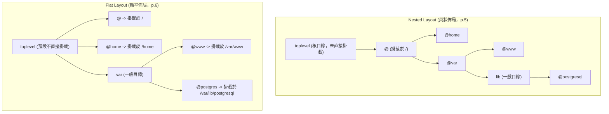
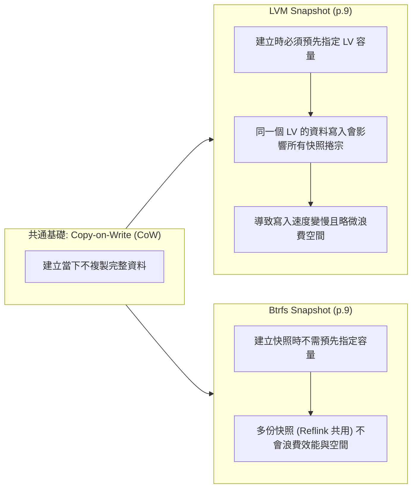
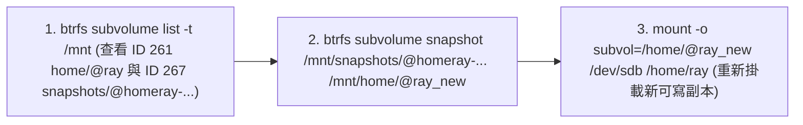
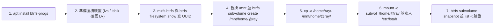

# Btrfs（B-Tree Filesystem）：Subvolume、佈局、快照與遷移實戰

> 一句話考試定位摘要：掌握現代 CoW 檔案系統 Btrfs 的五大核心特性、Subvolume（ID `5` Top-level 與 `@` 命名慣例）及 **Nested vs. Flat 佈局**取捨、Btrfs Snapshot（非遞迴、`-r` 唯讀、不需預指定容量且**無內建 rollback 指令**）與 LVM 快照差異，以及 Debian 13 將 `/home` 從 `ext4` 遷移至 Btrfs 並拍快照的完整操作流程。（`BTRFS.pdf, p.1-18`）

!!! info "教學型 HTML 簡報"
    想從零開始透過翻頁簡報循序理解 Btrfs Subvolume、佈局對照與 `/home` 遷移流程，請點此：[開啟教學型 HTML 簡報（新分頁）](slides/btrfs.html){ target="_blank" }。

## 學習目標與設計選型（Why Btrfs?）

- **來源簡報**：`BTRFS.pdf`（共 18 頁；NYCU CS IT Center，2026 管培勛 `phkoan`、2025 黃柏竣 `bjhuang`，全份以 Debian 13 `trixws` 實機操作為準）。（`BTRFS.pdf, p.1, 12-17`）
- **定位（Introduction）**：Btrfs 是 Linux 上的現代化**寫入時複製（Copy-on-Write, CoW）檔案系統**，兼具進階功能、容錯（fault tolerance）、修復與易於管理的特性，具備五大核心功能：（`BTRFS.pdf, p.2`）
  1. **Snapshots**：建立快照而不對檔案做完整複製。
  2. **Built-in volume management**：內建捲宗管理，支援基於軟體的 RAID 0、RAID 1 等層級。
  3. **Self-healing**：針對資料與中繼資料計算校驗和（checksums），自動偵測靜默資料毀損（silent data corruptions）。
  4. **Transparent data compression**：透明資料壓縮（例如掛載時指定 `mount -o compress=zstd /dev/sdx /mnt`）。
  5. **Reflinks**：快速且高效率的檔案複製（例如 `cp --reflink=always source target`）。
- **檔案系統選型比較（Why Btrfs?）**：（`BTRFS.pdf, p.3`）
  - **`ext4`**：最常見、提供基礎功能的檔案系統。
  - **`Btrfs`**：具備諸如**快照（snapshots）**等進階能力。
  - **`ZFS`**：同樣具備豐富進階能力，但**記憶體使用量相對較高（utilizing relatively high memory）**。

---

## 1. Subvolume 與兩大佈局：Nested Layout vs. Flat Layout

### 1.1 Subvolume 核心觀念與 `@` 命名慣例
- **定義**：Btrfs Subvolume（子捲宗）是檔案系統的一部分，但擁有**自己獨立的檔案／目錄階層與 inode 編號命名空間（independent file/directory hierarchy and inode number namespace）**。（`BTRFS.pdf, p.4`）
- **Top-level subvolume（ID `5`）**：（`BTRFS.pdf, p.4`）
  - 每個 Btrfs 檔案系統皆有一個 **ID 為 `5` 的頂層子捲宗（top-level subvolume）**，其在檔案系統上的路徑為 `/`。
  - 其他所有 subvolume 皆巢狀位於 top-level subvolume 之下；**直接掛載 Btrfs 檔案系統時，預設掛載的就是 top-level subvolume**。
- **常見 `@` 前綴命名慣例**：以 `@` 開頭命名 subvolume，例如 **`@`** 對應 `/`、**`@www`** 對應 `/var/www`。（`BTRFS.pdf, p.4`）

### 1.2 Nested Layout vs. Flat Layout 結構圖解與考點對比
組織 subvolume 時有兩種常見佈局方式：（`BTRFS.pdf, p.5-7`）


（來源：`BTRFS.pdf, p.5-6`）

| 比較項目 | Nested Layout（巢狀佈局，`p.5`） | Flat Layout（扁平佈局，`p.6-7`） |
| :--- | :--- | :--- |
| **階層結構** | Subvolume 建立在**另一個 subvolume 內部** | **全部 subvolume 皆直接是 top-level 的子項目** |
| **掛載行為** | **不需手動逐一掛載**；掛載父 subvolume 時子 subvolume 會隨之自動掛載 | **所有 subvolume 皆須手動（或於 `/etc/fstab`）逐一掛載** |
| **掛載選項** | **套用父 subvolume 的掛載選項**至子 subvolume | **每個 subvolume／掛載點可個別設定不同的掛載選項** |
| **刪除限制** | **刪除父 subvolume 之前，必須先刪除所有子 subvolume** | 彼此平級位於 top-level 下，不形成父子 subvolume 巢狀依附 |

#### Flat Layout 的 `/etc/fstab` 多選項掛載實例（`BTRFS.pdf, p.7`）
透過 `subvol=` 與個別掛載選項（如 `autodefrag`、`noatime`），可精細控制各掛載點行為：（`BTRFS.pdf, p.7`）

```text
UUID=the-btrfs-fs-uuid  /                    btrfs  subvol=@,defaults,autodefrag        0 0
UUID=the-btrfs-fs-uuid  /home                btrfs  subvol=@home,defaults,noatime       0 0
UUID=the-btrfs-fs-uuid  /var/www             btrfs  subvol=/var/@www,noatime            0 0
UUID=the-btrfs-fs-uuid  /var/lib/postgresql  btrfs  subvol=/var/@postgres,noatime       0 0
```

!!! tip "本單元考點"
    1. **Top-level subvolume ID 必背數字：`5`**，且未指定 `subvol=` 時預設掛載的是 top-level subvolume。（`BTRFS.pdf, p.4`）
    2. **Nested vs. Flat 最大取捨**：Nested 省去逐一掛載但**全套繼承父層選項**且**刪父層前必先刪全部子層**；Flat 需各別掛載但能**替不同掛載點套用獨立掛載選項**（如 `/` 開 `autodefrag`、`/home` 開 `noatime`）。（`BTRFS.pdf, p.5-7`）

!!! note "投影片未展開"
    - 投影片提及 Nested layout 刪除父 subvolume 前必先刪除全部子 subvolume，並未列出刪除 subvolume 的具體指令語法；亦未展開內建軟體 RAID 0/1 設定與 Self-healing 檢查／修復指令。（`BTRFS.pdf, p.2, 5`）

---

## 2. Btrfs 快照（Snapshot）、LVM 對比與還原（Rollback）

### 2.1 Snapshot 本質與建立指令
- **本質**：Btrfs snapshot **本質上就是一個 subvolume**，透過 Btrfs 的 **CoW** 能力與另一個 subvolume 共用資料（與中繼資料）。（`BTRFS.pdf, p.8`）
- **建立語法**：（`BTRFS.pdf, p.8`）
  ```sh
  btrfs subvolume snapshot [-r] <source subvolume> <destination subvolume>
  ```
- **三大關鍵特性**：（`BTRFS.pdf, p.8`）
  1. **不具遞迴性（Not recursive）**：若來源 subvolume 下還嵌有子 subvolume，建立快照時不會一併遞迴拍進子 subvolume。
  2. **`-r` 參數**：建立**唯讀快照（read-only snapshot）**。
  3. **可寫快照與原 subvolume 無異**：不加 `-r` 的可寫快照（writable snapshot）與原本的 subvolume 之間沒有實質差異。

### 2.2 LVM Snapshot vs. Btrfs Snapshot 對比
兩者的共通點皆為 **Copy-on-Write（CoW）**，但在空間配置與多快照寫入表現上有明顯差異：（`BTRFS.pdf, p.9`）


（來源：`BTRFS.pdf, p.9`）

### 2.3 Btrfs Snapshot Rollback（還原流程）
- **關鍵注意**：**Btrfs 沒有內建的 `rollback` 指令（has no built-in rollback command）**，且官方文件對快照還原步驟並無單一固定說法。（`BTRFS.pdf, p.10`）
- **常見兩種實作做法**：（`BTRFS.pdf, p.10`）
  1. 掛載快照 subvolume 後，將檔案複製回目標資料夾。
  2. **從快照 subvolume 再建立一份可寫的新 subvolume，然後重新掛載（remount）使用**：


（來源：`BTRFS.pdf, p.10`）

```sh
root@trixws:~# btrfs subvolume list -t /mnt
ID    gen    top level    path
--    ---    ---------    ----
261   47     5            home/@ray
267   39     5            snapshots/@homeray-1762502638

root@trixws:~# btrfs subvolume snapshot /mnt/snapshots/@homeray-1762502638 /mnt/home/@ray_new
root@trixws:~# mount -o subvol=/home/@ray_new /dev/sdb /home/ray
```
（來源：`BTRFS.pdf, p.10`）

!!! warning "本單元常見陷阱"
    1. **誤以為 Btrfs snapshot 會連巢狀子 subvolume 一起拍**：`btrfs subvolume snapshot` **Not recursive**（不會遞迴拍下層 subvolume）。（`BTRFS.pdf, p.8`）
    2. **誤以為 Btrfs 有 `rollback` 指令**：不同於 [LVM 的 `lvconvert --merge`](lvm.md)，Btrfs **沒有內建 rollback 指令**，實務常從快照再拍可寫 subvolume（如 `@ray_new`）並用 `-o subvol=` 重新掛載切換。（`BTRFS.pdf, p.10`；`LVM.pdf, p.10`）

---

## 3. 實戰演練：將 `/home` 從 `ext4` 遷移至 Btrfs 並建立快照

以下為 Debian 13（`trixws`）在 LVM 邏輯捲宗 `/dev/home-vg/home-vol`（由 `sda1` + `sda2` 組成、`3.99 GiB` / `4.0G`）上將 `/home/ray` 遷移至 Btrfs 的完整 7 步驟流程：（`BTRFS.pdf, p.11-17`）


（來源：`BTRFS.pdf, p.12-17`）

### 步驟逐一拆解與實機指令
1. **安裝 Btrfs 工具（Debian）**：（`p.12`）
   ```sh
   apt install btrfs-progs
   ```
2. **確認目標區塊裝置（磁碟、分割區或 LV）**：透過 `lvs` 與 `lsblk` 確認 LV `home-vg/home-vol`（`3.99g`）。（`p.12-13`）
3. **建立 Btrfs 檔案系統並查詢 UUID**：（`p.12, 14`）
   ```sh
   mkfs.btrfs /dev/home-vg/home-vol
   btrfs filesystem show     # 取得 uuid，如 0ed693ae-28ac-44ce-8674-9059f685d8f1
   ```
4. **暫時掛載並建立目標 Subvolume**：將頂層先暫掛至 `/mnt`，建立 `/mnt/home` 目錄與 `@ray` subvolume：（`p.12, 15`）
   ```sh
   mount /dev/home-vg/home-vol /mnt
   mkdir -p /mnt/home
   btrfs subvolume create /mnt/home/@ray
   ```
5. **完整保留屬性複製家目錄資料**：注意使用 `cp -a` 搭配 `/home/ray/.` 複製所有檔案（含隱藏檔）至新 subvolume：（`p.12, 15`）
   ```sh
   cp -a /home/ray/. /mnt/home/@ray/
   ```
6. **指定 `subvol=` 掛載新位置並設定 `/etc/fstab` 開機持續生效**：（`p.12, 16`）
   ```sh
   mount -o subvol=/home/@ray /dev/home-vg/home-vol /home/ray
   df -h
   echo "UUID=0ed693ae-28ac-44ce-8674-9059f685d8f1 /home/ray btrfs subvol=/home/@ray 0 0" >> /etc/fstab
   ```
7. **替新 Subvolume 建立快照並檢視清單**：於預備好的 `/mnt/snapshots` 目錄拍下含 UNIX 時間戳記的快照，並以 `list -t` 表格檢視 ID 與 `top level 5`：（`p.12, 17`）
   ```sh
   mkdir -p /mnt/snapshots
   btrfs subvolume snapshot /mnt/home/@ray /mnt/snapshots/@homeray-$(date +%s)
   btrfs subvolume list -t /mnt
   ```

!!! tip "實作布局與指令考點"
    - 在本遷移範例中，`/mnt/home` 與 `/mnt/snapshots` 是一般 **directory（目錄）**，而 `@ray` 與 `@homeray-...` 才是 **subvolume（`top level` 皆為頂層架構下的獨立 subvolume）**。（`BTRFS.pdf, p.12, 17`）
    - 寫入 `/etc/fstab` 前必須先用 **`btrfs filesystem show`** 取得檔案系統的 **UUID**，並以 **`subvol=/home/@ray`** 指定要掛載的 subvolume 路徑。（`BTRFS.pdf, p.14, 16`）

---

## 4. 考前核心指令與易錯陷阱速查表

| 任務目的 | 核心指令 / 語法 | 考前關鍵注意 | 來源頁碼 |
| :--- | :--- | :--- | :--- |
| 安裝與格式化 | `apt install btrfs-progs`<br>`mkfs.btrfs <device>` | Debian 套件名 `btrfs-progs` | `p.12, 14` |
| 檢視檔案系統資訊／UUID | `btrfs filesystem show` | 取得整體裝置大小、已用與 `uuid` 供 `/etc/fstab` 使用 | `p.14` |
| 壓縮掛載與 Reflink 複製 | `mount -o compress=zstd /dev/sdx /mnt`<br>`cp --reflink=always source target` | 啟用透明壓縮；Reflink 高效率複製 | `p.2` |
| 建立與列出 Subvolume | `btrfs subvolume create <path>`<br>`btrfs subvolume list -t <mnt>` | 每個 Btrfs 有 **ID `5` 的 top-level subvolume**；預設掛載 top-level | `p.4, 15, 17` |
| 掛載指定 Subvolume | `mount -o subvol=/home/@ray <dev> /home/ray` | Flat layout 可替每個 subvolume 在 `/etc/fstab` 指定不同 options（如 `autodefrag`、`noatime`） | `p.6-7, 16` |
| 建立快照 | `btrfs subvolume snapshot [-r] <src> <dst>` | **不具遞迴性**；`-r` 唯讀；**不需指定容量**；多份快照不浪費效能空間 | `p.8-9` |
| 快照還原（無內建指令） | 從快照再拍可寫 subvolume 後 `mount -o subvol=...` | Btrfs **無內建 rollback 指令**，亦可掛載快照後手動複製 | `p.10` |

---

## 跨主題關聯與範圍備註

### 跨主題延伸脈絡
- **前導檔案系統原理**：本頁的獨立 inode 命名空間、`/etc/fstab` 開機掛載機制與 CoW（Copy-on-Write）概念，延續並深化自 [檔案系統：架構、Inode、連結與權限管理](filesystem.md)。（`BTRFS.pdf, p.2, 4, 7`；`10_FileSystem.pdf, p.16, 26-29, 43`）
- **與 LVM 的實戰與比較關聯**：本頁的遷移範例建於 [邏輯捲宗管理（LVM）：架構、精簡配置、快照與磁碟擴縮實戰](lvm.md) 的 LV（`home-vg/home-vol`）之上，且 `p.9` 直接對比了 LVM 與 Btrfs 兩者的快照機制；完整三章對照與選型決策整理見 [儲存管理總對照：傳統分割區、LVM 與 Btrfs](storage-partition-lvm-btrfs.md)。（`BTRFS.pdf, p.9, 13-16`；`LVM.pdf, p.10-11, 18, 29`）

### FreeBSD 排除說明
- 經逐頁檢視 `BTRFS.pdf`（p.1–18），全份投影片完全以 Debian 13（`trixws`）與 Linux Btrfs 工具鏈撰寫，**無 FreeBSD 專屬內容需略過**。

### 投影片未展開彙整
- Btrfs 內建軟體 RAID（RAID 0/1 等）的建立與管理指令、Self-healing 檢測與修復指令，以及除 `compress=zstd` 外的其他壓縮參數。（`BTRFS.pdf, p.2`）
- 刪除 subvolume 的具體指令語法（僅於 `p.5` 提及 Nested layout 刪父層前必先刪全部子層）。（`BTRFS.pdf, p.5`）
- `btrfs` 其他進階管理子指令（如快照遠端傳輸、配額管理或切換預設掛載 subvolume 之機制）。（`BTRFS.pdf, p.4, 8-10, 18`）

## 資料來源

- `BTRFS.pdf`：p.1–18
