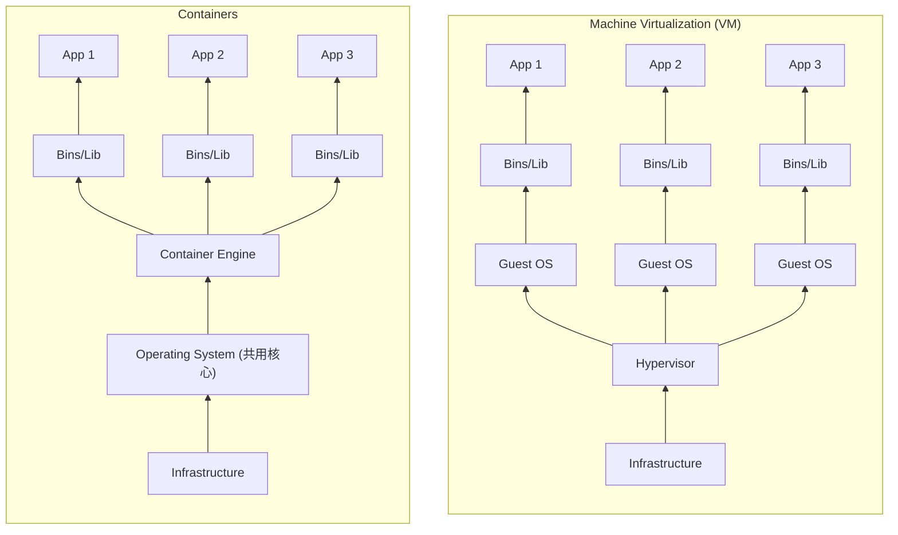
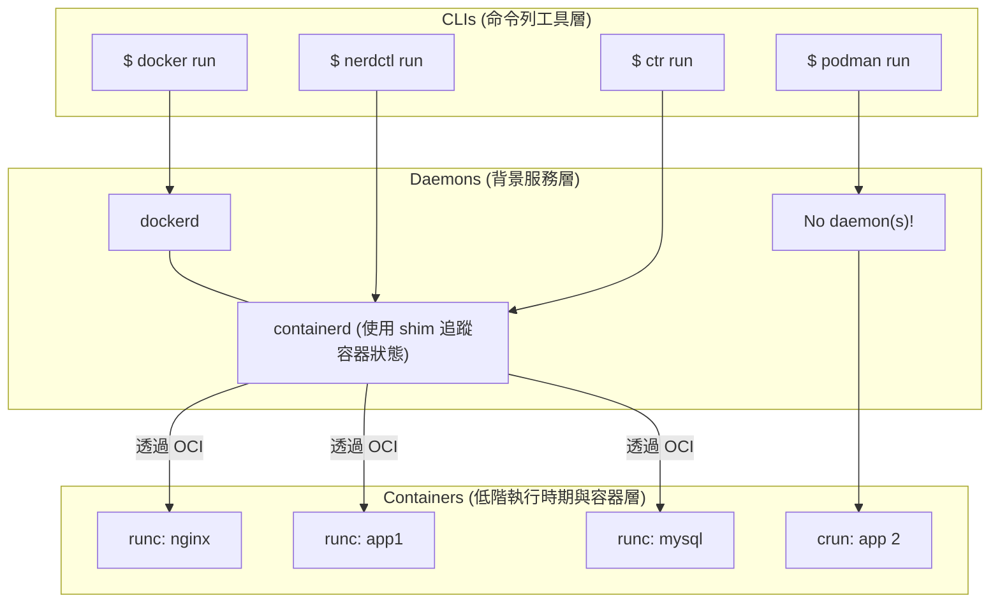
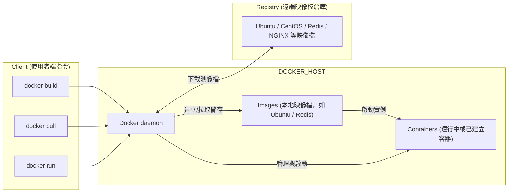
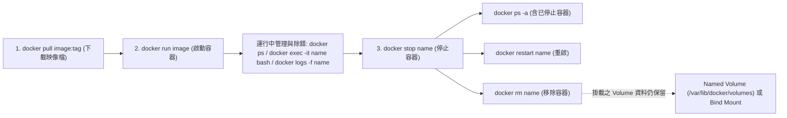

# Docker 基礎：容器概念、安裝與常用指令

> 一句話考試定位摘要：掌握容器與 Linux namespaces 隔離本質、Container 與 VM 分層架構差異、Docker / `containerd` / OCI / `shim` / `runc` 與 `Podman` 堆疊分工、Linux 官方安裝與免 `sudo` 設定，以及 `pull` / `run`（含 Named Volumes 與 Bind Mount）/ `exec` / `logs` / `ps` / `stop` / `restart` / `rm` 等日常操作生命週期。（`Docker_Basic.pdf, p.1-22`）

!!! info "教學型 HTML 簡報"
    想從零開始透過翻頁簡報循序理解本單元基本概念，請點此：[開啟教學型 HTML 簡報（新分頁）](slides/docker-basic.html){ target="_blank" }。

## 學習目標與課程大綱

- **來源簡報**：`Docker_Basic.pdf`（共 22 頁；NYCU CS IT Center，管培勛 `phkoan`，*Docker - Basic*）。（`Docker_Basic.pdf, p.1`）
- **三大核心單元（Outline）**：（`Docker_Basic.pdf, p.2`）
  1. **What's Container**：容器與映像檔定義、Linux namespaces、Docker 與其他容器執行時期、Container vs. VM，以及 Docker / `containerd` / `runc` 底層關係。（`Docker_Basic.pdf, p.2-9`）
  2. **Docker Installation**：官方安裝腳本下載執行、`systemd` 服務啟用與啟動，以及透過 `docker` 群組免 `sudo` 操作。（`Docker_Basic.pdf, p.2, 10-12`）
  3. **Common Commands**：Docker Workflow（Client / Host / Registry）、`docker pull` 與 Tag／多層結構、`docker run` 常用參數與兩種 Volumes 持久化機制、`docker exec`、`docker logs` 與容器生命週期管理指令。（`Docker_Basic.pdf, p.2, 13-22`）

---

## 1. 容器基礎概念與 Container vs. VM

### 1.1 Container、Container Image 與 Linux Namespaces
- **容器（Container）**：一個具備**隔離資源（isolated resources）**的子系統（subsystem）。（`Docker_Basic.pdf, p.4`）
- **容器映像檔（Container image）**：一個輕量（lightweight）且獨立（standalone）的套件，內含執行該軟體所需的一切內容（everything needed to run software）。（`Docker_Basic.pdf, p.4`）
- **Linux 底層實作關鍵**：在 Linux 上，容器技術是透過 **Linux namespaces** 實現的；Linux namespace 可隔離的資源包含：
  - **行程（processes）**（`Docker_Basic.pdf, p.4`）
  - **網路堆疊（network stacks）**（`Docker_Basic.pdf, p.4`）
  - **檔案系統（file systems）**（`Docker_Basic.pdf, p.4`）

### 1.2 Docker 定位與其他容器執行時期
- **Docker**：一套讓開發者能將應用程式及其相依套件（dependencies）打包成輕量、可攜（portable）容器的平台，使其能在不同環境中一致地執行（run consistently across different environments）。（`Docker_Basic.pdf, p.5`）
- Docker 是目前**最廣泛使用的容器引擎（container engine）**；其他容器執行時期（container runtimes）還包含 **`Podman`**、**`Singularity`** 等。（`Docker_Basic.pdf, p.5`）

### 1.3 Container vs. VM 架構與特性對比
比較傳統機器虛擬化（Machine Virtualization / VM）與容器（Containers）的架構疊層差異：（`Docker_Basic.pdf, p.6`）


（來源：`Docker_Basic.pdf, p.6`，原圖引自 NetApp Blog）

| 比較面向 | 虛擬機器（VM） | 容器（Container） |
| :--- | :--- | :--- |
| **系統堆疊結構** | `Infrastructure` → `Hypervisor` → 各自獨立的 `Guest OS` → `Bins/Lib` → `App`（`Docker_Basic.pdf, p.6`） | `Infrastructure` → 共用 `Operating System` → `Container Engine` → `Bins/Lib` → `App`（`Docker_Basic.pdf, p.6`） |
| **環境獨立性** | 擁有**完全獨立的環境**，包含作業系統本身（including OS）（`Docker_Basic.pdf, p.7`） | 與主機共用核心（shares the kernel），僅透過引擎與 namespace 隔離資源與 `Bins/Lib`（`Docker_Basic.pdf, p.4, 6-7`） |
| **效能與資源佔用** | 每個 VM 需承載完整 `Guest OS`（`Docker_Basic.pdf, p.6`） | **更快且更輕量（faster and more lightweight）**，因為共用核心（`Docker_Basic.pdf, p.7`） |
| **安全性** | **較安全（safer）**（`Docker_Basic.pdf, p.7`） | 相對共享核心，安全性隔離程度不及獨立 OS 之 VM（`Docker_Basic.pdf, p.7`） |
| **可重用性** | 相對較低（`Docker_Basic.pdf, p.7`） | **相對更容易重用（relatively reusable）**（`Docker_Basic.pdf, p.7`） |

!!! tip "本單元考點"
    1. **Linux 容器隔離基礎**：明確記住 Linux namespaces 隔離的三類資源——`processes`、`network stacks`、`file systems`。（`Docker_Basic.pdf, p.4`）
    2. **VM vs. Container 四句關鍵判準**：VM 有**完整獨立環境（含 OS）**且**較安全**；Container 因**共用核心（shares the kernel）**而**更快更輕量**，且**相對易於重用**。（`Docker_Basic.pdf, p.6-7`）

!!! warning "本單元常見陷阱"
    - 不可混淆「Container（隔離資源的運行實例／子系統）」與「Container image（包含執行軟體所需一切內容的獨立輕量套件）」兩者的定義。（`Docker_Basic.pdf, p.4`）
    - 容器架構圖中，多個容器各自保有自己的 `Bins/Lib` 與 `App`，但底部共用同一層 `Operating System` 與 `Container Engine`，並非每個容器都像 VM 一樣各自啟動一份 `Guest OS`。（`Docker_Basic.pdf, p.6`）

!!! note "投影片未展開"
    - 投影片在說明 Linux 容器實作機制時僅指出 **Linux namespaces**（隔離 processes、network stacks、file systems），未展開其他核心資源限制／計量機制，亦未進一步比較 `Podman` 與 `Singularity` 的詳細功能差異。（`Docker_Basic.pdf, p.4-5`）

---

## 2. 容器底層架構：Docker、containerd、runc 與 OCI

實務上，「Docker」並非單一程式包辦所有工作，而是分層協作的架構：（`Docker_Basic.pdf, p.8-9`）

| 元件名稱 | 角色與職責 |
| :--- | :--- |
| **Docker（CLI） / `dockerd`** | Docker 本身其實是透過 **`dockerd`** 來使用名為 **`containerd`** 的容器執行時期的 **CLI 工具**（`Docker_Basic.pdf, p.8-9`） |
| **`containerd`** | 負責**管理容器生命週期（lifecycle）**的執行時期；透過 **OCI** 與 `runc` 互動來操作容器，並使用 **`shim`** 追蹤 `runc` 容器的狀態（`Docker_Basic.pdf, p.8-9`） |
| **OCI（Open Container Initiative）** | 容器的開放規範標準（a spec for containers），`containerd` 透過 OCI 介面呼叫 `runc`（`Docker_Basic.pdf, p.8`） |
| **`shim`** | 由 `containerd` 使用，負責追蹤（track）`runc` 容器狀態的中介元件（`Docker_Basic.pdf, p.8`） |
| **`runc`** | **低階容器執行時期（low-level container runtime）**，能夠**直接利用系統核心（kernel）**建立與執行容器（`Docker_Basic.pdf, p.8-9`） |
| **`nerdctl` / `ctr`** | 與 `docker run` 同屬 CLI 工具，但可**不經 `dockerd`** 直接連結 `containerd` 執行容器（由 `containerd` → `runc` 運行 `nginx`、`app1`、`mysql` 等容器）（`Docker_Basic.pdf, p.9`） |
| **`Podman` / `crun`** | `podman run` 屬於 **無守護行程（`No daemon(s)!`）** 架構，不經過 `dockerd` 或 `containerd`，而是直接交由 **`crun`** 執行容器（例如 `app 2`）（`Docker_Basic.pdf, p.9`） |


（來源：`Docker_Basic.pdf, p.8-9`，架構圖引自 *Beyond Docker: Run Containers Across Runtimes*）

!!! tip "本單元考點"
    1. **由上到下完整呼叫鏈**：`$ docker run` → `dockerd` → `containerd`（生命週期管理 + `shim` 追蹤狀態 + `OCI` 規格）→ `runc`（低階 runtime，直接利用 kernel）。（`Docker_Basic.pdf, p.8-9`）
    2. **CLI 與 Daemon 對比**：`nerdctl` 與 `ctr` 直接連向 `containerd`；`podman` 則標示為 **`No daemon(s)!`**，並搭配 `crun` 執行容器。（`Docker_Basic.pdf, p.9`）

!!! warning "本單元常見陷阱"
    - 考題常問「真正直接操作 Linux kernel 啟動容器的低階 runtime 是誰？」——答案是 **`runc`**（或圖示中 Podman 對應的 `crun`），而非 Docker CLI 本身；`containerd` 負責的是容器**生命週期管理**。（`Docker_Basic.pdf, p.8-9`）

!!! note "投影片未展開"
    - 投影片未展開 OCI 規格的具體文件結構、`shim` 行程與 IPC 的實作細節、`crun` 與 `runc` 之間的語言／效能差異，以及 `nerdctl` / `ctr` 的參數語法。（`Docker_Basic.pdf, p.8-9`）

---

## 3. Docker 安裝、服務啟用與免 `sudo` 設定

Docker 官方提供適用於多種 Linux 發行版的安裝腳本，搭配 `systemd` 服務控制與群組授權即可完成部署：（`Docker_Basic.pdf, p.11-12`）

### 步驟一：下載並執行官方安裝腳本
```sh
curl -fsSL https://get.docker.com -o get-docker.sh
sudo sh ./get-docker.sh
```
（來源：`Docker_Basic.pdf, p.11`）

### 步驟二：設定開機自動啟動並立即啟動 Docker 服務
安裝完成後，可能需要使用 `systemctl` 啟用（enable）並啟動（start）Docker：（`Docker_Basic.pdf, p.11`）

```sh
sudo systemctl enable docker
sudo systemctl start docker
```
（來源：`Docker_Basic.pdf, p.11`）

### 步驟三：加入 `docker` 群組以允許免 `sudo` 操作並驗證版本
將使用者加入 `docker` 群組後，即可不使用 `sudo` 直接執行 `docker` 指令：（`Docker_Basic.pdf, p.12`）

```sh
sudo groupadd docker
sudo usermod -aG docker $USER
docker -v
```
（來源：`Docker_Basic.pdf, p.12`）

- **跨單元操作慣例銜接**：此處的 `curl -o get-docker.sh` 再以 `sudo sh ./get-docker.sh` 執行，即呼應了 [Shell：命令列、管線與文字處理](shell.md) 所介紹「先下載腳本再檢查／執行，而非盲目將未知遠端輸出透過管線送進 shell」的安全觀念；`$USER` 則是 Shell 中的環境變數。（`Docker_Basic.pdf, p.11-12`；`03_Shell.pdf, p.12, 15`）

!!! tip "本單元考點"
    - **`usermod -aG docker $USER`**：把目前使用者 `$USER` **附加（append）**至 `docker` 次要群組（`-aG`），使一般使用者能免 `sudo` 執行 Docker 指令；安裝後可用 `docker -v` 確認版本。（`Docker_Basic.pdf, p.12`）

!!! note "投影片未展開"
    - 投影片未展開透過 Debian `apt` 套件庫安裝 Docker 的步驟、加入 `docker` 群組後是否需重新登入才能生效，以及把使用者加入 `docker` 群組所帶來的系統權限與安全性考量，亦未展開 `systemctl` 服務狀態查詢指令。（`Docker_Basic.pdf, p.11-12`）

---

## 4. Docker 工作流程與常用指令實戰

### 4.1 Docker Workflow（`Client` / `DOCKER_HOST` / `Registry`）
Docker 的日常運作由三個角色透過指令互動構成：（`Docker_Basic.pdf, p.14`）


（來源：`Docker_Basic.pdf, p.14`，原圖引自 Pawsey: *Introduction to Docker*）

- **`Client`**：使用者下達 `docker build`、`docker pull`、`docker run` 等命令的端點。（`Docker_Basic.pdf, p.14`）
- **`DOCKER_HOST`**：執行 `Docker daemon`，負責在本地管理 **`Images`** 與 **`Containers`**。（`Docker_Basic.pdf, p.14`）
- **`Registry`**：存放遠端容器映像檔的倉庫，當 `docker pull`（或需要取得映像檔）時由 `Docker daemon` 與其互動並下載至本地 `Images`。（`Docker_Basic.pdf, p.14-15`）

### 4.2 映像檔拉取、Tag 與多層結構（`docker pull`）
啟動容器之前，必須先擁有映像檔；`docker pull` 可將容器映像檔下載至本地儲存空間（local storage）：（`Docker_Basic.pdf, p.15`）

```sh
# 語法：docker pull <image>:[<tag>]
docker pull debian:trixie
```
（來源：`Docker_Basic.pdf, p.15`）

- **映像檔倉庫（Repositories / Registries）**：（`Docker_Basic.pdf, p.15`）
  - **`Docker Hub`**：預設可搜尋與拉取映像檔的公開倉庫，例如 `docker pull debian:trixie` 會從 Docker Hub 取得 Debian Trixie 映像檔。（`Docker_Basic.pdf, p.15`）
  - **其他 Registry（例如 `AWS ECR`）**：在映像檔名稱前加上 `<registry_address>/<repository_name>` 前綴即可指定自其他倉庫拉取。（`Docker_Basic.pdf, p.15`）
- **映像檔標籤（Container Image Tag）**：包含映像檔的**版本（version）**與**屬性（attributes）**，決定作業系統基底與精簡程度：（`Docker_Basic.pdf, p.16`）

| 映像檔範例 | Tag 名稱 | 代表意義與屬性差異 |
| :--- | :--- | :--- |
| Debian（`p.16`） | `trixie` | Debian Trixie 映像檔 |
| Debian（`p.16`） | `trixie-slim` | Debian Trixie 映像檔，但**更輕量（more lightweight）** |
| Python（`p.16`） | `3.13-bookworm` | Python 3.13，基底為 **Debian Bookworm** |
| Python（`p.16`） | `3.13.5-alpine3.22` | Python 3.13.5，基底為 **Alpine 3.22** |

- **多層結構（Multiple Layers）**：（`Docker_Basic.pdf, p.17`）
  - 一個容器映像檔由**多層（multiple layers）**組成。（`Docker_Basic.pdf, p.17`）
  - 可透過 **Image Layer Details** 頁面檢視各層明細；例如投影片以 `python:3.13-bookworm` 截圖展示第 4–11 層各自對應的建置指令（如 `ENV PATH=...` 佔 `0 B`、`RUN ... apt-get install ...` 佔 `6.54 MB`、`RUN ... wget -O python.tar.xz ...` 佔 `26.48 MB`、`RUN ...` 佔 `250 B`、`CMD ["python3"]` 佔 `0 B`）。（`Docker_Basic.pdf, p.17`）

### 4.3 啟動容器與持久化資料（`docker run` & Volumes）
取得映像檔後，使用 `docker run <image>` 啟動容器：（`Docker_Basic.pdf, p.18`）

#### `docker run` 常用選項表（`Docker_Basic.pdf, p.18`）
| 選項 | 意義與用途 |
| :--- | :--- |
| `-it` | 互動模式（Interactive, `-i`）並開啟終端機（open tty, `-t`），兩者常一起使用（`Docker_Basic.pdf, p.18`） |
| `-d` | 脫離至背景執行（Detach to background）（`Docker_Basic.pdf, p.18`） |
| `--name <name>` | 指定容器名稱（Container name）（`Docker_Basic.pdf, p.18`） |
| `--rm` | 容器停止時自動刪除該容器（Delete on container stop）（`Docker_Basic.pdf, p.18`） |
| `-v <host path / volume name>:<container path>` | 掛載儲存捲（Volume mount）（`Docker_Basic.pdf, p.18`） |
| `-p <host port>:<container port>` | 連接埠轉發（Port forwarding）（`Docker_Basic.pdf, p.18`） |

#### 資料持久化機制：Docker Volumes（`Docker_Basic.pdf, p.19`）
- **為何需要 Volume**：Docker volume 是一種**持久化儲存機制（persistent storage mechanism）**，讓容器能**獨立於自身生命週期**來儲存與分享資料——即使容器重新啟動（restarts）或被刪除（deletions / container is gone），資料依然保留。（`Docker_Basic.pdf, p.19`）
- **兩種最常用的 Volume 類型**：（`Docker_Basic.pdf, p.19`）

| 類型 | 運作方式 | 主機端儲存位置 | 範例指令 |
| :--- | :--- | :--- | :--- |
| **Named Volumes** | 為儲存捲命名，交由 Docker 管理 | `/var/lib/docker/volumes` 目錄下（`Docker_Basic.pdf, p.19`） | `docker run -v my_vol:/data debian:trixie`（`Docker_Basic.pdf, p.19`） |
| **Bind Mount** | 將**主機上特定路徑（specific path on host）**直接綁定至容器內路徑 | 使用者指定的宿主機路徑（如 `./data`）（`Docker_Basic.pdf, p.19`） | `docker run -v ./data:/data debian:trixie`（`Docker_Basic.pdf, p.19`） |

!!! warning "考試高頻對比陷阱：Named Volume vs. Bind Mount 與 `--rm`"
    - `-v` 參數冒號左側決定的行為完全不同：寫成**名稱**（如 `my_vol:/data`）時建立的是置於 `/var/lib/docker/volumes` 的 **Named Volume**；寫成**主機路徑**（如 `./data:/data`）時則是 **Bind Mount**。（`Docker_Basic.pdf, p.19`）
    - 加上 `--rm` 只會在容器停止時刪除容器實例本身；**掛載於 Volume 中的資料因獨立於容器生命週期，仍會持續保留**。（`Docker_Basic.pdf, p.18-19`）

### 4.4 容器除錯與生命週期管理（`exec` / `logs` / `ps` / `stop` / `restart` / `rm`）
容器啟動後，可透過下列指令進入操作、追蹤日誌與管理容器狀態：（`Docker_Basic.pdf, p.20-22`）

- **`docker exec`（在運行中的容器內執行指令）**：（`Docker_Basic.pdf, p.20`）
  - 語法：`docker exec <container name> <command>`（`<command>` 常為 `bash` 或 `sh`）。
  - 常用選項 `-it`：開啟互動式 TTY，當 `<command>` 用於啟動 Shell 進入容器時最常搭配使用。（`Docker_Basic.pdf, p.20`）
- **`docker logs`（查看容器日誌排查問題）**：（`Docker_Basic.pdf, p.21`）
  - 語法：`docker logs <container name>`。
  - 常用選項 `-f`：顯示既有日誌並持續等待新日誌輸出（類似在 Shell 觀察持續寫入的輸出串流）。（`Docker_Basic.pdf, p.21`）
- **其他容器狀態與生命週期管理指令**：（`Docker_Basic.pdf, p.22`）
  - `docker ps`：列出執行中的容器；加上 `-a` 則**列出所有容器（包含已停止者，including stopped）**。（`Docker_Basic.pdf, p.22`）
  - `docker stop <name>`：停止容器。（`Docker_Basic.pdf, p.22`）
  - `docker restart <name>`：重新啟動容器。（`Docker_Basic.pdf, p.22`）
  - `docker rm <name>`：移除容器。（`Docker_Basic.pdf, p.22`）


（來源：`Docker_Basic.pdf, p.15-22`）

!!! tip "本單元考點"
    1. **`docker ps` 預設只顯示運行中容器**，若要看到已停止的容器（或未加 `--rm` 而留下來的已結束容器），必須加上 **`-a`**。（`Docker_Basic.pdf, p.18, 22`）
    2. **`docker run` vs. `docker exec`**：`docker run <image>` 是從**映像檔**建立並啟動**新容器**；`docker exec [-it] <container name> <command>` 則是在**已經啟動並運行中的容器**內執行指令（常搭配 `bash` 或 `sh`）。（`Docker_Basic.pdf, p.18, 20`）
    3. **Port 與 Volume 方向順序**：兩者皆為 **`<主機端>:<容器端>`**（`-v <host path / volume name>:<container path>`、`-p <host port>:<container port>`）。（`Docker_Basic.pdf, p.18`）

!!! warning "本單元常見陷阱"
    - 使用 `docker exec` 進入容器啟動互動式 Shell 時若漏掉 `-it`，將無法取得互動式 TTY；而執行 `docker exec` 的對象必須是**已啟動且正在運行中（launched and running）**的容器名稱（或 ID），並非映像檔名稱。（`Docker_Basic.pdf, p.20`）
    - 撰寫 `docker pull <image>:[<tag>]` 與 `docker run` 時，`-p` 與 `-v` 左側一律是**宿主機（host）**、右側才是**容器（container）**，不可寫反。（`Docker_Basic.pdf, p.18`）

!!! note "投影片未展開"
    - 投影片僅在 Workflow 圖（p.14）提及 `docker build` 與在多層架構截圖（p.17）展示映像檔各層，未展開 `Dockerfile` 語法、`docker build` 參數，以及未輸入 `:<tag>` 時是否自動對應特定預設標籤。（`Docker_Basic.pdf, p.14-17`）
    - 投影片未展開其餘子指令（如檢視／刪除映像檔、管理 Volume／Network、Docker Compose、容器停止狀態下能否直接 `rm` 或 Volume 唯讀旗標設定），亦未展開 `container` 被強制終止或停止時傳送的訊號。（`Docker_Basic.pdf, p.18-22`）

---

## 5. 考前核心指令與易錯陷阱速查表

| 任務目的 | 核心指令／語法 | 考前關鍵注意 | 來源頁碼 |
| :--- | :--- | :--- | :--- |
| 下載並執行官方安裝腳本 | `curl -fsSL https://get.docker.com -o get-docker.sh`<br>`sudo sh ./get-docker.sh` | 先下載再以 `sudo sh` 執行；適用多種 Linux 發行版 | `p.11` |
| 啟用與啟動 Docker 服務 | `sudo systemctl enable docker`<br>`sudo systemctl start docker` | `enable` 設定開機啟動、`start` 立即啟動服務 | `p.11` |
| 免 `sudo` 使用與版本檢查 | `sudo groupadd docker`<br>`sudo usermod -aG docker $USER`<br>`docker -v` | `-aG` 將使用者加入 `docker` 群組 | `p.12` |
| 下載映像檔 | `docker pull <image>:[<tag>]` | 預設對應 Docker Hub（如 `debian:trixie`）；其他倉庫加 `<registry_address>/<repository_name>` | `p.15` |
| 建立並啟動容器 | `docker run [選項] <image>` | `-it`（互動 TTY）、`-d`（背景）、`--name`（命名）、`--rm`（停止即刪）、`-v`（Volume）、`-p`（Port） | `p.18` |
| Named Volume vs. Bind Mount | `-v my_vol:/data` vs. `-v ./data:/data` | Named Volume 存於 `/var/lib/docker/volumes`；Bind Mount 綁定宿主機特定路徑；容器刪除後資料皆保留 | `p.19` |
| 進入運行中容器 | `docker exec -it <container name> bash` | 針對**運行中容器**執行指令（常見 `bash` 或 `sh`）；互動 Shell 需加 `-it` | `p.20` |
| 檢視／持續追蹤日誌 | `docker logs [-f] <container name>` | 排查容器問題；`-f` 持續等待新日誌 | `p.21` |
| 列出／停止／重啟／移除容器 | `docker ps [-a]`、`docker stop <name>`、<br>`docker restart <name>`、`docker rm <name>` | `docker ps` 僅列執行中容器，加 `-a` 含已停止容器 | `p.22` |

---

## 跨主題關聯與範圍備註

### 跨主題延伸脈絡
- **Shell 操作與安全下載慣例**：官方安裝腳本採用 `curl -fsSL ... -o get-docker.sh` 搭配 `sudo sh ./get-docker.sh`、環境變數 `$USER` 以及 `docker exec -it ... bash/sh`，可搭配複習 [Shell：命令列、管線與文字處理](shell.md) 中的終端機／Shell 概念、變數展開與程式執行流程。（`Docker_Basic.pdf, p.11-12, 20`；`03_Shell.pdf, p.4-5, 12, 15`）
- **後續主題預告**：本主題提及的 `systemctl enable / start` 服務管理、`groupadd` / `usermod -aG` 使用者與群組授權，以及容器網路堆疊／`-p` 連接埠轉發概念，將於後續對應單元（開關機與服務、帳號權限管理、Linux 網路指令）匯入後建立跨頁連結。（`Docker_Basic.pdf, p.4, 11-12, 18`）

### FreeBSD 排除說明
- 經逐頁檢視 `Docker_Basic.pdf`（p.1–22），全份投影片皆以 Linux（含 Debian `trixie` / `bookworm` 等映像檔範例）說明容器與 Docker 操作，**無 FreeBSD 專屬內容需略過**。

### 投影片未展開彙整
- Linux 容器機制僅提及 **Linux namespaces**（p.4），未展開額外資源配額隔離機制。
- `Podman` 與 `Singularity` 的詳細差異、`OCI` 規格條文、`shim` 追蹤機制與 `crun` 細節（p.5, 8–9）。
- `apt` 原生套件安裝、`docker` 群組權限風險與重新登入生效細節、`systemctl status` 檢查方式（p.11–12）。
- `Dockerfile` 語法、`docker build` 操作選項、省略 Tag 時的預設規則、`docker images`、`docker rmi`、`docker volume`、`docker network`、`docker compose` 與容器停止訊號細節（p.14–22）。

## 資料來源

- `Docker_Basic.pdf`：p.1–22
