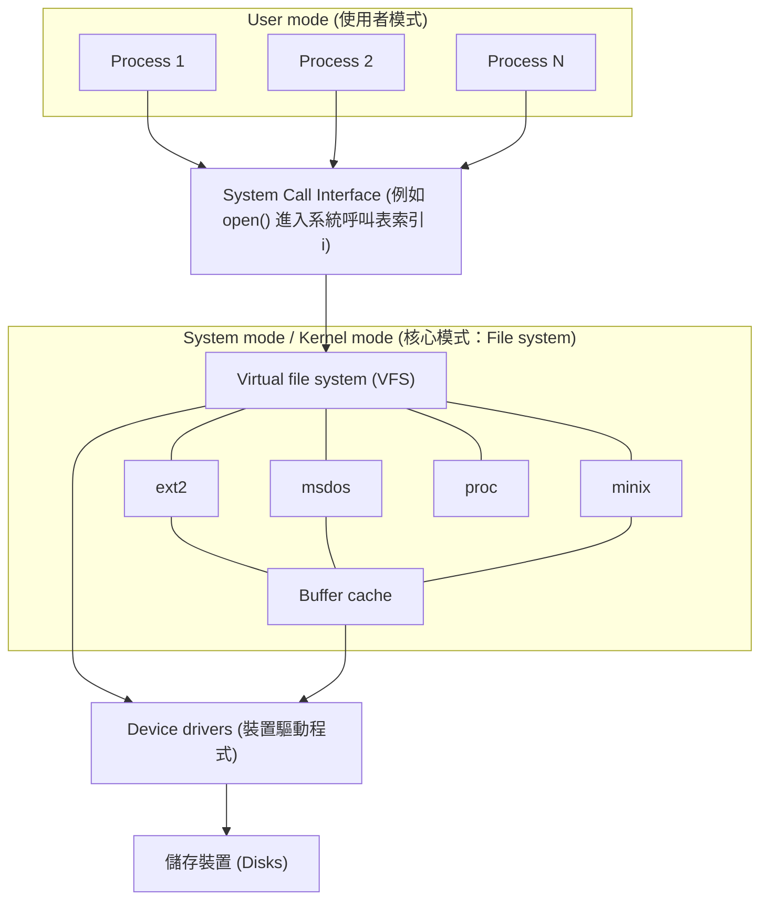
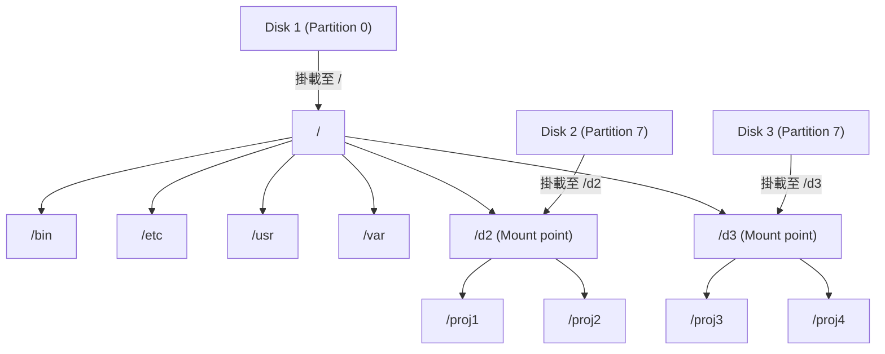
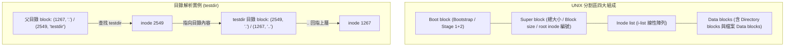
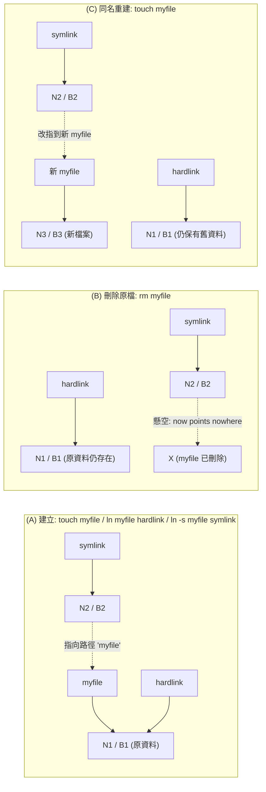
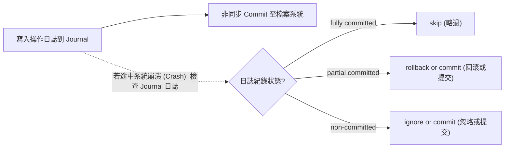

# 檔案系統：架構、Inode、連結與權限管理

> 一句話考試定位摘要：掌握檔案系統 VFS 分層與路徑掛載（`mount` / `/etc/fstab` / `umount` + `lsof`）、七大檔案類型與 IPC 物件、分割區四大結構（Boot/Super/Inode list/Data blocks）與 Hard Link vs. Symbolic Link 行為差異，以及 `chmod` / 特殊位元（`4000`/`2000`/`1000`）/ `umask` 位元遮罩運算與 File Protection 最低權限表。（`10_FileSystem.pdf, p.1-44`）

!!! info "教學型 HTML 簡報"
    想從零開始透過翻頁簡報循序理解檔案系統概念與 **權限 Bit Mask 逐位演算**，請點此：[開啟教學型 HTML 簡報（新分頁）](slides/filesystem.html){ target="_blank" }。

## 學習目標、大綱與 `ls -l` 八欄快速解讀

- **來源簡報**：`10_FileSystem.pdf`（共 44 頁；NYCU CS IT Center，`tsaimh` 2022–2024、`jnlin` 2019–2021）。（`10_FileSystem.pdf, p.1`）
- **課程三大主軸（Outline）**：（`10_FileSystem.pdf, p.4`）
  1. **File System Architecture**：Pathname、File Tree、Mounting、File Types。（`10_FileSystem.pdf, p.4-25`）
  2. **inode and file**：inode 結構、UNIX 分割區組成、Hard Link vs. Symbolic Link。（`10_FileSystem.pdf, p.4, 26-31`）
  3. **File Access Mode**：權限表示法、特殊位元、`umask`、最低保護權限與變更擁有者（Changing File Owner）。（`10_FileSystem.pdf, p.4, 32-38`；以及補充特性 Journaling / CoW / File Attribute Extension，`p.42-44`）

### 先看懂 `ls -l` 的各欄位（`10_FileSystem.pdf, p.3`）
以 `$ ls -l` 輸出 `drwx--x--x 7 tsaimh dcs 1024 Sep 22 17:25 public_html` 為例：（`10_FileSystem.pdf, p.3`）

| 顯示內容 | 投影片欄位意義 |
| :--- | :--- |
| `d` | File Type（檔案類型，此處為目錄） |
| `rwx--x--x` | File Access Mode（檔案存取權限模式） |
| `7` | inodes（投影片於該表標註欄位名） |
| `tsaimh` | File User Owner（檔案擁有者） |
| `dcs` | File Group Owner（檔案群組擁有者） |
| `1024` | File Size（檔案大小） |
| `Sep 22 17:25` | File Last Modify Time（最後修改時間） |
| `public_html` | File Name（檔案／目錄名稱） |

---

## 1. 檔案系統架構、路徑與目錄配置

### 1.1 分層架構（VFS）、四大元件與系統呼叫
檔案系統的基本目的是**抽象呈現（represent / provide abstract interface）並組織系統的儲存空間**；運作關係為 **Application ↔ Kernel ↔ Hardware**——應用程式透過 **system-calls** 請求服務，Kernel 則呼叫對應驅動程式完成服務。（`10_FileSystem.pdf, p.5-6`）


（來源：`10_FileSystem.pdf, p.5, 8`）

- **檔案系統的四大核心元件（Four main components）**：（`10_FileSystem.pdf, p.6`）
  1. **Namespace（命名空間）**：為物件命名並將其排列成階層結構（例如目錄 directory）。
  2. **Application Programming Interface（API）**：用來巡覽與操作節點的一組系統呼叫（system calls）。
  3. **Security model（安全模型）**：保護、隱藏與分享資源的機制（例如 file permissions）。
  4. **Implementation（實作）**：將邏輯模型繫結至實體磁碟的程式碼。
- **系統呼叫操作序列範例（`cp file1 file2`）**：開啟來源檔（不存在則中止）→ 建立目標檔（若已存在則覆寫）→ 迴圈「自輸入檔讀取並寫入輸出檔」直到讀到 EOF → 關閉輸入與輸出檔 → 輸出完成訊息至螢幕 → 正常結束。（`10_FileSystem.pdf, p.7`）
- **檔案系統中的五類物件與共通存取介面**：（`10_FileSystem.pdf, p.9`）
  - **可於檔案系統找到的物件**：Files and directories、Hardware device files、Processes information、Interprocess communication（IPC）channel、Shared memory（SHM）segments。
  - **共通存取介面（System Calls）**：`open`、`read`、`write`、`close`、`seek`、`ioctl`、`fcntl` 等。

### 1.2 路徑名稱（Pathname）與標準目錄樹（`hier(7)`）
- **兩種路徑寫法與長度限制**：（`10_FileSystem.pdf, p.10`）
  - **絕對路徑（Absolute path）**：從 `/` 開始，例如 `/net/dcs/93/9317807/test/haha.c`。
  - **相對路徑（Relative path）**：從目前工作目錄（current directory）開始，例如 `test/haha.c`。
  - **長度限制（Constraints）**：單一路徑組件（Single component）**`≦ 255` 字元**；單一完整絕對路徑（Single absolute path）**`≦ 1023` 字元**。
- **單一根目錄樹（File Tree）與標準目錄用途（`hier(7)`，聚焦通用與 Linux 環境）**：（`10_FileSystem.pdf, p.11-13`）

| 路徑名稱 | 內容與用途（`10_FileSystem.pdf, p.12-13`） |
| :--- | :--- |
| `/` | 檔案系統的根目錄（root directory） |
| `/bin` & `/sbin` | 單人模式與多人模式皆仰賴的基礎使用者工具與系統程式 |
| `/usr` | 使用者工具與應用程式（User utilities and applications） |
| `/usr/bin` & `/usr/sbin` | 本機可執行檔（Local executable） |
| `/lib` | 共用與封存函式庫（Shared and archive libraries） |
| `/libexec` | `/bin` 與 `/sbin` 執行檔所需的關鍵系統工具 |
| `/mnt` | 空目錄，系統管理員常用作暫時掛載點（temporary mount point） |
| `/tmp` | 暫存檔目錄，**不保證在系統重開機後保留**（另有 `/var/tmp`） |
| `/usr/lib` | 標準 UNIX 程式的支援函式庫 |
| `/usr/libexec` | 系統守護行程（daemons）與由其他程式執行的系統工具 |
| `/usr/include` | 函式庫標頭檔（Libraries Header files） |
| `/usr/local` | 本機額外安裝的執行檔、函式庫等 |
| `/etc` | 系統組態設定檔與腳本 |
| `/usr/local/etc` | `/usr/local` 對應的組態設定目錄（比照 `/etc`） |
| `/dev` | 磁碟、終端機、數據機等裝置項目（Device entries） |
| `/proc` | 所有運行中行程的映像資訊（Images of all running process） |
| `/var` | 多用途的日誌（log）、暫存、瞬態（transient）與佇列（spool）檔案 |
| `/var/db` | 資料庫檔案 |
| `/var/log` | 各式系統日誌檔案 |
| `/var/mail` | 使用者信箱檔案 |
| `/var/spool` | 印表機、郵件等佇列處理（Spooling）目錄 |

---

## 2. 掛載（Mounting）、`/etc/fstab` 與卸載排障

### 2.1 `mount(8)` 運作原理與多磁碟掛載樹
- **常見檔案系統來源**：多數為磁碟分割區（disk partitions）、網路檔案伺服器（network file servers）、記憶體磁碟模擬器（memory disk emulators）與核心元件（kernel components）。（`10_FileSystem.pdf, p.14`）
- **`mount` 指令核心行為**：將既有檔案樹中的某個**掛載點（mount point）**對應至新接上檔案系統的根目錄（root）。（`10_FileSystem.pdf, p.14`）
- **重要考點**：掛載後，**該掛載點目錄原本的內容會變得暫時無法存取（The previous contents of the mount point become inaccessible）**，直到卸載後才恢復可見。（`10_FileSystem.pdf, p.14`）


（來源：`10_FileSystem.pdf, p.15`）

### 2.2 開機自動掛載設定檔 `/etc/fstab`
- 透過 **`/etc/fstab`**（Filesystem table，手冊頁 `fstab(5)`），列於其中的檔案系統會在**開機時自動進行檢查與掛載（checked and mounted automatically at boot time）**。（`10_FileSystem.pdf, p.16`）
- `/etc/fstab` 紀錄包含六個欄位：`Device`、`Mountpoint`、`FStype`、`Options`（例如 `rw`、`sw`）、`Dump`、`Pass#`（swap 分割區在 `Mountpoint` 欄位填 `none`、`FStype` 填 `swap`）。（`10_FileSystem.pdf, p.16`）

### 2.3 卸載（`umount(8)`）與 Busy 排除（`lsof(8)`）
- **基本卸載語法**：`umount { node | device }`，可傳入掛載點路徑或裝置名稱（例如 `umount /home`）。（`10_FileSystem.pdf, p.17`）
- **為什麼發生 Busy filesystem？**（`10_FileSystem.pdf, p.17`）
  1. 有使用者的目前工作目錄（current directory）正停留在該掛載目錄內。
  2. 該檔案系統上仍有已開啟的檔案（opened files）。
- **處理與診斷工具**：（`10_FileSystem.pdf, p.17-18`）
  - 可使用 `umount -f` 強制卸載（`10_FileSystem.pdf, p.17`）。
  - 可使用 **`lsof(8)`**（list open files）找出究竟是哪個行程佔用資源使其處於 busy 狀態；`lsof` 輸出關鍵欄位包含 `COMMAND`、`PID`、`USER`、`FD`（如 `cwd` 目前工作目錄、`rtd` 根目錄、`txt` 程式碼文字檔）、`TYPE`（如 `VDIR`、`VREG`）、`SIZE/OFF`、`NODE`、`NAME`。（`10_FileSystem.pdf, p.17-18`）

!!! tip "本單元考點"
    1. **掛載遮蔽行為**：新檔案系統掛載到某目錄後，該目錄**原本存放在下層的舊內容會被遮蔽而不可存取**（不是被刪除）。（`10_FileSystem.pdf, p.14`）
    2. **卸載忙碌排查**：遇到無法 `umount` 時，兩大常見原因是 **有人 `cd` 留在該目錄（`cwd`）** 或 **有行程開著檔案未關閉**，可用 **`lsof`** 找出對應 `PID`。（`10_FileSystem.pdf, p.17-18`）

!!! note "投影片未展開"
    - 投影片僅呈現 `/etc/fstab` 六欄格式與 `rw`/`swap`/`sw` 範例，未展開其他掛載選項細節、`Dump` 與 `Pass#` 的各數值規則，亦未說明 `mount` 在 Debian Linux 上可省略或指定的 `-t` 檔案系統類型旗標。（`10_FileSystem.pdf, p.14, 16`）

---

## 3. 七大檔案類型與 IPC 物件

在 `ls -l` 權限欄最前端的第一個字元，代表系統中的七大檔案類型：（`10_FileSystem.pdf, p.19`）

| 符號 | 檔案類型（File types） | 特性與相關操作指令（`10_FileSystem.pdf, p.19-25`） |
| :---: | :--- | :--- |
| `-` | Regular file（一般檔案） | 可用 `file` 指令辨識內容類型（如 ASCII text、ELF 動態連結執行檔等）（`p.19-20`） |
| `b` | Block device file（區塊裝置檔） | 裝置檔類型之一（`p.19`） |
| `c` | Character device file（字元裝置檔） | 裝置檔類型之一（`p.19`） |
| `d` | Directory（目錄） | 每個目錄皆含 `.` 與 `..`；以 `mkdir` / `rmdir` 建立與移除（`p.19, 21`） |
| `l` | Symbolic link（符號連結） | 內含指向另一個路徑名稱（pathname）的檔案，類似 Windows 捷徑；以 `ln -s ori-file soft-file` 建立（`p.19, 25`） |
| `s` | UNIX domain socket | 由 `socket()` 建立，僅限單一主機本機使用（local to a particular host）；**透過檔案系統物件而非網路 Port 引用**，由 `Process A` 寫入核心 `Socket buffer` 再供 `Process B` 讀取（`p.19, 22`） |
| `p` | Named pipe（具名管線） | 讓兩個行程進行 FIFO 通訊（`p.19, 23-24`） |

### Pipes：匿名管線 vs. Named Pipe（`mkfifo`）
- **Pipes**：讓兩個行程進行 **FIFO（先進先出）** 通訊的機制。（`10_FileSystem.pdf, p.23`）
  - **匿名 Pipe**：單一行程在 Kernel 建立 `Pipe` 搭配讀取端 `fd[0]` 與寫入端 `fd[1]`，經 **`Fork`** 產生子行程後，父行程寫入 `fd[1]`、子行程自 `fd[0]` 讀取資料完成單向 FIFO 通訊。（`10_FileSystem.pdf, p.23`）
  - **Named Pipe（`p`）**：在檔案系統建立有實體名稱的 FIFO 檔，供不同行程透過檔名讀寫：（`10_FileSystem.pdf, p.24`）

```sh
# 語法：mkfifo [-m mode] fifo_name ...
$ mkfifo pipe
$ du >> pipe
# 在另一個獨立行程中讀取：
$ sort -n pipe
```
（來源：`10_FileSystem.pdf, p.24`）

!!! note "投影片未展開"
    - 投影片以圖解說明 `fd[0]` / `fd[1]` 與 `Fork` 的管線資料流，並未列出匿名 Pipe 的 C 系統呼叫程式碼；亦未展開 `b` 與 `c` 裝置檔在 `/dev` 底下的 major/minor 編號概念。（`10_FileSystem.pdf, p.19, 23`）

---

## 4. Inode、磁碟分割區結構與 Hard Link vs. Symbolic Link

### 4.1 Inode 結構與 `ls -i`
- **inode** 是用來記錄一個檔案中繼資訊（information of a file）的資料結構；可用 **`ls -i`** 查看每個檔案的 inode 編號。（`10_FileSystem.pdf, p.26`）
- **inode 內部記錄欄位與區塊指標（`p.26`）**：包含 `mode`、`owners(2)`、`timestamps(3)`、`size block`、`count`，以及指向實際 `data` 區塊的四級指標：**`direct blocks`**、**`single indirect`**、**`double indirect`** 與 **`triple indirect`**。（`10_FileSystem.pdf, p.26`）

### 4.2 UNIX 分割區四大組成與「目錄 → Inode → Data Block」對應
一個 UNIX 磁碟分割區包含四個主要區塊：**While users think of files in terms of file names, Unix thinks of files in terms of inodes.**（`10_FileSystem.pdf, p.27`）

| 分割區區塊 | 職責說明（`10_FileSystem.pdf, p.27`） |
| :--- | :--- |
| **Boot block** | 存放用來載入作業系統的啟動程式（bootstrap program，圖註 `Boot Stage 1 (+ 2)`） |
| **Super block** | 描述檔案系統整體狀態（例如分割區總大小、區塊大小 block size、**根目錄的 inode 編號**） |
| **Inode list（i-list）** | 線性的 inode 陣列，核心以 inode 編號識別檔案 |
| **Data blocks** | 存放檔案實際內容（亦包含存放目錄項目的 directory blocks） |

- **目錄的本質**：目錄也是一種區塊（`directory block`），裡面儲存一筆筆 **`(i-node number, filename)`** 對照紀錄；例如當目錄 `/home/fyli/testdir` 的 inode 為 `2549`、上層目錄 inode 為 `1267` 時，`testdir` 目錄內部的項目即為 `2549 → .` 與 `1267 → ..`，而父目錄則存有 `2549 → testdir`。（`10_FileSystem.pdf, p.28-29`）


（來源：`10_FileSystem.pdf, p.27-29`）

### 4.3 Hard Link vs. Symbolic Link（必考三階段實驗）
| 比較項目 | Hard Link（硬連結） | Soft / Symbolic Link（符號連結） |
| :--- | :--- | :--- |
| **定義（`p.30`）** | 將兩個以上檔名**關聯到同一個 inode** | 一個獨立檔案，內部**指向另一個路徑名稱（another pathname）** |
| **建立指令（`p.30`）** | `ln ori-file hard-file` | `ln -s ori-file soft-file` |
| **跨分割區限制（`p.30`）** | **必須位於同一個分割區（Must in the same partition）** | 無同分割區限制（指向路徑名稱）（`p.25, 30`） |
| **擁有獨立 inode 與 Data block？（`p.31`）** | 共用目標檔案原本的 inode（`N1`）與資料塊（`B1`） | 擁有自己專屬的 inode（`N2`）與資料塊（`B2`，紀錄目標路徑文字） |
| **來源被 `rm` 刪除後（`p.31`）** | **`hardlink` 仍完整可讀**（仍指著 `N1/B1`） | **`symlink` 失效**（`now points nowhere`） |
| **同名新檔再被 `touch` 重建後（`p.31`）** | 新 `myfile` 拿到新 inode（`N3/B3`）；**`hardlink` 仍指舊資料 `N1/B1`** | **`symlink` 自動改指向新建的 `myfile`（`N3/B3`）** |


（來源：`10_FileSystem.pdf, p.31`）

!!! tip "本單元考點"
    1. **為什麼 Hard link 不能跨分割區？** 因為每個分割區各自擁有獨立的 **Super block 與 Inode list**，不同分割區的 inode 編號互相獨立；而目錄記錄的是 `(inode number, filename)`，只能指向同一個分割區內的 `i-list` 項目。（`10_FileSystem.pdf, p.27-30`）
    2. **三階段實驗必考結論**：執行 `rm myfile` 再 `touch myfile` 後，**`hardlink` 讀到的仍是舊檔案內容（`N1/B1`），`symlink` 讀到的則是重建後的新檔案（`N3/B3`）**。（`10_FileSystem.pdf, p.31`）

!!! note "投影片未展開"
    - 投影片繪出 inode 內的 `owners(2)`、`timestamps(3)` 與 `count`，但未展開這兩組複數欄位的各別細項名稱（亦未詳細推演檔案刪除需等 link `count` 歸零的釋放條件細節）。（`10_FileSystem.pdf, p.26`）

---

## 5. 檔案存取權限、位元遮罩、`umask` 與所有權

### 5.1 基本權限 `rwx` 位元遮罩與 `chmod(1)`
Linux 檔案存取模式由 9 個基本權限位元分成三組——**User（`u`）、Group（`g`）、Other（`o`）**，每組依序對應 **`r`（讀）、`w`（寫）、`x`（執行）**，本質上是一個 **3-bit 二進位權重位元遮罩（Bit Mask）**：（`10_FileSystem.pdf, p.32, 35`）

| 權限字元 | 二進位遮罩（`r w x`） | 3-bit 數值權重 | 常見組合實例（`10_FileSystem.pdf, p.35`） |
| :---: | :---: | :---: | :--- |
| `r` | `1 0 0` | `4` | `r--` = `4`（僅讀，如 `444`） |
| `w` | `0 1 0` | `2` | `rw-` = `4 + 2 = 6`（讀寫，如 `644`、`600`） |
| `x` | `0 0 1` | `1` | `--x` = `1`（僅執行，如 `711`） |
| `r-x` | `1 0 1` | `4 + 1 = 5` | `r-x` = `5`（讀與執行，如 `755`、`750`、`4555`） |
| `rwx` | `1 1 1` | `4 + 2 + 1 = 7` | `rwx` = `7`（全部權限，如 `755`、`700`、`1777`） |

- **`chmod` 符號式語法（`chmod(1)` `"MODES"`）**：`chmod access-string file`，結構為 **`[ACCESS CLASS: u/g/o/a] + [OPERATOR: +/-/=] + [ACCESS TYPE: r/w/x/...]`**。（`10_FileSystem.pdf, p.32`）
- **常用範例**：（`10_FileSystem.pdf, p.32`）

```sh
$ chmod u+x test.sh
$ chmod u+w,g-w hehe haha
$ chmod -R 755 public_html/     # -R 遞迴套用至目錄及其內容
```

### 5.2 特殊權限位元：`setuid (4000)`、`setgid (2000)`、`sticky (1000)`
在基本 3 位八進位數字（`000`–`777`）之前，可加上代表**高位 3-bit 特殊旗標**的千位數（十進位／八進位參數，投影片標題稱 `Decimal argument of chmod`）：（`10_FileSystem.pdf, p.33-35`）

| 特殊位元 | `chmod` 前導數值 | 二進位遮罩（高位 3 bits） | 套用於**檔案**之效果 | 套用於**目錄**之效果 |
| :--- | :---: | :---: | :--- | :--- |
| **`setuid`** | **`4000`** | `1 0 0` | 執行所產生行程之**有效 UID（effective uid）設為該檔案擁有者的 UID**（例：`passwd`、`chsh`、`crontab`）（`p.33`） | — |
| **`setgid`** | **`2000`** | `0 1 0` | 執行所產生行程之**有效 GID（effective gid）設為該檔案所屬群組的 GID**（`p.33`） | **目錄內新建檔案的群組會自動與該目錄相同**（`p.34`） |
| **`sticky bit`** | **`1000`** | `0 0 1` | — | 如 **`/tmp`**：**禁止刪除或重新命名目錄內檔案**，除非你是 **(1) 檔案擁有者、(2) 目錄擁有者，或 (3) `root`**（`p.34`） |

#### 常用權限數字與屬性字串完整對照表（`10_FileSystem.pdf, p.35`）
| Mode | Attribute | 拆解說明 | Mode | Attribute | 拆解說明 |
| :---: | :--- | :--- | :---: | :--- | :--- |
| `755` | `- rwx r-x r-x` | 一般可執行檔 | `644` | `- rw- r-- r--` | 一般純文字／公開讀取檔 |
| `4755` | `- rws r-x r-x` | 帶 **`setuid`** 的執行檔（User `x` 顯示 `s`） | `600` | `- rw- --- ---` | 僅擁有者可讀寫的私密檔 |
| `2755` | `- rwx r-s r-x` | 帶 **`setgid`** 的執行檔（Group `x` 顯示 `s`） | `444` | `- r-- r-- r--` | 所有人唯讀檔案 |
| `2775` | `d rwx rws r-x` | 帶 **`setgid`** 且同群組可寫目錄 | `1777` | `d rwx rwx rwt` | 帶 **`sticky`** 的共用目錄（Other `x` 顯示 `t`） |
| `755` | `d rwx r-x r-x` | 一般公開瀏覽目錄 | `4555` | `- r-s r-x r-x` | 帶 **`setuid`** 且無寫權限執行檔 |
| `750` | `d rwx r-x ---` | 同群組可進不可寫、其他人全擋目錄 | `711` | `- rwx --x --x` | 僅執行不給其他人讀內容 |
| `700` | `d rwx --- ---` | 僅擁有者可進入與讀取的私密目錄 | `711` | `d rwx --x --x` | 其他人只能穿過目錄不可列清單 |

### 5.3 預設權限與 `umask` 位元遮罩計算（必考陷阱）
- **核心定位**：`umask` 是一個 **Shell built-in command**，用來決定新建檔案或目錄的預設權限（Inference the default permissions given to the files newly created）。（`10_FileSystem.pdf, p.36`）
- **基本完整權限（Full permission bit）與遮罩公式**：（`10_FileSystem.pdf, p.36`）
  - **File（新建一般檔案）**：基本完整權限為 **`666`**（二進位 `110 110 110`）。
  - **Dir（新建目錄）**：基本完整權限為 **`777`**（二進位 `111 111 111`）。
  - **計算公式**：**`full permission bit & (!umask)`**——亦即 `umask` 中為 **`1`** 的位元會透過反相（`!umask`）變成 `0`，再做位元 `AND` 運算，把對應權限「遮掉」！（`10_FileSystem.pdf, p.36`）

#### `umask` 位元遮罩逐例對照與二進位演算（`10_FileSystem.pdf, p.36`）
| `umask` | 二進位 `!umask` | File 運算 (`666 & !umask`) | New File | Dir 運算 (`777 & !umask`) | New Dir |
| :---: | :---: | :--- | :--- | :--- | :--- |
| **`022`** | `111 101 101` (`755`) | `110 110 110 & 111 101 101 = 110 100 100` (`644`) | `- rw- r-- r--` | `111 101 101` (`755`) | `d rwx r-x r-x` |
| **`033`** | `111 100 100` (`744`) | `110 110 110 & 111 100 100 = 110 100 100` (`644`) | **`- rw- r-- r--`** | `111 100 100` (`744`) | `d rwx r-- r--` |
| **`066`** | `111 001 001` (`711`) | `110 110 110 & 111 001 001 = 110 000 000` (`600`) | `- rw- --- ---` | `111 001 001` (`711`) | `d rwx --x --x` |
| **`000`** | `111 111 111` (`777`) | `110 110 110 & 111 111 111 = 110 110 110` (`666`) | `- rw- rw- rw-` | `111 111 111` (`777`) | `d rwx rwx rwx` |
| **`277`** | `101 000 000` (`500`) | `110 110 110 & 101 000 000 = 100 000 000` (`400`) | `- r-- --- ---` | `101 000 000` (`500`) | `d r-x --- ---` |
| **`777`** | `000 000 000` (`000`) | `110 110 110 & 000 000 000 = 000 000 000` (`000`) | `- --- --- ---` | `000 000 000` (`000`) | `d --- --- ---` |

### 5.4 File Protection：執行各指令所需最低權限（考前必背）
目錄權限控管的是「**能否進入目錄或增刪改裡面的目錄項目（檔名）**」，檔案權限控管的才是「**能否讀寫或執行該檔案內容**」：（`10_FileSystem.pdf, p.37`）

| 指令操作 | On file itself（檔案本身最低需求） | On directory（所在目錄最低需求） | 考點解讀（`10_FileSystem.pdf, p.37`） |
| :--- | :---: | :---: | :--- |
| `cd /home/test` | — | **`x`** | 切換工作目錄只需目錄有穿越（`x`）權限 |
| `ls /home/test` | — | **`r`** | 僅列出目錄內的檔名清單只需 `r` |
| `ls -s /home/test/*.c` | — | **`rx`** | 需要展開並讀取檔案中繼資訊時需目錄 `rx` |
| `cat runme` | **`r`** | **`x`** | 透過目錄（`x`）找到檔案後讀取檔案內容（`r`） |
| `cat >> runme` | **`w`** | **`x`** | 透過目錄（`x`）找到檔案後寫入檔案內容（`w`） |
| `run-binary`（執行二進位檔） | **`x`** | **`x`** | 執行編譯後二進位程式只需檔案 `x` |
| `run-script`（執行腳本） | **`rx`** | **`x`** | 直譯器必須**讀取腳本內容並執行**，故需 **`rx`** |
| `rm rumme`（刪除檔案） | **無（空）** | **`wx`** | **刪除檔案不看檔案本身權限**，而是修改目錄內容（`wx`） |

### 5.5 變更檔案擁有者與群組（`chown(8)` / `chgrp(1)`）
- `chown(8)` 用於變更檔案擁有者（亦可同時或單獨變更群組）；`chgrp(1)` 用於變更群組擁有者；`-R` 代表遞迴套用：（`10_FileSystem.pdf, p.38`）

```sh
$ chown -R tsaimh /home/tsaimh        # 僅變更 user owner
$ chown -R tsaimh:dcs /home/tsaimh    # 同時變更 user owner 與 group owner
$ chown -R :dcs /home/tsaimh          # 僅變更 group owner
$ chgrp -R dcs /home/tsaimh           # 變更 group owner
```
（來源：`10_FileSystem.pdf, p.38`）

!!! tip "本單元考點"
    1. **為什麼 `umask` 不可以用減法計算？** 因為若用減法，`666 - 033 = 633` 會錯算成給 Group/Other `wx`（寫加執行），但 **`3`（`011`）要遮掉的 `x` 位元原本在 `666` 就已是 `0`**，所以正確的 **`666 & (!033)` 必須是 `644`（`- rw- r-- r--`）**。（`10_FileSystem.pdf, p.36`）
    2. **三大目錄與檔案權限核心差異**：`rm` 只需要**目錄 `wx`**、完全不需檔案本身權限；執行二進位程式需檔案 **`x`**，但執行 **Shell 腳本需要檔案 `rx`**（同時皆需目錄 `x`）。（`10_FileSystem.pdf, p.37`）
    3. **`setgid` 對目錄 vs. `sticky` 對目錄**：`2000`（`setgid`）讓目錄內新建檔案繼承目錄群組；`1000`（`sticky`）使 `/tmp` 中只有檔案擁有者、目錄擁有者或 `root` 能刪除／更名檔案。（`10_FileSystem.pdf, p.34-35`）

!!! warning "本單元常見陷阱"
    - 看到 `umask 277` 時勿直覺以為減去後負數無法計算——套用 **`full & (!umask)`** 即可立刻算出 File `110 110 110 & 101 000 000 = 100 000 000`（`r-- --- ---`）與 Dir `101 000 000`（`r-x --- ---`）。（`10_FileSystem.pdf, p.36`）
    - 用 `chmod` 設定 `rwx` 時，不要忘記對目錄而言 `x` 代表「能否進入／存取目錄內項目」，僅有 `r` 可 `ls` 檔名但無法 `cd`。（`10_FileSystem.pdf, p.37`）

!!! note "投影片未展開"
    - 投影片於 `p.33` 僅列出 `setuid` 的範例（`passwd`、`chsh`、`crontab`），`setgid` 用於一般可執行檔的具體範例未展開；`p.35` 對照表中的所有 `s`/`t` 均搭配具備 `x` 位元的模式，未展開缺少執行權限位元時的顯示符號差異。（`10_FileSystem.pdf, p.33, 35`）

---

## 6. 現代檔案系統進階特性：Journaling、CoW 與擴充屬性

### 6.1 日誌檔案系統（Journaling File System）
- **核心機制**：先將操作日誌寫入 journal，再**非同步提交（commit it asynchronously）**至實際資料區。（`10_FileSystem.pdf, p.42`）
- **效益**：大幅縮短崩潰後的 **`fsck` 時間**並降低**資料不一致（data inconsistency）**風險。（`10_FileSystem.pdf, p.42`）
- **代表範例**：`ext3`、`ext4`、`xfs`、`btrfs`。（`10_FileSystem.pdf, p.42`）


（來源：`10_FileSystem.pdf, p.42`）

### 6.2 寫入時複製（CoW, Copy on Write File System）
- **原理**：若部分資料被複製但**尚未修改**，兩者會**參照儲存裝置上的同一個實體位址（referred to the same physical address in the storage）**。（`10_FileSystem.pdf, p.43`）
- **優點（Pros）**：**減少使用空間（Reduce the space used）**、**低成本快照（Low cost snapshots）**。（`10_FileSystem.pdf, p.43`）
- **缺點（Cons）**：**資料不一致風險**（例如參照計數 reference count 不一致）、看到的**並非檔案真實佔用空間（Not "real" used space on file）**。（`10_FileSystem.pdf, p.43`）
- **代表範例**：`ZFS deduplication`（課程後續於 Btrfs 主題進一步深入 CoW）。（`10_FileSystem.pdf, p.43`）

### 6.3 檔案擴充屬性（File Attribute Extension）
- **定義**：將**不被檔案系統主動解譯的中繼資料（metadata not interpreted by the filesystem）**與檔案關聯，以 **Key-value pairs** 形式**儲存在 inode 中**。（`10_FileSystem.pdf, p.44`）
- **常見範例**：`mime_type`、`md5/sha1 checksum`、`security attributes`。（`10_FileSystem.pdf, p.44`）

!!! note "投影片未展開"
    - 本節為概念性介紹，投影片未展開 `fsck` 修復指令參數、CoW 在寫入變更時如何配置新區塊的操作指令細節，以及讀取或設定擴充屬性的具體工具名稱。（`10_FileSystem.pdf, p.42-44`）

---

## 7. 考前核心指令與易錯陷阱速查表

| 主題 / 操作 | 核心指令或公式 | 考前必抓重點 | 來源頁碼 |
| :--- | :--- | :--- | :--- |
| 觀察權限與 inode | `ls -l` / `ls -i` / `file <path>` | `ls -l` 首碼分辨 `- b c d l s p`；`ls -i` 看 inode 編號 | `p.3, 19-20, 26` |
| 掛載與卸載排障 | `mount` / `/etc/fstab` / <code>umount { node &#124; device }</code> / `lsof` | 掛載後原目錄內容暫時不可見；`umount -f`；`lsof` 查佔用程序 | `p.14, 16-18` |
| Named Pipe | `mkfifo [-m mode] fifo_name` | 讓獨立行程透過檔案系統節點進行 FIFO 通訊 | `p.24` |
| 硬連結 vs. 符號連結 | `ln ori hard` vs. `ln -s ori soft` | 硬連結同 inode 限同分割區，`rm` 原檔後仍有效；軟連結會失效，重建同名檔後指向新檔 | `p.25, 30-31` |
| 修改權限與特殊位元 | `chmod [u/g/o/a][+/-/=][r/w/x]` / `chmod [-R] 4755/2775/1777` | `setuid=4000`、`setgid=2000`（目錄群組繼承）、`sticky=1000`（`/tmp` 保護） | `p.32-35` |
| `umask` 計算公式 | `full & (!umask)`（File `666` / Dir `777`） | Shell 內建指令；**不可用減法**（例 `umask 033` → File `644`、Dir `744`） | `p.36` |
| 最低權限速記 | `rm`: 檔無 + 目錄 `wx` / `run-script`: 檔 `rx` + 目錄 `x` | 刪檔改的是目錄項目而非檔案；腳本須讓直譯器讀入內容 | `p.37` |
| 變更擁有者／群組 | `chown -R user[:group] path` / `chgrp -R group path` | `chown :dcs` 可單改群組 | `p.38` |

---

## 跨主題關聯與範圍備註

### 跨主題延伸脈絡
- **前導主題串聯**：本頁的 `ls -l` / `rm`、`chmod +x` 與 Script 執行需 `rx` 權限、Pipes FIFO 概念，分別與 [Shell：命令列、管線與文字處理](shell.md) 及 [Shell 腳本設計：流程控制、健壯性與 sed / awk](shell-programming.md) 互補。（`10_FileSystem.pdf, p.3, 23-24, 32, 37`）
- **後續儲存路線延伸**：本頁的分割區掛載與 `/etc/fstab` 已銜接至 [邏輯捲宗管理（LVM）：架構、精簡配置、快照與磁碟擴縮實戰](lvm.md)；第 6 節介紹的 Journaling 與 CoW 低成本快照機制亦已銜接至 [Btrfs（B-Tree Filesystem）：Subvolume、佈局、快照與遷移實戰](btrfs.md)。（`10_FileSystem.pdf, p.14-16, 42-43`）

### 已略過之 FreeBSD 專屬內容
依本知識庫「聚焦 Debian Linux」鐵則，完整略過下列 `10_FileSystem.pdf` 中的 FreeBSD 專屬對照與附錄：
- `p.2`：FreeBSD 官方 Handbook permissions 說明網址。
- `p.13`：`hier(7)` 表格中的 `/usr/src` BSD 原始碼說明、`/usr/obj` 編譯產物樹與 `/var/db/pkg & /var/db/ports`（`ports(7)`）。
- `p.14, 16, 17`：FreeBSD 磁碟分割區裝置路徑範例（`/dev/ad2s1e`、`/dev/ad0s1a`、`/dev/ad0s1b`）與 `ufs` `/etc/fstab` 實例列（保留通用 `/etc/fstab` 欄位與掛載原理）。
- `p.17–18`：FreeBSD `fstat(1)` 指令及 `lsof` 範例輸出中的 `/usr/ports/...`、`/libexec/ld-elf.so.1` 等專屬路徑細節（保留通用 `lsof(8)` 原理與欄位）。
- `p.20, 32`：`file /bin/sh` 輸出範例中的 `(FreeBSD)` ELF 標籤與範例檔名 `.tcshrc`。
- `p.39–41`：**整段 `Appendix: FreeBSD bonus flags`（`chflags(1)`、`schg`/`sunlnk`/`sappnd`/`uappend`/`uunlnk`、`ls -ol`、`wheel`）**。

### 投影片未展開彙整
- `ls -l` 第三欄標示為 `inodes` 時與硬連結數之進一步關聯（p.3）；路徑上限除 `255` / `1023` 外之其他實作說明（p.10）。
- `/etc/fstab` 各欄位詳細掛載選項清單與 `Dump` / `Pass#` 數值細節（p.16）；`b` 與 `c` 裝置檔編號與匿名 Pipe 系統呼叫程式碼（p.19, 23）。
- `inode` 內 `owners(2)`、`timestamps(3)` 各自包含的子欄位名稱與釋放條件細節（p.26）。
- `setgid` 套用於可執行檔之具體範例，以及特殊權限位元於缺少 `x` 時的顯示字母規則（p.33, 35）。
- `fsck` 操作方式、CoW 寫入配置實作與擴充屬性操作工具（p.42–44）。

## 資料來源

- `10_FileSystem.pdf`：p.1–44
