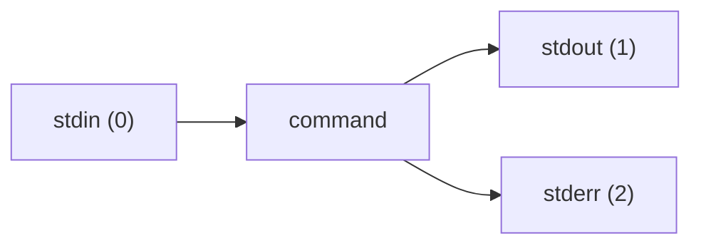

# 標準串流、I/O 重導向與管線（Pipelines）

> 一句話考試定位摘要：掌握檔案描述子（FD `0/1/2`）與標準串流、重導向的由左至右求值順序陷阱（`>out 2>&1`），以及管線 `|` 預設只接 `stdout`、可攜合併寫法 `2>&1 |` 與非 POSIX `|&` 的差異。（`03_Shell.pdf, p.27-30`）

## 核心定義與原理

### 1. 標準串流與檔案描述子（Standard Streams and File Descriptors）
| 檔案描述子（FD） | 名稱 | 預設來源 / 目的地 |
| :---: | :--- | :--- |
| `0` | `stdin` | 鍵盤 / 呼叫端輸入（`03_Shell.pdf, p.27`） |
| `1` | `stdout` | 終端機 / 呼叫端標準輸出（`03_Shell.pdf, p.27`） |
| `2` | `stderr` | 終端機 / 呼叫端錯誤串流（`03_Shell.pdf, p.27`） |

### 2. I/O 重導向（Redirection）
| 語法 | 作用說明 |
| :--- | :--- |
| `cmd < file` | 以 `file` 作為 `stdin`（`03_Shell.pdf, p.28`） |
| `cmd > file` | 將 `stdout` 寫入 `file`；**寫入前先截斷清空（truncate first）**（`03_Shell.pdf, p.28`） |
| `cmd >> file` | 將 `stdout` 附加（append）到 `file` 尾端（`03_Shell.pdf, p.28`） |
| `cmd 2> file` | 將 `stderr` 寫入 `file`（`03_Shell.pdf, p.28`） |
| `cmd >out 2>&1` | 將 `stdout` 與 `stderr` 導向同一個檔案 `out`（`03_Shell.pdf, p.28`） |

### 3. 管線（Pipelines）
- 管線符號 `|` 會將左側指令的 **`stdout`** 連接到右側指令的 **`stdin`**。（`03_Shell.pdf, p.29`）
- 每個階段應只專注做好一件小事；遇到長管線時應跨行折疊並對齊各階段，讓資料流向一目了然。（`03_Shell.pdf, p.29`）
- **`stderr` 預設不會經由 `|` 傳遞**，除非顯式進行重導向。（`03_Shell.pdf, p.29`）
- `tee` 指令可將一份串流同時複製輸出到 `stdout` 與指定檔案。（`03_Shell.pdf, p.30`）

## 流程與架構圖

### 標準串流（FD `0/1/2`）模型

（來源：`03_Shell.pdf, p.27`）

### 四階段管線資料流範例

（來源：`03_Shell.pdf, p.29`）

## 關鍵指令、設定與細節

### 1. 基本重導向範例
```sh
$ grep root /etc/passwd
root:x:0:0:root:/root:/bin/bash

$ grep root /etc/passwd > result.txt
$ grep nobody missing.txt 2> errors.txt
$ make > build.log 2>&1
```
（來源：`03_Shell.pdf, p.28`）

### 2. 在管線中分離或合併 `stdout` 與 `stderr`
```sh
# 將標準輸出與錯誤各自導向不同檔案（需要分開處理錯誤時採用）
command >output.log 2>error.log

# 進入管線前先合併 stderr 到 stdout，並由 tee 同時輸出到螢幕與檔案（廣泛可攜）
command 2>&1 | tee combined.log

# Bash / zsh 捷徑寫法（非 POSIX sh 語法）
command |& tee combined.log
```
（來源：`03_Shell.pdf, p.30`）

- 只有當你真的希望標準輸出與錯誤訊息交錯（interleaved）時才合併串流；否則應分開檔案保存。（`03_Shell.pdf, p.30`）

## 考點與常見陷阱

!!! tip "考點"
    1. **重導向的由左至右順序（Order matters）**：`2>&1` 的精確語意是「**讓 fd 2 指向 fd 1 目前所指向的位置**」。因此在複雜重導向中，由左至右的撰寫順序會直接改變結果（必須先 `> build.log` 讓 fd 1 指向檔案，再 `2>&1`）。（`03_Shell.pdf, p.28`）
    2. **可攜性差異（`2>&1 |` vs `|&`）**：`2>&1` 具有廣泛可攜性（POSIX `sh` 支援）；`|&` 只是 `bash` 與 `zsh` 的便利簡寫，**並非 POSIX `sh` 語法**。（`03_Shell.pdf, p.30`）

!!! warning "常見陷阱"
    1. **以為 `|` 會把錯誤訊息一起送給下一個指令**：`|` 只傳遞 `stdout`（FD `1`），`stderr`（FD `2`）仍會直接輸出到終端機，除非先使用 `2>&1` 合併。（`03_Shell.pdf, p.29-30`）
    2. **`>` 會直接清空既有檔案**：`cmd > file` 在寫入前會先 truncate 目標檔案；若要保留原內容改用 `>>`。（`03_Shell.pdf, p.28`）

## 相關頁面

- 所屬簡報總覽：[簡報總覽：Shells（命令列、管線與文字處理）](src-03-shell.md)
- 指令解析順序：[Terminal、Shell、Kernel 分層與指令執行流程](shell-terminal-kernel-and-execution.md)
- UNIX 哲學與管線設計：[檔案目錄指令、UNIX 哲學與文字處理選型地圖](unix-philosophy-and-text-toolkit.md)

## 資料來源

- `03_Shell.pdf`：p.27–30、p.45
