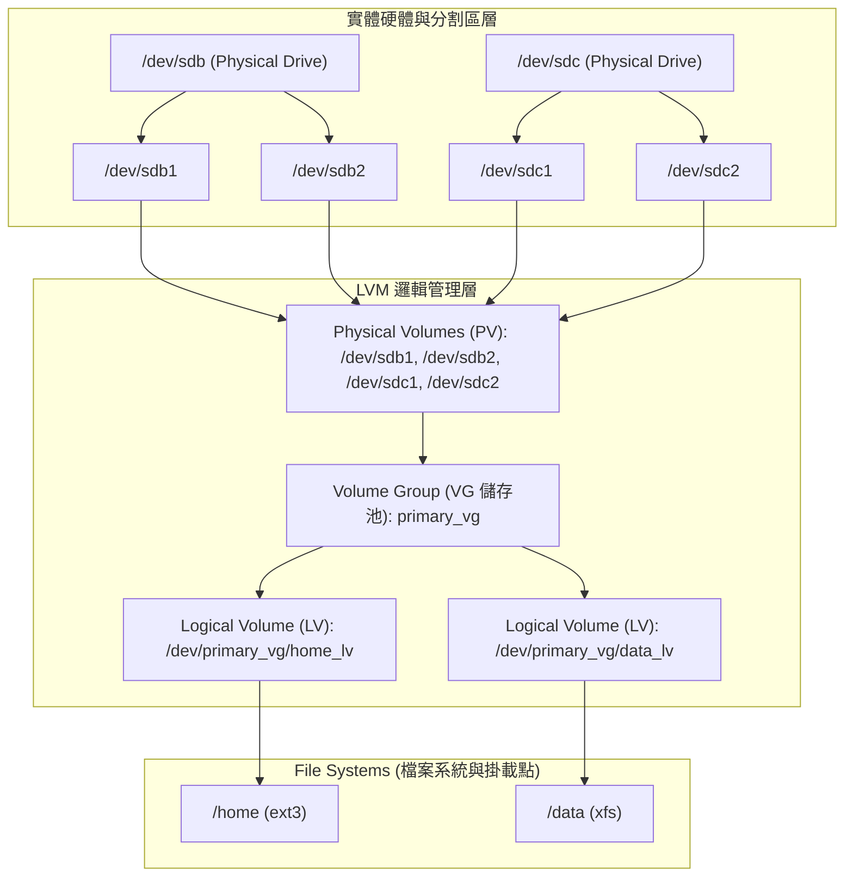
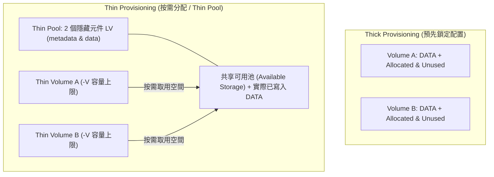
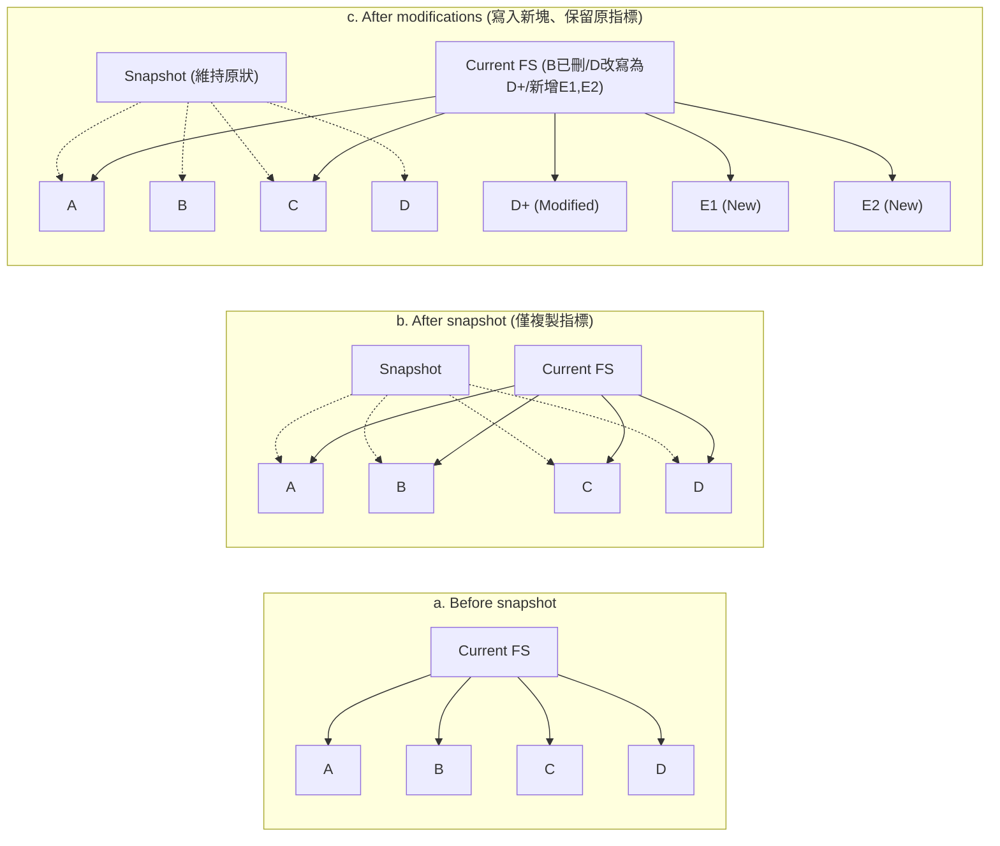
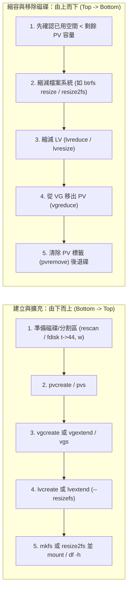

# 邏輯捲宗管理（LVM）：架構、精簡配置、快照與磁碟擴縮實戰

> 一句話考試定位摘要：掌握 Linux Device Mapper 框架下 `PV → VG → LV` 三層儲存池模型與 `PE / LE`（預設 `4MB`）配置邏輯、Thin Provisioning（Thin Pool 的 `metadata` + `data` 隱藏元件）與 CoW 快照（`Not backup!`、`umount` + `lvconvert --merge`），以及 **新增／擴充由下而上（Bottom → Top）** 對比 **縮容／移碟由上而下（Top → Bottom）** 的實戰步驟與易錯順序。（`LVM.pdf, p.1-31`）

!!! info "教學型 HTML 簡報"
    想從零開始透過翻頁簡報循序理解 LVM 觀念、Thin Provisioning 與擴縮容實務操作，請點此：[開啟教學型 HTML 簡報（新分頁）](slides/lvm.html){ target="_blank" }。

## 學習目標與適用情境

- **來源簡報**：`LVM.pdf`（共 31 頁；NYCU CS IT Center，黃柏竣 `bjhuang`，全份以 Debian 13 `trixws` 實機操作與 Linux Device Mapper 為準）。（`LVM.pdf, p.1-2, 16-30`）
- **LVM 是什麼（What is LVM?）**：（`LVM.pdf, p.2`）
  - 基於 **Device Mapper 框架（`/dev/mapper/`）**，為 Linux 核心提供邏輯捲宗管理（logical volume management）。
  - 將實體磁碟或分割區整合成一個位於**實體磁碟與檔案系統之間**的**儲存池（storage pool）**。
  - 可把任意數量的磁碟當成同一顆大磁碟運用、抽象化為「虛擬分割區（virtual partitions）」，並**輕鬆調整捲宗大小，無需煩惱傳統分割區順序（partition precedence）**。
- **何時適合使用 LVM（When to use LVM?）**：（`LVM.pdf, p.12`）
  - 機器上有多顆磁碟。
  - 目前只有一顆磁碟，但未來計畫擴充更多磁碟（**就算只使用單顆磁碟，LVM 同樣很實用**）。
  - 不想手動管理磁碟分割區的相鄰順序（partition precedence）。
  - 不確定各掛載點或應用程式實際需要多大的分割區容量。

---

## 1. LVM 三層核心架構：PV、VG、LV 與 PE / LE

### 1.1 從實體磁碟到檔案系統的六層架構
LVM 由底層實體設備向上堆疊建立抽象儲存池與邏輯分割區，最後再於其上格式化檔案系統並掛載使用：（`LVM.pdf, p.3, 13`）


（來源：`LVM.pdf, p.3`，原圖引自 Arch Linux Tutorial）

### 1.2 核心三層元件與管理指令（PV / VG / LV）

| 層級與縮寫 | 定義與角色 | 核心操作指令與範例（`LVM.pdf, p.4-6, 24-25`） |
| :--- | :--- | :--- |
| **Physical Volume（PV）**<br>實體捲宗 | LVM 的**基礎儲存單位**，可為整顆硬碟、硬碟分割區或 Linux software RAID（`/dev/mdXXX` 等）；建立後會在裝置寫入 **LVM 相關標頭（header）**（`p.4`） | 建立：`pvcreate <device>`<br>例：`pvcreate /dev/sdb1 /dev/sdb2 /dev/sdc1 /dev/sdc2`（`p.4`）<br>檢視：`pvs` / `pvdisplay`（`p.7, 24`） |
| **Volume Group（VG）**<br>捲宗群組 | 由一個或多個 PV 匯集而成的**儲存池（storage pool）**（`p.2, 5`） | 建立：`vgcreate <VG name> <PV name>`<br>例：`vgcreate primary_vg /dev/sdb1 /dev/sdb2 /dev/sdc1 /dev/sdc2`<br>擴充：`vgextend <VG name> <PV name>`（`p.5`）<br>檢視：`vgs` / `vgdisplay`（`p.7, 24`） |
| **Logical Volume（LV）**<br>邏輯捲宗 | 位於 VG 內部、對外呈現如**虛擬分割區**的區塊裝置（`p.6`） | 依剩餘比率／extents：`lvcreate -l 100%FREE <VG> -n <LV>`（例：`lvcreate -l 50%FREE primary_vg -n home_lv`）（`p.6`）<br>依明確容量：`lvcreate -L 50G <VG> -n <LV>`（例：`lvcreate -L 50G primary_vg -n data_lv`）（`p.6`）<br>檢視：`lvs` / `lvdisplay`（`p.7, 25`） |

- **LV 裝置的兩條等效存取路徑**：（`LVM.pdf, p.6`）
  1. `/dev/<VG name>/<LV name>`（例：`/dev/data-vg/data_vol`，`p.18`）
  2. `/dev/mapper/<VG name>-<LV name>`（例：`/dev/mapper/trixws--vg-root`、`/dev/mapper/data--vg-data_vol`；實務截圖可見 VG 或 LV 名稱內的單個連字號 `-` 在 `/dev/mapper/` 下會顯示為雙連字號 `--`，`p.6, 16, 18, 28`）

### 1.3 Physical Extent（PE）與 Logical Extent（LE）
- **Physical Extent（PE）**：PV 中可分配給 LV 的**最小連續區塊單位（smallest contiguous extent）**。（`LVM.pdf, p.7`）
  - **預設大小為 `4MB`**；LV 所需的空間是從 VG 分配 PE 組成。（`LVM.pdf, p.7`）
  - **PV 的容量必須是 PE 的整數倍**（multiple of PE）；可用 `pvdisplay` 與 `vgdisplay` 查看 PE 大小與數量。（`LVM.pdf, p.7`）
- **Logical Extent（LE）**：概念與 PE 相同，但是位於 Logical Volume（LV）層級，**大小與 PE 完全相等**；可用 `lvdisplay` 查看 LE 數量。（`LVM.pdf, p.7`）

!!! tip "本單元考點"
    1. **`lvcreate -l` vs. `-L` 差異**：小寫 **`-l`** 指定 **extents 數量或百分比**（如 `-l 100%FREE`、`-l 50%FREE`）；大寫 **`-L`** 指定**明確儲存容量**（如 `-L 50G`）。（`LVM.pdf, p.6`）
    2. **PE 預設值與關係**：PE 預設 **`4MB`**、PV 大小必為 PE 整數倍，且 LV 的 LE 與底層 PE **大小相等**。（`LVM.pdf, p.7`）
    3. **LV 路徑寫法**：`/dev/<VG>/<LV>` 與 `/dev/mapper/<VG>-<LV>`（`df -h` 與 `lsblk` 常呈現後者且名中 `-` 轉為 `--`）。（`LVM.pdf, p.6, 16, 18`）

---

## 2. 精簡配置（LVM Thin Provisioning）

### 2.1 厚配置（Thick）vs. 精簡配置（Thin Provisioning）
**Thin Provisioning** 採用**按需分配（On-demand allocation）**，特別適合用於**虛擬機器主機（virtual machine host）**。（`LVM.pdf, p.8`）


（來源：`LVM.pdf, p.8-9`，對比圖引自 DiskInternals）

### 2.2 Thin Pool 與 Thin LV 建立指令
LVM Thin Provisioning 涉及兩種相關的 LV：（`LVM.pdf, p.8`）
1. **Thin Pool**：由 **兩個隱藏元件 LV（`metadata` 與 `data`）** 組成，作為精簡配置的共享儲存池：
   ```sh
   lvcreate --type thin-pool -n <pool name> -L <Size> <VG name>
   ```
2. **Thin LV**：駐留在 Thin Pool 之內的邏輯捲宗；參數 **`-V <VirtualSize>`** 代表該 Thin LV 的**虛擬容量上限（upper bound size）**，而非一開始就扣光實體空間：
   ```sh
   lvcreate --type thin -n <LV name> -V <VirtualSize> --thinpool <pool name> <VG name>
   ```

!!! note "投影片未展開"
    - 投影片僅列出 Thin Pool（`--type thin-pool`）與 Thin LV（`--type thin`）建立語法，未展開 Thin Pool 容量過度配置（over-provisioning）後的空間監控指令、自動擴充設定，以及針對 Thin LV 建立 Thin Snapshot 的專用選項。（`LVM.pdf, p.8, 31`）

---

## 3. LVM CoW 快照（Snapshot）與還原機制

### 3.1 LVM Copy-on-Write（CoW）快照三階段原理
LVM 支援 **CoW（Copy-on-Write）快照**：建立瞬間**不複製資料（僅建立指標 pointers）**，因此速度極快且節省空間。**但務必注意：快照不是備份（Not backup!）**。（`LVM.pdf, p.10`）


（來源：`LVM.pdf, p.11`，原理圖引自 *Mastering LVM Snapshots*）

### 3.2 建立快照與快照還原（Rollback）步驟
1. **建立 LV 快照**：快照**本身也是一個 LV**，空間大小通常設為目標 LV 容量的 **20–30%**（用於存放後續修改寫入的原始資料差異）：（`LVM.pdf, p.10`）
   ```sh
   lvcreate -L <SIZE> --snapshot --name <snapshot LV name> <target LV name>
   ```
2. **快照還原（Snapshot rollback）**：**必須先 `umount` 目標 LV**，再執行合併指令：（`LVM.pdf, p.10`）
   ```sh
   umount <target LV mountpoint>
   lvconvert --merge <snapshot LV name>
   ```

!!! warning "本單元常見陷阱"
    - **Snapshot ≠ Backup**：當原始資料塊損毀或所屬底層儲存失敗時快照無法單獨當異地備份使用；而且快照預設只配置目標 LV 的 **20–30%** 空間。（`LVM.pdf, p.10`）
    - **還原前必須卸載（`umount`）**：執行 `lvconvert --merge <snapshot LV name>` 之前，須先 `umount` 目標 LV。（`LVM.pdf, p.10`）

---

## 4. 三大實戰流程與「由下而上 vs. 由上而下」黃金順序

**實作前最高準則**：為了確保資料一致性，進行以下任何磁碟增減操作前，**務必先備份（backup）原始資料**。（`LVM.pdf, p.14`）


（來源：`LVM.pdf, p.13, 15, 19, 27-30`）

### 4.1 實戰一：新增硬碟掛載為 `/data`（Bottom → Top）
情境：透過一顆新硬碟（如 `/dev/sdb`，`4G`）建立獨立的儲存空間（與 rootfs 分離）給 `/data` 使用：（`LVM.pdf, p.15-18`）

1. **檢視區塊裝置**：使用 `lsblk` 查看所有磁碟與現有掛載樹（範例確認有新碟 `sdb 4G`）。（`LVM.pdf, p.16`）
2. **由下而上建立 PV → VG → LV**：（`LVM.pdf, p.15, 17`）
   ```sh
   pvcreate /dev/sdb
   vgcreate data-vg /dev/sdb
   lvcreate -l 100%FREE -n data_vol data-vg
   ```
   （若日後替 `/data` 再加硬碟，同樣使用 `vgextend` 與 `lvextend` 即可，`p.17`）
3. **格式化、掛載與設定開機自動掛載**：（`LVM.pdf, p.18`）
   ```sh
   mkfs.btrfs /dev/data-vg/data_vol
   mkdir /data
   mount /dev/data-vg/data_vol /data
   df -h    # 可見 /dev/mapper/data--vg-data_vol 掛載於 /data
   ```
   - 最後須**修訂 `/etc/fstab`**，確保重新開機後 `/data` 仍會自動掛載（搭配 [檔案系統：架構、Inode、連結與權限管理](filesystem.md#22-etcfstab)）。（`LVM.pdf, p.18`）

### 4.2 實戰二：線上擴充 `rootfs`（`/`）容量（Bottom → Top）
情境：虛擬機磁碟 `/dev/sda` 已加大（`48G`），但原本分割區（`sda1`–`sda3`）未用滿全部容量，且 `/` 已位於 LVM（`trixws-vg/root`）上：（`LVM.pdf, p.19-26`）

1. **重新掃描磁碟大小（若 VM 調整後核心未反映新容量）**：（`LVM.pdf, p.19`）
   ```sh
   echo 1 > /sys/block/<disk>/device/rescan
   ```
2. **使用 `fdisk /dev/sda` 建立新分割區並設定類型為 `Linux LVM`**：（`LVM.pdf, p.19-23`）
   - `lsblk` 確認原本狀態：`sda3`（`24G`）承載 `trixws-vg-root`（`22.8G`）。（`p.20`）
   - 進入 `fdisk /dev/sda`（注意工具會提醒不建議在磁碟使用中重新分割，`p.21`）：
     1. **`p`**：先檢視目前 GPT 分割表（`p.22`）。
     2. **`n`**：在後方剩餘空間建立新分割區 `/dev/sda4`（`22.1 GiB`，`p.22`）。
     3. **`t`**：將第 4 分割區的 GPT partition type 改為 **`44`**（即 **`Linux LVM`**；`p.23`）。
     4. **`p`**：寫入前再次列印檢查確認類型為 `Linux LVM`（`p.23`）。
     5. **`w`**：寫入分割表並同步磁碟（**Most important!**，`p.23`）。
3. **加入 LVM 儲存池並擴大 LV**：（`LVM.pdf, p.24-25`）
   ```sh
   pvcreate /dev/sda4                     # pvs 檢視 PSize / PFree
   vgextend trixws-vg /dev/sda4           # vgs 檢視總空間擴增 (24g -> 46.09g)
   lvextend /dev/trixws-vg/root /dev/sda4 # 或加上 --resizefs 一次完成下一步
   ```
4. **線上擴展檔案系統並驗證**：（`LVM.pdf, p.25-26`）
   ```sh
   resize2fs /dev/trixws-vg/root          # 執行線上擴展 (on-line resizing)
   df -h                                  # 確認 /dev/mapper/trixws--vg-root 從 23G 增為 44G
   ```
   - **快捷技巧**：在步驟 3 直接加上 **`lvextend --resizefs`**，即可一併調整檔案系統大小，省去單獨執行步驟 4 的 `resize2fs`。（`LVM.pdf, p.25`）

### 4.3 實戰三：縮減空間並移除其中一顆磁碟／分割區（Top → Bottom）
情境：LV（`/dev/data-vg/data-vol`，總容量 `4.0G`，使用 Btrfs 掛載於 `/data`）橫跨兩顆分割區 PV（`sda1` `2G` + `sda2` `2G`），目標是要安全**移除 `sda2`**。（`LVM.pdf, p.27-30`）

- **關鍵檢查前提**：必須先以 `df -h` 確認**已使用空間小於移除後剩餘 PV 的總容量**（範例中僅用 `5.8M`，遠小於剩餘 `sda1` 的 `2G`）。（`LVM.pdf, p.28`）
- **由上而下（Top → Bottom）五步流程**：（`LVM.pdf, p.27, 29-30`）
  1. **縮減目標檔案系統**（通用步驟寫 `resize2fs`，此實例以 Btrfs 示範將 `/data/` 縮減 `2G`）：（`p.27, 29`）
     ```sh
     btrfs filesystem resize -2g /data/
     df -h   # 確認 Size 從 4.0G 降至 2.0G
     ```
  2. **縮減 LV**（步驟總覽提及 `lvresize`，實測使用 `lvreduce` 減少 `2g`）：（`p.27, 30`）
     ```sh
     lvreduce --size -2g /dev/data-vg/data-vol
     ```
     （因前一步已完成 Btrfs 縮容，此指令會自動偵測 `File system size (1.99 GiB) is equal to the requested size (1.99 GiB). File system reduce is not needed, skipping.` 並將 LV 從 `1022` extents 縮為 `510` extents，`p.30`）
  3. **從 VG 移出目標 PV**：（`p.27, 30`）
     ```sh
     vgreduce data-vg /dev/sda2
     ```
  4. **清除 PV 的 LVM 標籤**：（`p.27, 30`）
     ```sh
     pvremove /dev/sda2
     ```
  5. **從機器安全退出該磁碟**（Eject the disk）。（`p.27`）

!!! tip "本單元考點"
    1. **記住兩個完全相反的指令方向**：**建立與擴充一定從下往上**（`PV → VG → LV → Filesystem`）；**縮容與拆碟一定從上往下**（`Filesystem → LV → VG → PV`），絕對不可在未縮檔案系統前先縮 LV 或拆 PV。（`LVM.pdf, p.13, 19, 27, 30`）
    2. **`fdisk` GPT 類型代碼 `44` 與 `w`**：在 `fdisk` 切好新分割區後，要用 `t` 切換成 GPT 類型 **`44`（`Linux LVM`）**，最後一定要執行 **`w`** 寫入。（`LVM.pdf, p.23`）
    3. **`lvextend --resizefs`**：可在擴充 LV 時順便完成檔案系統擴展，省去額外執行 `resize2fs`。（`LVM.pdf, p.25`）

!!! warning "本單元常見陷阱"
    - 移除磁碟／PV 前若沒有確認「**目前總已用空間小於剩餘 PV 容量**」，或忘記**先做資料備份**，會造成資料遺失或縮容失敗。（`LVM.pdf, p.14, 28`）
    - 若 VG 或 LV 名稱中含 `-`（例如 `data-vg`、`data-vol`），在 `/dev/mapper/` 底下會轉義成兩個連字號 `--`（如 `/dev/mapper/data--vg-data--vol`）。（`LVM.pdf, p.18, 28`）

!!! note "投影片未展開"
    - 投影片實戰三（移除 `sda2`）的情境只用了 `5.8M` 資料量（遠小於 `sda1` 的 `2G`），未展開當某顆待拆 PV 上實際散落資料 extents 時如何先將資料搬移至其他 PV 的進階指令。（`LVM.pdf, p.27-30`）
    - 投影片未展開不同檔案系統（如 `ext4`、`xfs`、`btrfs`）各自支援線上／離線擴容與縮容的詳細差異（範例僅展示 `resize2fs` 線上擴展 `/` 與 `btrfs filesystem resize -2g` 縮減 `/data/`）。（`LVM.pdf, p.26-29`）
    - 投影片未展開刪除 LV 或 VG 的指令。（`LVM.pdf, p.4-30`）

---

## 5. 考前核心指令與順序陷阱速查表

| 操作層級 / 階段 | 檢視 / 建立 / 擴充（Bottom → Top） | 縮容 / 拆除（Top → Bottom） | 來源頁碼 |
| :--- | :--- | :--- | :--- |
| **硬碟與分割區** | `lsblk` / `echo 1 > /sys/block/<disk>/device/rescan`<br>`fdisk`（`n` → `t` 選 `44` → `p` → `w`） | 退出磁碟（最後步驟） | `p.16, 19-23, 27` |
| **Physical Volume (PV)** | `pvcreate <dev>` / `pvs` / `pvdisplay` | `pvremove <dev>` | `p.4, 7, 24, 30` |
| **Volume Group (VG)** | `vgcreate <VG> <PV...>` / `vgextend <VG> <PV>`<br>`vgs` / `vgdisplay` | `vgreduce <VG> <PV>` | `p.5, 7, 24, 30` |
| **Logical Volume (LV)** | `lvcreate -l 100%FREE <VG> -n <LV>` / `-L 50G`<br>`lvextend [--resizefs] <LV> <PV>` / `lvs` / `lvdisplay` | `lvreduce --size -2g <LV>` / `lvresize` | `p.6-7, 25, 27, 30` |
| **Thin Provisioning** | `lvcreate --type thin-pool -n <pool> -L <Size> <VG>`<br>`lvcreate --type thin -n <LV> -V <VSize> --thinpool <pool> <VG>` | — | `p.8-9` |
| **CoW Snapshot** | `lvcreate -L <SIZE> --snapshot --name <snap> <target LV>`（常設 20–30%） | 還原：**先 `umount`** 再 `lvconvert --merge <snap>` | `p.10-11` |
| **Filesystem** | `mkfs.btrfs` / `resize2fs <LV>` / `mount` / `/etc/fstab` / `df -h` | **最先執行**：`btrfs filesystem resize -2g <mp>` / `resize2fs` | `p.18, 26-29` |

---

## 跨主題關聯與範圍備註

### 跨主題延伸脈絡
- **前導檔案系統觀念**：本主題的分割區、`/etc/fstab`、掛載點管理、`umount` 與 CoW（Copy-on-Write）底層原理，銜接自 [檔案系統：架構、Inode、連結與權限管理](filesystem.md)。（`LVM.pdf, p.10-11, 18`；`10_FileSystem.pdf, p.14-18, 43`）
- **後續 Btrfs 比較銜接**：本單元實作已採用 `mkfs.btrfs` 與 `btrfs filesystem resize`，且同時介紹了 LVM 層級的 CoW 快照與 Thin Pool 儲存池；關於 Subvolume、Flat／Nested 佈局與無內建 rollback 的 Btrfs 快照細節，請接續閱讀 [Btrfs（B-Tree Filesystem）：Subvolume、佈局、快照與遷移實戰](btrfs.md)（兩者之跨章比較整理將於後續再行規劃建立）。（`LVM.pdf, p.10-11, 18, 29`）

### FreeBSD 排除說明
- 經逐頁檢視 `LVM.pdf`（p.1–31），全份投影片完全以 Debian 13（`trixws`）與 Linux Device Mapper 撰寫並附有實機截圖，**無 FreeBSD 專屬內容需略過**。

### 投影片未展開彙整
- Thin Pool 過度配置（over-provisioning）監控、自動擴充設定與 Thin Snapshot 專用指令（`p.8, 31`）。
- 移除含資料 extents 的 PV 時事先搬移資料的進階指令（`p.27-30`）。
- 各種檔案系統線上／離線擴縮容限制差異，以及刪除 LV／VG 的指令（`p.4-30`）。

## 資料來源

- `LVM.pdf`：p.1–31
