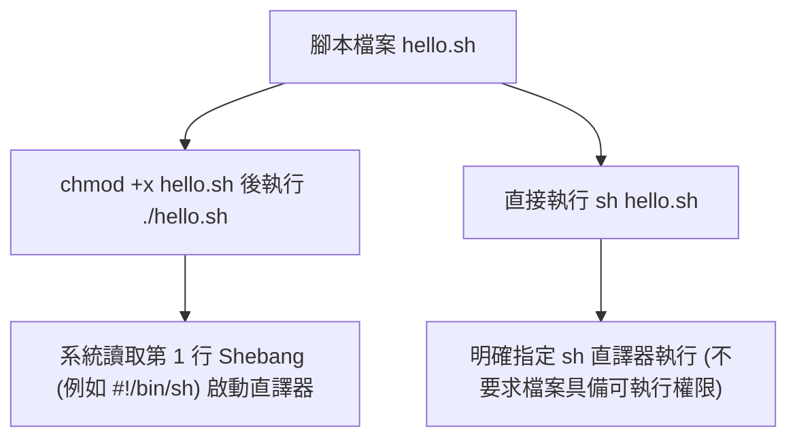
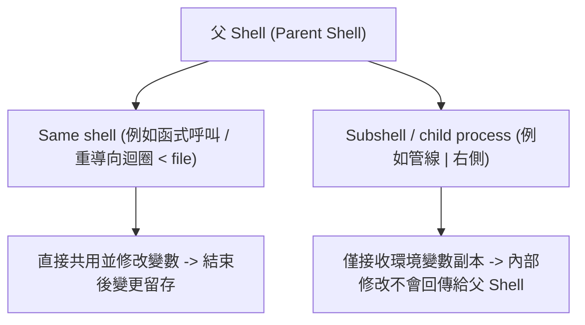
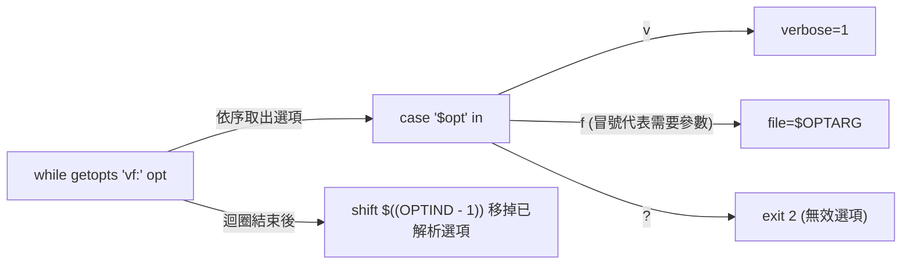
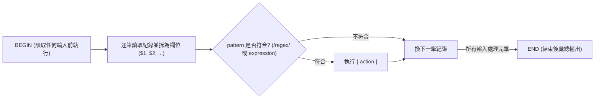

# Shell 腳本設計：流程控制、健壯性與 `sed` / `awk`

> 一句話考試定位摘要：聚焦於以可攜式 POSIX `#!/bin/sh` 撰寫系統管理腳本，掌握安全引用與參數展開、`"$@"` vs `"$*"`、條件測試與管線 Subshell 變數作用域、`getopts`、`trap`/Signal 與除錯追蹤，以及正規表達式（BRE/ERE）搭配 `sed` 與 `awk` 處理文字串流。（`03_Shell_Programming.pdf, p.1-62`）

!!! info "教學型 HTML 簡報"
    想從零開始透過翻頁簡報循序理解本單元基本概念，請點此：[開啟教學型 HTML 簡報（新分頁）](slides/shell-programming.html){ target="_blank" }。

## 學習目標與課程原則

- **來源簡報**：`03_Shell_Programming.pdf`（共 62 頁；NYCU CS IT Center，*Shell Programming — Portable shell scripting, control flow, robustness, sed, and awk*）。（`03_Shell_Programming.pdf, p.1`）
- **五大核心能力（What You Will Learn）**：
  1. 使用 `/bin/sh` 語法與安全引號（safe quoting）撰寫具可攜性的 Shell 腳本。（`03_Shell_Programming.pdf, p.2`）
  2. 運用變數、位置參數（positional parameters）、條件測試、算術與流程控制結構。（`03_Shell_Programming.pdf, p.2`）
  3. 以函式（functions）與 `getopts` 結構化腳本；理解結束狀態碼（exit status）與訊號（signals）。（`03_Shell_Programming.pdf, p.2`）
  4. 透過追蹤執行（tracing）與 `ShellCheck` 除錯，並安全清理暫存資源。（`03_Shell_Programming.pdf, p.2`）
  5. 運用正規表達式（regular expressions）、`sed` 與 `awk` 建構實用的文字處理管線。（`03_Shell_Programming.pdf, p.2`）
- **課程主軸（Roadmap & Emphasis）**：分成 **Shell language**（直譯器與 Shebang、變數與引號、參數與測試、算術與流程控制）與 **Robust scripting**（函式與選項、Exit status 與 Signals、除錯與 `ShellCheck`、Regex/`sed`/`awk`）兩大主軸；核心原則是**寧可寫出可攜、易讀且行為可預測的程式碼，也不要追求聰明卻難懂的單行指令**，並一律以實際管理系統上的 `man` 手冊為準。（`03_Shell_Programming.pdf, p.2-3, 62`）

---

## 1. 腳本基礎、Shebang 與執行方式

### 1.1 為何撰寫 Shell 腳本與目標 Shell 選擇
- **Shell 的核心定位**：Shell 是一個直譯器（interpreter），逐行讀取並將腳本當作指令執行，非常適合自動化重複的命令列工作（系統管理、部署、監控、批次作業），並透過管線、重導向與結束狀態碼把現有工具黏合起來。（`03_Shell_Programming.pdf, p.5`）
- **經驗法則（Rule of thumb）**：**當真正的工作多半由現有指令完成時，Shell 最能發揮威力**。（`03_Shell_Programming.pdf, p.5`）
- **課程目標（POSIX 風格 `sh`）**：使用 `#!/bin/sh` 確保在 Debian 與眾多類 Unix 系統間的可攜性；除非明確教學或指定，否則避開特定 Shell 擴充語法（例如 `bash` 的許多擴充功能與陣列、`zsh` 的腳本擴充）。（`03_Shell_Programming.pdf, p.6`）
- **重要觀念**：`/bin/sh` 是一個**介面規範（interface）**，未必等同於歷史上的 Bourne shell，其實作會依作業系統而異。（`03_Shell_Programming.pdf, p.6`）

### 1.2 第一支腳本與 Shebang 執行機制
```sh
#!/bin/sh

for i in 1 2 3; do
    printf 'Hello world %s\n' "$i"
done
```
（來源：`03_Shell_Programming.pdf, p.7`）

- 第一行 `#!`（Shebang）用來指定直譯器。（`03_Shell_Programming.pdf, p.7-8`）
- 變數展開一律加雙引號（例如 `"$i"`），除非刻意需要斷詞（word splitting）或檔名展開（globbing）。（`03_Shell_Programming.pdf, p.7`）
- 在格式化輸出時，**`printf` 比 `echo` 更可預測（more predictable）**。（`03_Shell_Programming.pdf, p.7`）

```sh
# 方式 A：賦予執行權限後透過 Shebang 執行
$ chmod +x hello.sh
$ ./hello.sh
Hello world 1
Hello world 2
Hello world 3

# 方式 B：明確指定直譯器（不需要 executable bit）
$ sh hello.sh
```
（來源：`03_Shell_Programming.pdf, p.8`）


（來源：`03_Shell_Programming.pdf, p.8`）

!!! tip "本單元考點"
    1. **`#!/bin/sh` vs `#!/usr/bin/env bash`**：`#!/bin/sh` 是系統腳本的可攜預設值；`#!/usr/bin/env bash` 會透過 `PATH` 尋找 Bash，但這代表 **`PATH` 會影響實際執行哪個直譯器**，因此在重視可重現性（reproducibility）時應使用**絕對直譯器路徑**。（`03_Shell_Programming.pdf, p.8`）
    2. **`printf` 優先於 `echo`**：不管格式化輸出（p.7）或互動提示（p.29），可攜腳本一律優先用 `printf`。（`03_Shell_Programming.pdf, p.7, 29`）

!!! note "投影片未展開"
    - 投影片指出 `/bin/sh` 實作因系統而異，並未點名 Debian Linux 上 `/bin/sh` 對應的具體底層程式套件。（`03_Shell_Programming.pdf, p.6`）

---

## 2. 變數、參數展開與位置參數

### 2.1 變數、引號與指令替換核心複習
| 用途 / 寫法 | 行為與作用域 | 範例 |
| :--- | :--- | :--- |
| `name=value` | Shell 變數（僅目前 Shell 可見；**`=` 兩側不可有空白**） | `name='shell programming'`（`p.10`） |
| `export name=value` | 環境變數（會被子行程繼承） | `export PAGER=/usr/bin/less`（`p.10`） |
| `"$name"` / `"${name}"` | 依使用時機展開變數 | `printf '%s\n' "$name"`（`p.10`） |
| `'text'` vs `"text"` vs unquoted | 單引號完全字面保留；雙引號允許變數與指令替換；未加引號可能觸發斷詞與路徑展開 | 最佳實踐：引用 `"$var"`、`"$(command)"`、`"$@"`（`p.11`） |
| `$(command)` | 指令替換：擷取 `stdout` 並**移除尾端換行**；比舊式反引號更清楚且易巢狀 | `month=$(date +%m)`、`count=$(wc -l < /etc/passwd)`（`p.10, 12`） |

### 2.2 參數展開：預設值與防呆檢查（Defaults and Checks）
當變數**未設定（unset）或為空字串（empty）**時，可直接在展開過程中處理預設值或中止：（`03_Shell_Programming.pdf, p.13`）

| 展開語法 | 當 `var` 未設定或為空時的行為 |
| :--- | :--- |
| `${var:-default}` | 使用 `default` 作為展開結果，但**不賦值給 `var`**（`03_Shell_Programming.pdf, p.13`） |
| `${var:=default}` | **將 `default` 賦值給 `var`**，再使用該值（`03_Shell_Programming.pdf, p.13`） |
| `${var:?message}` | 將 `message` 印到 `stderr` 並**中止此次展開（abort）**（`03_Shell_Programming.pdf, p.13`） |
| `${var:+alternate}` | 僅在 `var` **已設定且非空**時，才改用 `alternate`（`03_Shell_Programming.pdf, p.13`） |

```sh
config=${CONFIG_FILE:-/etc/myapp.conf}
: "${HOME:?HOME must be set}"
```
（來源：`03_Shell_Programming.pdf, p.13`）

### 2.3 參數展開：字串長度與前後綴裁切（String Operations）
不需呼叫外部程式（如 `cut`、`basename`），即可在 Shell 內完成基本字串處理：（`03_Shell_Programming.pdf, p.14`）

| 展開語法 | 結果說明 |
| :--- | :--- |
| `${#var}` | 取得字串長度（`03_Shell_Programming.pdf, p.14`） |
| `${var#pattern}` | 從開頭移除**最短**符合的前綴（prefix）（`03_Shell_Programming.pdf, p.14`） |
| `${var##pattern}` | 從開頭移除**最長**符合的前綴（prefix）（`03_Shell_Programming.pdf, p.14`） |
| `${var%pattern}` | 從結尾移除**最短**符合的後綴（suffix）（`03_Shell_Programming.pdf, p.14`） |
| `${var%%pattern}` | 從結尾移除**最長**符合的後綴（suffix）（`03_Shell_Programming.pdf, p.14`） |

```sh
path=/var/log/system.log
base=${path##*/}   # system.log（從左去除最長匹配 */）
stem=${base%.log}  # system（從右去除最短匹配 .log）
```
（來源：`03_Shell_Programming.pdf, p.14`）

### 2.4 位置參數與 `"$@"` vs `"$*"`
| 參數 | 意義說明 |
| :--- | :--- |
| `$0` | 腳本名稱（`03_Shell_Programming.pdf, p.15`） |
| `$1, $2, ...` | 位置參數（Positional arguments，**從 `$1` 開始**）（`03_Shell_Programming.pdf, p.15`） |
| `$#` | 傳入的位置參數個數（`03_Shell_Programming.pdf, p.15`） |
| `$?` | 最近一個執行指令的結束狀態碼（`03_Shell_Programming.pdf, p.15`） |
| `$$` | 目前 Shell 的 PID（`03_Shell_Programming.pdf, p.15`） |
| `$!` | 最近一個背景管線的 PID（例：`./my_web_server & echo $! > /var/run/my_server.pid`）（`03_Shell_Programming.pdf, p.15`） |

當腳本收到 3 個參數 `one`、`"two words"`、`three` 時，**`"$@"` 與 `"$*"` 的展開結果截然不同**：（`03_Shell_Programming.pdf, p.16`）

```sh
# 假設腳本收到三個參數：one  "two words"  three

for x in "$@"; do
    printf '<%s>\n' "$x"
done
# 輸出保留原始三個參數邊界：
# <one>
# <two words>
# <three>

printf '<%s>\n' "$*"
# 輸出合併成單一字串：
# <one two words three>
```
（來源：`03_Shell_Programming.pdf, p.16`）

!!! tip "本單元考點"
    1. **轉傳參數必用 `"$@"`**：需要保留每個參數原本的邊界（特別是含空白的參數）時，永遠使用 `"$@"`。（`03_Shell_Programming.pdf, p.16`）
    2. **參數展開前後綴口訣**：`#` 在鍵盤上於 `$` 左邊代表去**左（prefix）**，`%` 在右邊代表去**右（suffix）**；單個符號去最短、雙符號（`##` / `%%`）去最長。（`03_Shell_Programming.pdf, p.14`）
    3. **位置參數起點**：`$0` 是腳本名稱，真正的命令列參數從 `$1` 開始。（`03_Shell_Programming.pdf, p.15`）

---

## 3. 條件測試、算術與流程控制

### 3.1 Exit Status 與 `test` / `[ ... ]` 語法規則
- 每個指令都回傳一個整數結束狀態碼：**`0` 代表成功（真）**，**非 `0` 代表失敗或特殊條件（假）**；`if`、`&&`、`||` 皆依據 `$?` 做決策（例如 `grep -q '^root:' /etc/passwd`）。（`03_Shell_Programming.pdf, p.18, 25`）
- **`[` 本身是一個指令**，而結尾的 **`]` 是必備的參數**；因此 **`[`、運算子與 `]` 周圍都必須有空白**，且測試內的變數展開務必加上雙引號（例如 `[ "$mode" = production ]` 即使在 `$mode` 為空字串時依然安全）。（`03_Shell_Programming.pdf, p.19`）

```sh
test -f /etc/passwd
printf '%s\n' "$?"

[ -f /etc/passwd ]
printf '%s\n' "$?"
```
（來源：`03_Shell_Programming.pdf, p.19`）

### 3.2 檔案測試、字串測試與整數比較
| 測試類別 | 運算子 / 寫法 | 成立條件（True when...） |
| :--- | :--- | :--- |
| **檔案測試**（`p.20`） | `-e file` / `-f file` / `-d file` / `-L file` | 路徑存在 / 一般檔案 / 目錄 / 符號連結（symbolic link） |
| **檔案權限與大小**（`p.20`） | `-r` / `-w` / `-x` / `-s file` | 可讀 / 可寫 / 可執行 / 存在且大小大於零 |
| **檔案時間**（`p.20`） | `file1 -nt file2` | `file1` 比 `file2` 更新（newer than） |
| **字串長度**（`p.21`） | `-z "$s"` / `-n "$s"` | 字串長度為零 / 字串長度非零 |
| **字串相等**（`p.21`） | `"$a" = "$b"` / `"$a" != "$b"` | 兩字串相等 / 兩字串不同（**POSIX `sh` 請用 `=` 而非 `==`**） |
| **整數比較**（`p.22`） | `-eq` / `-ne` / `-gt` / `-ge` / `-lt` / `-le` | 等於 / 不等 / 大於 / 大於等於 / 小於 / 小於等於 |

### 3.3 組合條件、算術展開與分支（`if` / `case`）
- **組合條件**：使用 Shell 層級的 **`&&` 與 `||`** 連接多個 `[ ... ]` 測試，**不要使用 `[ ... ]` 內部的 `-a` 與 `-o`**（兩者在歷史上具有歧義）。（`03_Shell_Programming.pdf, p.23`）

```sh
[ -f "$cfg" ] && printf 'config exists\n'
[ -d "$dir" ] || mkdir -p "$dir"

if [ -r "$file" ] && [ -s "$file" ]; then
    process "$file"
fi
```
（來源：`03_Shell_Programming.pdf, p.23`）

- **算術展開 `$(( ... ))`**：在 Shell 內進行**整數（integer）**運算；在算術展開括號內的變數名稱通常不需加 `$`，寫法比呼叫外部 `expr` 更清楚。（`03_Shell_Programming.pdf, p.24`）

```sh
count=8
count=$((count + 9))
count=$((count * 2))
printf '%s\n' "$count"
```

- **`if / elif / else` 與 `case`**：（`03_Shell_Programming.pdf, p.25-26`）

```sh
if [ "$mode" = production ]; then
    start_prod
elif [ "$mode" = test ]; then
    start_test
else
    printf 'Unknown mode: %s\n' "$mode" >&2
    exit 2
fi

case "$answer" in
    [Yy]|[Yy][Ee][Ss])
        printf 'yes\n'
        ;;
    [Nn]|[Nn][Oo])
        printf 'no\n'
        ;;
    *)
        printf 'invalid input\n' >&2
        ;;
esac
```

### 3.4 迴圈安全寫法、互動輸入與暫存目錄清理
- **`for` 迴圈**：可明確列舉小集合（`for x in red green blue; do ...; done`）或直接用檔名萬用字元（`for f in *.log; do ...; done`，視需要處理無符合檔案情境）。（`03_Shell_Programming.pdf, p.27`）
- **`while IFS= read -r` 與管線 Subshell 陷阱**：（`03_Shell_Programming.pdf, p.28`）

```sh
# 正確：IFS= 保留行首尾空白，read -r 防止反斜線被轉義；以 < 重導向維持在同一 Shell
while IFS= read -r line; do
    printf 'line: %s\n' "$line"
done < input.txt

# 錯誤示範：管線會開啟 Subshell，迴圈結束後 $count 永遠是 0！
count=0
cat data.txt | while read -r line; do
    count=$((count + 1))
done
echo "Total lines: $count"   # always 0
```

- **安全讀取互動輸入**：（`03_Shell_Programming.pdf, p.29`）
  1. 用 `printf` 取代 `echo -n` 顯示可攜提示訊息。
  2. 當使用者輸入非預期內容時，預設採行**較安全的動作**（例如預設不刪除 `[y/N]`）。
  3. 當指令支援 `--`（option terminator）時，在檔名前加上 `--` 避免檔名開頭為 `-` 被當成選項。

```sh
printf "Delete temporary files? [y/N] "
IFS= read -r answer
case "$answer" in
    [Yy]|[Yy][Ee][Ss])
        rm -f -- "$tmpfile"
        ;;
    *)
        printf 'Cancelled\n'
        ;;
esac
```

- **暫存檔案與目錄安全模式**：讓 `mktemp` 產生唯一名稱，將暫存檔集中於專屬私有暫存目錄內，並**在建立後立刻以 `trap` 註冊清理動作**。（`03_Shell_Programming.pdf, p.30`）

```sh
tmpdir=$(mktemp -d) || exit 1
trap 'rm -rf "$tmpdir"' EXIT HUP INT TERM

tmpfile=$tmpdir/output.txt
printf 'program output\n' > "$tmpfile"
```

!!! tip "本單元考點"
    1. **POSIX 字串測試**：不可在 `[ ... ]` 中使用 `==`（應用 `=`），且避免在 `[ ... ]` 內用 `<` / `>` 比較字串順序。（`03_Shell_Programming.pdf, p.21`）
    2. **`case` 使用的是 Shell Glob 語法**，**不是正規表達式**；且在可攜 `sh` 中每個分支都以 `;;` 結束。（`03_Shell_Programming.pdf, p.26`）
    3. **為何要寫 `while IFS= read -r`**：`IFS=` 避免修剪行首／行尾空白；`-r` 防止反斜線被直譯。（`03_Shell_Programming.pdf, p.28`）

!!! warning "本單元常見陷阱"
    1. **`for f in $(ls)` 必炸陷阱**：會因為檔名中的空白、Tab、換行與萬用字元而斷裂；永遠直接用 `for f in *.log`。（`03_Shell_Programming.pdf, p.27`）
    2. **`cat file | while ...` 變數修改消失**：管線右側會在 Subshell 中執行，內部對變數的遞增在迴圈結束後完全不會影響外層變數；需要保留變數結果時應改用 `< input.txt` 重導向輸入。（`03_Shell_Programming.pdf, p.28, 33`）

!!! note "投影片未展開"
    - 投影片提醒 `for f in *.log` 應「視需要處理沒有任何檔案符合（no-match）的情況」，未展開具體處理寫法（例如檢查 `[ -e "$f" ] || continue`）。（`03_Shell_Programming.pdf, p.27`）

---

## 4. 函式、作用域、Subshell 與 `getopts`

### 4.1 函式定義、參數與 `return` 觀念
```sh
log() {
    printf '[%s] %s\n' "$(date +%H:%M:%S)" "$*"
}

copy_if_readable() {
    [ "$#" -eq 2 ] || return 2
    [ -r "$1" ] || return 3
    cp -- "$1" "$2"
}

log 'service started'
copy_if_readable source.txt backup.txt
status=$?
```
（來源：`03_Shell_Programming.pdf, p.32, 34`）

- 函式必須在**首次呼叫之前定義**。（`03_Shell_Programming.pdf, p.32`）
- 函式擁有自己獨立的位置參數（`$1, $2, ...` 與 `$#`），使用前應先驗證參數數量。（`03_Shell_Programming.pdf, p.32, 34`）
- 函式預設**共用外部的 Shell 變數**，除非該 Shell 實作額外提供了非 POSIX 的區域變數機制（`local`）。（`03_Shell_Programming.pdf, p.32`）
- **`return` 只設定結束狀態碼（`0–255`），不是一般程式語言的任意回傳值**；若要從函式回傳文字資料，應寫入 **`stdout`**（配合 `$(...)` 擷取）。（`03_Shell_Programming.pdf, p.34`）

### 4.2 Same Shell vs Subshell 作用域差異
| 執行環境 | 變數可見與修改行為 |
| :--- | :--- |
| **Same shell**（如一般函式呼叫、`< input.txt` 重導向迴圈） | 函式或迴圈內的賦值可直接修改呼叫端變數；`export` 僅標記為環境變數；**變動在返回後依然留存**（`03_Shell_Programming.pdf, p.33`） |
| **Subshell / child process**（如管線中的命令） | 僅收到已匯出（exported）變數的副本；**內部任何變數修改都不會回傳給父行程**（`03_Shell_Programming.pdf, p.33`） |


（來源：`03_Shell_Programming.pdf, p.28, 33`）

### 4.3 使用 `getopts` 解析命令列選項
```sh
verbose=0
file=
while getopts 'vf:' opt; do
    case "$opt" in
        v) verbose=1 ;;
        f) file=$OPTARG ;;
        ?) exit 2 ;;
    esac
done
shift $((OPTIND - 1))
```
（來源：`03_Shell_Programming.pdf, p.35`）


（來源：`03_Shell_Programming.pdf, p.35`）

- 選項字母後方加上冒號（如 `f:`）代表該選項**需要一個參數**；該參數值會存入 `$OPTARG`。（`03_Shell_Programming.pdf, p.35`）
- `$OPTIND` 指向下一個待處理的參數索引；解析結束後必須執行 `shift $((OPTIND - 1))`，才能讓接下來的 `$1, $2, ...` 對準剩餘的非選項參數。（`03_Shell_Programming.pdf, p.35`）

!!! tip "本單元考點"
    1. **可攜設計準則**：絕對不要依賴管線內部對變數所做的修改能在管線結束後被看到。（`03_Shell_Programming.pdf, p.33`）
    2. **`return` vs `stdout`**：函式回傳成敗代碼用 `return`（0–255）；回傳字串資料用 `printf` 到 `stdout`。（`03_Shell_Programming.pdf, p.34`）
    3. **`getopts` 關鍵三寶**：`:`（需要選項參數）、`$OPTARG`（當前選項參數值）、`shift $((OPTIND - 1))`（清除已處理選項）。（`03_Shell_Programming.pdf, p.35`）

!!! note "投影片未展開"
    - 投影片提及部分 Shell 具有非 POSIX 的 `local` 機制，但刻意不展開其語法以維持 POSIX `sh` 可攜範圍。（`03_Shell_Programming.pdf, p.32`）

---

## 5. 健壯腳本、Signal 處理與除錯

### 5.1 錯誤處理原則與 Shell Options（`set -u` / `set -x`）
- **錯誤處理四原則**：檢查真正關鍵的失敗而非假設每步都會成功；將診斷訊息送至 **`stderr`（`printf ... >&2`）**；對無效輸入或操作失敗回傳有意義的非零結束碼；**不要用長管線或未檢查的指令替換掩蓋指令失敗**。（`03_Shell_Programming.pdf, p.37`）

```sh
if ! cp -- "$src" "$dst"; then
    printf 'copy failed: %s -> %s\n' "$src" "$dst" >&2
    exit 1
fi
```
執行腳本時可分離正常輸出與錯誤紀錄：`./your_script.sh > output.log 2> error.log`。（`03_Shell_Programming.pdf, p.37`）

| 選項 | 效果 | 注意事項（Caution） |
| :--- | :--- | :--- |
| `set -u` | 展開未設定的變數時直接視為錯誤（例：`PORT: unbound variable`） | 對選擇性變數搭配預設值，如 `APP_PORT=${PORT:-8080}`（`03_Shell_Programming.pdf, p.38`） |
| `set -x` | 在展開之後、執行之前印出完整指令（以 `+ ` 開頭） | **可能把密碼、Token 或機密印進日誌**（`03_Shell_Programming.pdf, p.38, 41`） |

- **課程建議**：對重要操作使用明確檢查；審慎理解並刻意使用 Shell options，不要把它們當成萬能魔法安全開關。（`03_Shell_Programming.pdf, p.38`）

### 5.2 `trap` 清理與常見 Signals
```sh
tmpdir=$(mktemp -d) || exit 1
cleanup() {
    rm -rf "$tmpdir"
}
trap cleanup EXIT HUP INT TERM
```
（來源：`03_Shell_Programming.pdf, p.39`）

- `EXIT` 適合用於腳本正常結束時的通用清理；撰寫 `trap` 應使用**訊號名稱（如 `HUP`、`INT`、`TERM`）**以提高可讀性，避免使用數字代號。（`03_Shell_Programming.pdf, p.39`）

| Signal | 常見意義 | 能否被捕捉（Catchable?） |
| :--- | :--- | :--- |
| `SIGHUP` | 終端機／工作階段結束，或作為重新載入設定（reload）慣例 | **Yes**（`03_Shell_Programming.pdf, p.40`） |
| `SIGINT` | 來自 `Ctrl+C` 的中斷訊號 | **Yes**（`03_Shell_Programming.pdf, p.40`） |
| `SIGQUIT` | 來自終端機的退出訊號 | **Yes**（`03_Shell_Programming.pdf, p.40`） |
| `SIGTERM` | 禮貌性的終止請求 | **Yes**（`03_Shell_Programming.pdf, p.40`） |
| `SIGKILL` | 立即強制終止 | **No**（**不可捕捉或忽略**，`03_Shell_Programming.pdf, p.39-40`） |
| `SIGSTOP` | 暫停行程 | **No**（**不可捕捉或忽略**，`03_Shell_Programming.pdf, p.39-40`） |

### 5.3 追蹤除錯（Tracing）與 `ShellCheck` 工作流程
- **Tracing**：在命令列執行 `sh -x script.sh` 可於展開後、執行前印出實際命令（以 `+` 標示）；或在腳本內部以 `set -x` 開啟、以 `set +x` 關閉。（`03_Shell_Programming.pdf, p.41`）
- **`ShellCheck`**：靜態分析工具（`shellcheck script.sh`），能抓出常見引號漏寫、可疑展開、可攜性問題與無法到達的程式碼；應把警告當成「需要調查的說明」而非盲從改寫。（`03_Shell_Programming.pdf, p.42`）


（來源：`03_Shell_Programming.pdf, p.42`）

!!! warning "本單元常見陷阱"
    1. **`SIGKILL` 與 `SIGSTOP` 無法用 `trap` 攔截**：即使寫了 `trap cleanup ...`，遇到 `SIGKILL` 強制終止仍不會觸發清理函式。（`03_Shell_Programming.pdf, p.39-40`）
    2. **`set -x` / `sh -x` 外洩機密風險**：因為展開後的變數內容都會直接印出，除錯含密碼或 API Token 的腳本時務必特別小心。（`03_Shell_Programming.pdf, p.38, 41`）

!!! note "投影片未展開"
    - 投影片未列出除 `set -u`、`set -x` 以外的其他 `set` 選項（如遇錯中止類旗標）。（`03_Shell_Programming.pdf, p.38`）

---

## 6. 正規表達式（Regular Expressions）

### 6.1 核心概念與 Shell Globbing 的區別
- 正規表達式（Regular Expression）用來描述**一組字串集合**，核心由三大運算構成：**串接（Concatenation）**（依序排列）、**選擇（Alternation）**（多選一）與**重複（Repetition）**（多次匹配）。（`03_Shell_Programming.pdf, p.44`）
- **兩種截然不同的樣式語言**：**Shell globbing（如 `*.log`）用來選擇檔案路徑名稱**；**Regular expressions 用來匹配資料內部的文字**，切勿混淆。（`03_Shell_Programming.pdf, p.44`）

### 6.2 常見 ERE 運算子與判讀原則
| 運算子 | 意義 | 範例 |
| :--- | :--- | :--- |
| `.` | 任意單一字元（`03_Shell_Programming.pdf, p.45`） | `r.n` |
| `[abc]` | 集合中任一字元（`03_Shell_Programming.pdf, p.45`） | `[Yy]` |
| `[^abc]` | **不在**集合中的任一字元（`03_Shell_Programming.pdf, p.45`） | `[^0-9]` |
| `^` / `$` | 行首 / 行尾錨點（anchor）（`03_Shell_Programming.pdf, p.45`） | `^root:` |
| `*` | 零次或多次（`03_Shell_Programming.pdf, p.45`） | `ab*` |
| `+` | 一次或多次（`03_Shell_Programming.pdf, p.45`） | `[0-9]+` |
| `?` | 零次或一次（`03_Shell_Programming.pdf, p.45`） | `colou?r` |
| `{m,n}` | 重複次數範圍（`03_Shell_Programming.pdf, p.45`） | `[0-9]{2,4}` |

範例與閱讀方式（由左至右閱讀：錨點限制位置、字元類別限制單一字元、重複運算子修飾前一個元素）：（`03_Shell_Programming.pdf, p.46`）

```text
^John              # 以 John 開頭的行
[Ee][Nn][Dd]$      # 以 end、End、END 等結尾的行
^[A-Za-z0-9_]+$    # 整行由一個或多個字母、數字或底線組成
```

### 6.3 BRE、ERE 與工具方言差異
| 工具 | 預設正規方言 | 延伸形式 |
| :--- | :--- | :--- |
| `grep` | BRE（基本正規表達式） | `grep -E`（`03_Shell_Programming.pdf, p.47`） |
| `sed` | BRE（基本正規表達式） | `sed -E`（現代 GNU 等系統常見）（`03_Shell_Programming.pdf, p.47`） |
| `awk` | **ERE**（延伸正規表達式） | **內建即是 ERE**（`03_Shell_Programming.pdf, p.47`） |

!!! tip "本單元考點"
    1. **Glob vs Regex 否定字元集差異**：Shell globbing 用 `[!abc]`；正規表達式用 `[^abc]`；Shell globbing 管檔名（也包含 `case` 分支），Regex 管資料文字。（`03_Shell_Programming.pdf, p.26, 44-45`）
    2. **教學與除錯必聲明方言**：隨時明確指出使用的工具與正規方言（`grep`/`sed` 預設 BRE，`awk` 內建 ERE）。（`03_Shell_Programming.pdf, p.47`）

!!! note "投影片未展開"
    - 投影片僅列 ERE 運算子表與工具方言表，未逐一展開 BRE 中哪些符號（如 `+`、`?`、`{m,n}`）需加反斜線跳脫。（`03_Shell_Programming.pdf, p.45, 47`）

---

## 7. `sed` 與 `awk` 文字串流處理

### 7.1 `sed`：串流編輯器（Stream Editor）
`sed` 一次讀取一行進入當前的 pattern space 套用編輯指令，除非加上 **`-n` 抑制自動輸出**，否則會把結果印至 `stdout`；**除非顯式使用原地編輯，否則原始檔案內容不會改變**。（`03_Shell_Programming.pdf, p.49, 51`）

- **位址（Addresses）與列印／刪除**：（`03_Shell_Programming.pdf, p.50-51`）

| 位址寫法 | 選取範圍 | 常見指令範例 |
| :--- | :--- | :--- |
| `10` | 第 10 行（`p.50`） | `sed -e '1,10d' -e 's/yellow/black/g' input.txt`（`p.49`） |
| `/error/` | 符合該 Regex 的行（`p.50`） | `sed -n '/^root:/p' /etc/passwd`（`-n` 配 `p` 只印選中行，`p.51`） |
| `10,20` | 第 10 行至第 20 行（`p.50`） | `sed '10,20d' file.txt`（刪除範圍行，`p.50`） |
| `10,/END/` | 從第 10 行到下一個匹配 `END` 的行（`p.50`） | `sed '/^#/d' file.txt`（刪除註解行，`p.50-51`） |

- **替換（Substitution）與旗標**：（`03_Shell_Programming.pdf, p.52`）

```sh
sed 's/old/new/' file.txt               # 每行僅替換第一個匹配項目
sed 's/old/new/g' file.txt              # g：替換該行所有匹配項目
sed -n 's/error/ERROR/p' log.txt        # p：僅在替換成功時印出該行（搭配 -n）
# 旗標 N：僅替換該行第 N 次出現的匹配項目
```

- **插入（`i`）、附加（`a`）、取代整行（`c`）**：`i` 在選中行**之前**插入、`a` 在選中行**之後**附加、`c` 取代整行；複雜轉換應把 `sed` 程式寫在獨立檔案中。（`03_Shell_Programming.pdf, p.53`）

```text
# sed script file
/^ERROR/i\
--- important event follows ---

/^END/a\
--- section complete ---
```

### 7.2 `awk`：`pattern { action }` 資料流模型
`awk` 將輸入切為紀錄（records，通常為每一行），再將每筆紀錄拆為欄位（fields）。**省略 `pattern` 代表「套用到每筆紀錄」；省略 `{ action }` 代表「印出該紀錄」**。（`03_Shell_Programming.pdf, p.54`）


（來源：`03_Shell_Programming.pdf, p.54-55`）

- **`awk` 常用模式與內建變數**：（`03_Shell_Programming.pdf, p.55-56`）

| 類別 | 項目 | 說明 |
| :--- | :--- | :--- |
| **Patterns**（`p.55`） | `/regex/` / `expression` | 紀錄符合正規式 / 運算式求值為真（例：`awk '$3 > 1000 {print $1}' file.txt`） |
| **特殊區塊**（`p.55`） | `BEGIN` / `END` | 讀取輸入前執行 / 全部輸入處理完後執行 |
| **內建變數**（`p.56`） | `$0` / `$1, $2, ...` | 整筆目前紀錄 / 目前紀錄的各欄位 |
| **內建變數**（`p.56`） | `NF` / `NR` / `FILENAME` | 目前紀錄的欄位數 / 目前紀錄編號 / 目前輸入檔名 |
| **分隔符變數**（`p.56`） | `FS` / `OFS` | 輸入欄位分隔符 / 輸出欄位分隔符 |

```sh
# 統計錯誤數並搭配 BEGIN / END
awk 'BEGIN { print "start" }
     /error/ { count++ }
     END { print count }' log.txt

# 處理 /etc/passwd（-F: 指定冒號為分隔符）
awk -F: '$1 == "root" {
    print "uid=" $3, "home=" $6, "shell=" $7
}' /etc/passwd
```
（來源：`03_Shell_Programming.pdf, p.55, 57`）

- 當「挑選條件」與「欄位邏輯」屬於同一件事時，**用一個 `awk` 通常比串一長串 `grep + cut` 更清晰**。（`03_Shell_Programming.pdf, p.57`）

!!! note "投影片未展開"
    - 投影片提及 `sed` 可顯式使用原地編輯（in-place editing）與將複雜 `sed` 程式放進獨立檔案，但未列出具體旗標寫法，亦未展開 `sed` hold space 等進階緩衝區。（`03_Shell_Programming.pdf, p.51, 53`）

---

## 8. 實戰案例重構與撰寫檢查清單

### 8.1 案例研究：檢查主機是否回應（Fragile vs Better Approach）
| 寫法類型 | 實作方式與問題（`03_Shell_Programming.pdf, p.59`） |
| :--- | :--- |
| **脆弱寫法（Fragile approach）** | 解析給人類閱讀的 `ping` 統計文字、寫入可預測的暫存檔名、變數不加引號、針對單一 `ping` 實作硬編碼郵件解析邏輯 |
| **較佳寫法（Better approach）** | **直接使用 `ping` 的結束狀態碼**、驗證恰有 1 個主機參數、引用所有展開、回傳有意義狀態碼並交由排程器決定通知與後續動作 |

```sh
#!/bin/sh
usage() {
    printf 'Usage: %s HOST\n' "$0" >&2
}

[ "$#" -eq 1 ] || { usage; exit 2; }
host=$1

if ping -c 3 "$host" >/dev/null 2>&1; then
    printf '%s is reachable\n' "$host"
    exit 0
else
    printf '%s is unreachable\n' "$host" >&2
    exit 1
fi
```
（來源：`03_Shell_Programming.pdf, p.60`）

- **重構優勢**：不需暫存檔、不依賴受語系（localization）影響的文字解析，並將通知邏輯拆離，讓健康檢查本身保持易測試。（`03_Shell_Programming.pdf, p.60`）

### 8.2 Shell 腳本撰寫檢查清單（Checklist）
1. 選定目標直譯器，並嚴格遵守該語言規範撰寫。（`03_Shell_Programming.pdf, p.61`）
2. 變數展開預設一律加引號；轉傳參數使用 `"$@"`。（`03_Shell_Programming.pdf, p.61`）
3. 檢查關鍵指令的結束狀態碼；將錯誤訊息明確輸出到 `stderr`。（`03_Shell_Programming.pdf, p.61`）
4. 使用安全的迴圈與輸入處理方式，不要解析 `ls` 輸出或依賴 `echo` 的平台怪癖。（`03_Shell_Programming.pdf, p.61`）
5. 善用 `trap` 清理暫存資源。（`03_Shell_Programming.pdf, p.61`）
6. 先執行 `ShellCheck` 靜態分析，再針對真實邊界情況（edge cases）進行測試。（`03_Shell_Programming.pdf, p.61`）
7. 在能讓文字處理邏輯**更清晰**時使用 `sed` 與 `awk`——不只是為了寫得更短。（`03_Shell_Programming.pdf, p.61`）

---

## 跨主題關聯與範圍備註

- **前導主題**：本頁延續並展開 [Shell：命令列、管線與文字處理](shell.md) 中介紹的基礎變數展開、I/O 重導向、Signal 與 `grep`/`sed`/`awk` 概念；建議交互複習。
- **已略過之 FreeBSD / `tcsh` 專屬內容**：依聚焦 Debian Linux 原則，略過 `p.6` 的 FreeBSD 與 `tcsh` 歷史介紹、`p.47` 的 FreeBSD 系統括註與 `p.62` 的 FreeBSD manual pages 參照。
- **投影片未展開彙整**：Debian `/bin/sh` 具體底層實作名稱（p.6）、`for f in *.log` 遇到無匹配項目的具體處理代碼（p.27）、非 POSIX `local` 變數實作語法（p.32）、除 `set -u`/`set -x` 外的其餘 Shell 選項（p.38）、BRE 跳脫規則逐項清單（p.45, 47），以及 `sed` 原地編輯／外部腳本載入旗標與進階空間（p.51, 53）。

## 資料來源

- `03_Shell_Programming.pdf`：p.1–62
