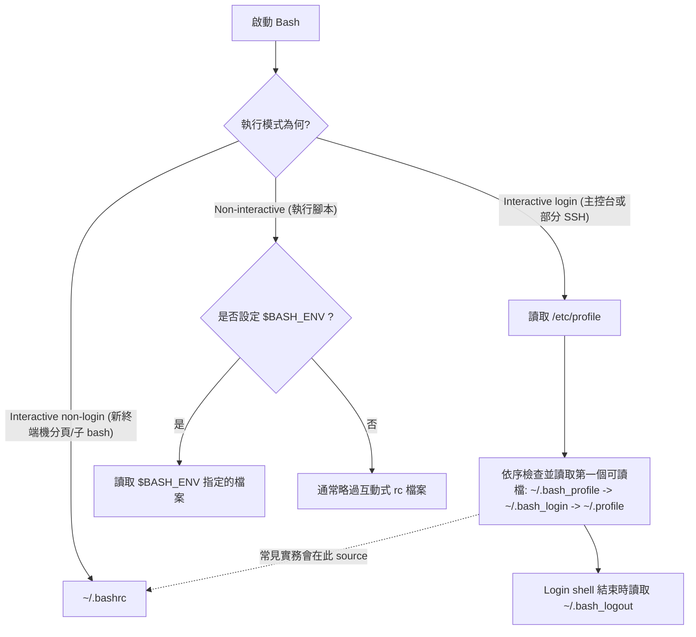

# Shell 執行模式與 Bash 啟動設定檔

> 一句話考試定位摘要：依據 Shell 屬於互動登入（interactive login）、互動非登入（interactive non-login）或非互動（non-interactive）模式，決定系統會讀取哪些啟動設定檔，避免將自動化腳本需要的變數誤放進 `~/.bashrc`。（`03_Shell.pdf, p.9-10`）

## 核心定義與原理

### 1. 三種 Shell 執行模式
修改任何 Shell 設定檔前，必須先判斷執行情境與對應讀取的設定檔類型：（`03_Shell.pdf, p.8-9`）

| Shell 模式 | 典型情境範例 | 影響重點 |
| :--- | :--- | :--- |
| **Interactive login**（互動式登入） | 主控台（Console）登入；部分設定下的 `ssh` 工作階段 | 讀取 **login startup files**（`03_Shell.pdf, p.9`） |
| **Interactive non-login**（互動式非登入） | 開啟新的終端機分頁；在現有 Shell 中再啟動 `bash` | 讀取 **interactive rc files**（`03_Shell.pdf, p.9`） |
| **Non-interactive**（非互動式） | 執行腳本，例如 `./backup.sh` | **通常跳過互動式 rc 檔案**（`03_Shell.pdf, p.9`） |

### 2. Bash 啟動與離開讀取檔案順序
依 GNU Bash Reference Manual「Bash Startup Files」整理，Bash 在不同模式下讀取的設定檔如下：（`03_Shell.pdf, p.10`）

| 模式 | Bash 讀取的檔案 |
| :--- | :--- |
| **Interactive login** | 先讀 `/etc/profile`，接著讀取 `~/.bash_profile`、`~/.bash_login`、`~/.profile` 三者中**第一個可讀取**的檔案（`03_Shell.pdf, p.10`） |
| **Interactive non-login** | `~/.bashrc`（`03_Shell.pdf, p.10`） |
| **Non-interactive** | 若有設定環境變數 `$BASH_ENV`，則讀取該變數指定的檔案（`03_Shell.pdf, p.10`） |
| **Login shell exit** | 登出離開時執行 `~/.bash_logout`（`03_Shell.pdf, p.10`） |

- **常見搭配模式（Typical pattern）**：`~/.bash_profile` 通常會在內部 `source`（載入）`~/.bashrc`，使登入式與非登入式互動工作階段共用相同的互動設定。（`03_Shell.pdf, p.10`）

## 流程與架構圖


（來源：`03_Shell.pdf, p.9-10`）

## 關鍵指令、設定與細節

### 啟動檔常見設定內容（`~/.profile` 或 `~/.bashrc`）
```sh
# ~/.profile or ~/.bashrc
export EDITOR=vim
export PATH="$HOME/bin:$PATH"
alias ll="ls -lah"
```
（來源：`03_Shell.pdf, p.12`）

### 安全編輯啟動檔的四項原則
1. **先閱讀再複製或載入（source）**：在複製或 `source` 任何設定片段前，先閱讀其內容。（`03_Shell.pdf, p.12`）
2. **重大修改前先備份**：避免語法或環境錯誤影響後續登入。（`03_Shell.pdf, p.12`）
3. **明確套用變更**：開啟一個新的 Shell 測試，或以 `source` 明確重新載入該設定檔。（`03_Shell.pdf, p.12`）
4. **區隔全域與個人設定**：將系統層級（system-wide）與單一使用者（per-user）的設定分開維護。（`03_Shell.pdf, p.12`）

## 考點與常見陷阱

!!! tip "考點"
    1. **Bash Interactive login 讀檔邏輯**：先讀 `/etc/profile`，再從 `~/.bash_profile`、`~/.bash_login`、`~/.profile` 依序挑**第一個可讀（first readable）**的檔案，而非三個全部讀取。（`03_Shell.pdf, p.10`）
    2. **Non-interactive 模式讀什麼**：不讀 `~/.bashrc`，而是檢查 `$BASH_ENV`。（`03_Shell.pdf, p.10`）

!!! warning "常見陷阱"
    1. **只把腳本所需變數寫在 `~/.bashrc`**：因為非互動式 Shell 通常跳過互動式 rc 檔，若把腳本必要的環境變數只放在 `~/.bashrc`，該腳本在 `cron`、SSH 自動化或 `systemd` 環境下執行時就會出現不同行為或失敗。（`03_Shell.pdf, p.9`）
    2. **直接使用 `curl | sh` 的風險**：將遠端下載內容直接透過管線送進 Shell 執行會繞過檢視步驟；安全做法應是先下載（Download）、檢視（Inspect）、驗證來源（Verify），最後才執行（Execute）。（`03_Shell.pdf, p.12`）

!!! note "投影片未展開"
    - 投影片未展開 `/etc/profile` 內部預設內容，亦未詳細列出 Debian 在非 login 情境下是否另有系統層級的全域 rc 檔。（`03_Shell.pdf, p.10`）

## 相關頁面

- 所屬簡報總覽：[簡報總覽：Shells（命令列、管線與文字處理）](src-03-shell.md)
- Shell 與環境變數差異：[Shell 變數與環境變數](shell-vs-environment-variables.md)
- 管線與安全觀念：[標準串流、I/O 重導向與管線（Pipelines）](io-redirection-and-pipelines.md)

## 資料來源

- `03_Shell.pdf`：p.8–12
