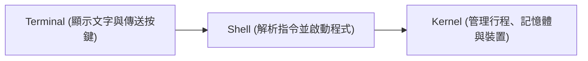
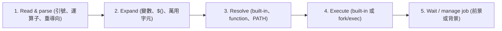

# Terminal、Shell、Kernel 分層與指令執行流程

> 一句話考試定位摘要：區分使用者介面（Terminal）、命令解譯程式（Shell）與系統核心（Kernel）的職責邊界，並掌握按下 Enter 後 Shell 先於外部程式完成語法解析與展開的 5 階段流程。（`03_Shell.pdf, p.4-5`）

## 核心定義與原理

### 1. Terminal、Shell 與 Kernel 三層職責
- **Terminal（終端機）**：負責**顯示文字並傳送按鍵輸入**的使用者介面（user interface）。（`03_Shell.pdf, p.4`）
- **Shell**：**執行在 Terminal 內部的程式**，負責解析指令語法、展開變數與樣式（patterns），再執行內建指令（built-ins）或啟動外部程式。（`03_Shell.pdf, p.4`）
- **Kernel（核心）**：管理行程（processes）、記憶體（memory）與裝置（devices），並提供程式最終使用的系統呼叫（system calls）。（`03_Shell.pdf, p.4`）

### 2. 按下 Enter 後的 5 階段執行流程
當使用者輸入指令（例如 `ls "$HOME"/*.txt | grep report > matches.txt 2> errors.txt`）並按下 Enter，Shell 會依序執行五個步驟，且**會在多數外部程式看到它們的參數之前，就先處理完語法展開**：（`03_Shell.pdf, p.5`）

1. **Read & parse（讀取與解析）**：處理引號（quotes）、運算子（operators）與重導向（redirections）。（`03_Shell.pdf, p.5`）
2. **Expand（展開）**：執行變數展開、指令替換 `$(...)` 與萬用字元（wildcards）。（`03_Shell.pdf, p.5`）
3. **Resolve（解析定位）**：判斷目標為 Shell 內建指令（built-in）、函式（function），或依 `PATH` 搜尋外部指令。（`03_Shell.pdf, p.5`）
4. **Execute（執行）**：直接執行內建指令，或透過 `fork/exec` 建立行程執行外部程式。（`03_Shell.pdf, p.5`）
5. **Wait / manage job（等待或管理工作）**：依前景（foreground）或背景（background）模式管理該工作。（`03_Shell.pdf, p.5`）

## 流程與架構圖

### Terminal → Shell → Kernel 互動分層

（來源：`03_Shell.pdf, p.4`）

### 按下 Enter 後的 5 階段流程

（來源：`03_Shell.pdf, p.5`）

## 關鍵指令、設定與細節

### 常見 Shell 分類與定位
不要假設所有「shell 語法」皆通用；撰寫腳本時必須明確宣告其目標 Shell。（`03_Shell.pdf, p.6`）

| Shell | 家族 / 角色 | 典型路徑 | 備註 |
| :--- | :--- | :--- | :--- |
| `sh` | POSIX 風格 Bourne shell | `/bin/sh` | 腳本的可攜性基準（portable baseline）（`03_Shell.pdf, p.6`） |
| `bash` | Bourne Again Shell | `/bin/bash` | Linux 上常見的互動式 Shell（`03_Shell.pdf, p.6`） |
| `zsh` | Bourne 風格互動式 Shell | `/bin/zsh` | macOS 預設登入 Shell（`03_Shell.pdf, p.6`） |
| `tcsh` | C shell 家族 | `/bin/tcsh` | 常見於 BSD 與舊式環境（`03_Shell.pdf, p.6`） |
| PowerShell | 物件導向自動化 Shell | `pwsh` / `powershell.exe` | 可執行於 Windows、Linux 與 macOS（`03_Shell.pdf, p.6`） |

### Debian 預設 Shell 與驗證方式
- **Debian 一般新使用者預設值**：依 Debian `adduser.conf(5)`，新增一般使用者預設使用 `bash`；而 `/bin/sh` 是獨立的 POSIX 風格 Shell 介面（separate POSIX-style shell interface）。預設設定仍可能因個別使用者或本地政策而改變。（`03_Shell.pdf, p.7`）
- **驗證而非猜測（Check, do not guess）**：（`03_Shell.pdf, p.7`）

```sh
# 查詢帳號設定的登入 Shell（Linux）
getent passwd "$USER"

# 作為輔助提示檢查 SHELL 環境變數
echo "$SHELL"
```

- 基礎工作階段測試範例（確認目前目錄、身分與系統時間）：（`03_Shell.pdf, p.4`）

```sh
$ pwd
/home/tsaimh
$ whoami
tsaimh
$ date
Sun Sep  7 20:00:00 CST 2026
```

## 考點與常見陷阱

!!! tip "考點"
    1. **三層分工**：Terminal 只是介面，Shell 才是執行於其中的解譯程式，Kernel 才真正負責行程、記憶體與系統呼叫。（`03_Shell.pdf, p.4`）
    2. **五階段先後順序**：`Read & parse` → `Expand` → `Resolve` → `Execute` → `Wait / manage job`。因此像 `*.txt`、`$HOME` 與重導向目標都是由 Shell 先展開與設定，外部程式（如 `ls`）拿到的是展開後的結果。（`03_Shell.pdf, p.5`）
    3. **Debian 中的 `bash` vs `/bin/sh`**：Debian 新建一般使用者的預設互動 Shell 為 `bash`，但 `/bin/sh` 是獨立的 POSIX 風格介面，撰寫可攜腳本時應以 `sh` 為基準。（`03_Shell.pdf, p.6-7`）

!!! warning "常見陷阱"
    - 不可僅憑 `echo "$SHELL"` 斷定目前正在執行的 Shell（詳見 [Shell 變數與環境變數](shell-vs-environment-variables.md)），應以系統工具（如 `getent passwd "$USER"`）查驗帳號紀錄。（`03_Shell.pdf, p.7, 15`）

!!! note "投影片未展開"
    - 投影片僅說明 Debian `/bin/sh` 為「獨立的 POSIX 風格 Shell 介面」，並未點名或展開其背後的具體實作套件名稱。（`03_Shell.pdf, p.7`）
    - 第 4 階段提及 `fork/exec` 機制，未展開其底層 C/系統呼叫細節。（`03_Shell.pdf, p.5`）

## 相關頁面

- 所屬簡報總覽：[簡報總覽：Shells（命令列、管線與文字處理）](src-03-shell.md)
- 引號與展開細節：[Shell 引號規則、展開與指令替換](shell-quoting-and-expansion.md)
- 內建指令與外部程式分辨：[內建指令、工作控制、別名與歷史紀錄](shell-builtins-aliases-and-job-control.md)
- `$SHELL` 與環境變數：[Shell 變數與環境變數](shell-vs-environment-variables.md)

## 資料來源

- `03_Shell.pdf`：p.4–7
