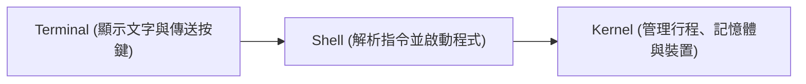
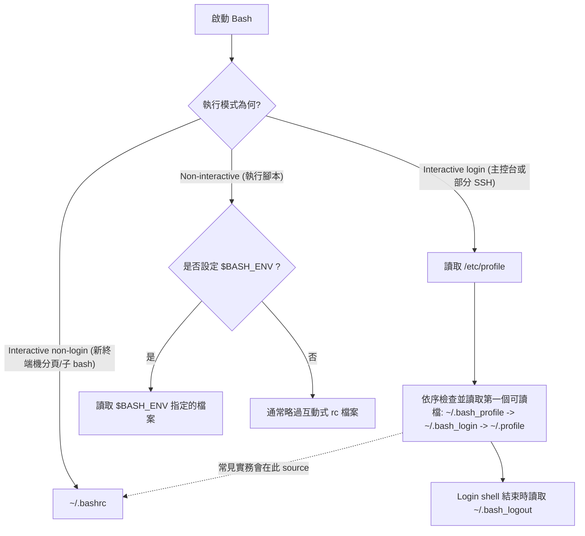
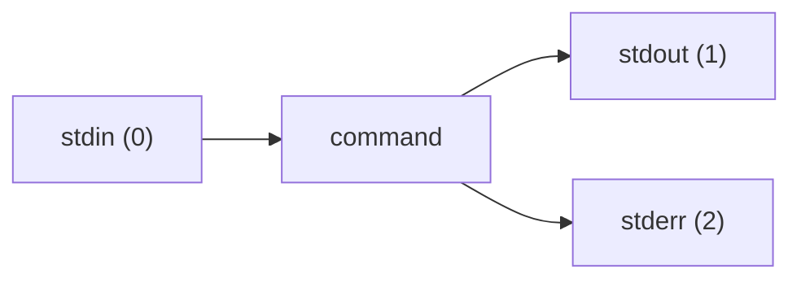
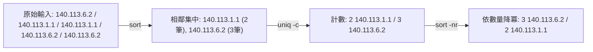

# Shell：命令列、管線與文字處理

> 一句話考試定位摘要：掌握 Terminal / Shell / Kernel 分層與 Enter 後五階段展開順序、Bash 啟動檔與變數引號規則、工作控制與 I/O 重導向順序陷阱，以及 UNIX 小工具管線組合與安全檔名處理。（`03_Shell.pdf, p.1-49`）

!!! info "教學型 HTML 簡報"
    想從零開始透過翻頁簡報循序理解本單元基本概念，請點此：[開啟教學型 HTML 簡報（新分頁）](slides/shell.html){ target="_blank" }。

## 學習目標與課程原則

- **來源簡報**：`03_Shell.pdf`（共 49 頁；NYCU CS IT Center，*Shells — Command-line interfaces, pipelines, and everyday text processing*）。（`03_Shell.pdf, p.1`）
- **五大核心能力（What You Will Learn）**：
  1. 說明 Shell 的角色，以及它與 Terminal（終端機）和 Kernel（核心）的差異。（`03_Shell.pdf, p.2`）
  2. 設定啟動檔（startup files）、變數（variables）、引號規則（quoting）、展開（expansion）、別名（aliases）與工作控制（job control）。（`03_Shell.pdf, p.2`）
  3. 使用重導向（redirection）與管線（pipelines）串接小型 UNIX 工具。（`03_Shell.pdf, p.2`）
  4. 安全地使用 `grep`、`cut`、`awk`、`sort`、`uniq`、`tr`、`sed` 與 `xargs` 處理文字。（`03_Shell.pdf, p.2`）
  5. 辨識 `sh`/`bash`、`tcsh`、`zsh` 與 PowerShell 之間的可攜性（portability）差異。（`03_Shell.pdf, p.2`）
- **課程核心原則（Course Emphasis & Strategy）**：
  - **先學可攜觀念（portable ideas first）**，特定 Shell 的便利語法擺在第二。（`03_Shell.pdf, p.2`）
  - 互動操作可使用系統給予的 Shell，但撰寫可攜腳本時應以 `sh` 為目標（除非作業明確指定其他 Shell）；各指令在特定機器上的權威參考永遠是其 `man` 手冊（manual pages）與平台文件。（`03_Shell.pdf, p.11, 49`）

---

## 1. 基礎架構與指令執行流程

### 1.1 Terminal、Shell 與 Kernel 三層職責
- **Terminal（終端機）**：負責**顯示文字並傳送按鍵輸入**的使用者介面（user interface）。（`03_Shell.pdf, p.4`）
- **Shell**：**執行在 Terminal 內部的程式**，負責解析指令語法、展開變數與樣式（patterns），再執行內建指令（built-ins）或啟動外部程式。（`03_Shell.pdf, p.4`）
- **Kernel（核心）**：管理行程（processes）、記憶體（memory）與裝置（devices），並提供程式最終使用的系統呼叫（system calls）。（`03_Shell.pdf, p.4`）


（來源：`03_Shell.pdf, p.4`）

工作階段基礎指令驗證範例：（`03_Shell.pdf, p.4`）

```sh
$ pwd
/home/tsaimh
$ whoami
tsaimh
$ date
Sun Sep  7 20:00:00 CST 2026
```

### 1.2 按下 Enter 後的 5 階段執行流程
當輸入指令（例如 `ls "$HOME"/*.txt | grep report > matches.txt 2> errors.txt`）並按下 Enter 時，Shell 會先依序處理語法，**在多數外部程式看到它們的參數之前完成展開與重導向設定**：（`03_Shell.pdf, p.5`）

1. **Read & parse（讀取與解析）**：處理引號（quotes）、運算子（operators）與重導向（redirections）。（`03_Shell.pdf, p.5`）
2. **Expand（展開）**：執行變數展開、指令替換 `$(...)` 與萬用字元（wildcards）。（`03_Shell.pdf, p.5`）
3. **Resolve（解析定位）**：判斷目標為 Shell 內建指令（built-in）、函式（function），或依 `PATH` 搜尋外部指令。（`03_Shell.pdf, p.5`）
4. **Execute（執行）**：直接執行內建指令，或透過 `fork/exec` 建立行程執行外部程式。（`03_Shell.pdf, p.5`）
5. **Wait / manage job（等待或管理工作）**：依前景（foreground）或背景（background）模式管理該工作。（`03_Shell.pdf, p.5`）


（來源：`03_Shell.pdf, p.5`）

### 1.3 常見 Shell 分類與 Debian 預設值
不要假設「shell 語法」放諸四海皆準；腳本必須明確宣告其目標 Shell。（`03_Shell.pdf, p.6`）

| Shell | 家族 / 角色 | 典型路徑 | 備註 |
| :--- | :--- | :--- | :--- |
| `sh` | POSIX 風格 Bourne shell | `/bin/sh` | 腳本的可攜性基準（portable baseline）（`03_Shell.pdf, p.6`） |
| `bash` | Bourne Again Shell | `/bin/bash` | Linux 上常見的互動式 Shell（`03_Shell.pdf, p.6`） |
| `zsh` | Bourne 風格互動式 Shell | `/bin/zsh` | macOS 預設登入 Shell（`03_Shell.pdf, p.6`） |
| `tcsh` | C shell 家族 | `/bin/tcsh` | 常見於 BSD 與舊式環境（`03_Shell.pdf, p.6`） |
| PowerShell | 物件導向自動化 Shell | `pwsh` / `powershell.exe` | 可執行於 Windows、Linux 與 macOS（`03_Shell.pdf, p.6`） |

- **Debian 平台預設設定**：依 Debian `adduser.conf(5)`，新增一般使用者預設使用 **`bash`**；而 **`/bin/sh` 是獨立的 POSIX 風格 Shell 介面**（separate POSIX-style shell interface）。各帳號與系統仍可依政策調整設定。（`03_Shell.pdf, p.7`）
- **驗證而非猜測（Check, do not guess）**：（`03_Shell.pdf, p.7`）

```sh
# 查詢帳號實際設定的登入 Shell（Linux）
getent passwd "$USER"

# 將 echo "$SHELL" 僅作為輔助提示
echo "$SHELL"
```

!!! tip "本單元考點"
    1. **三層職責分工**：Terminal 只是介面，Shell 才是執行於其中的解譯程式，Kernel 才負責行程、記憶體與系統呼叫。（`03_Shell.pdf, p.4`）
    2. **五階段先後順序**：Shell 在執行外部程式前就已完成展開（例如 `*.txt`、`$HOME`）與重導向設定。（`03_Shell.pdf, p.5`）
    3. **Debian `bash` vs `/bin/sh`**：Debian 新建一般使用者的預設互動 Shell 是 `bash`，但 `/bin/sh` 是獨立的 POSIX 風格介面。（`03_Shell.pdf, p.7`）

!!! warning "本單元常見陷阱"
    - 不可只憑 `echo "$SHELL"` 認定目前正在運行的 Shell（`$SHELL` 記錄的是設定的登入 Shell，見第 3 單元），應以 `getent passwd "$USER"` 查驗帳號紀錄。（`03_Shell.pdf, p.7, 15`）

!!! note "投影片未展開"
    - 投影片未指明 Debian `/bin/sh` 背後具體指向的實作套件名稱，亦未展開 `fork/exec` 的底層機制。（`03_Shell.pdf, p.5, 7`）

---

## 2. Shell 執行模式與 Bash 啟動設定檔

### 2.1 三種 Shell 執行模式
修改任何 Shell 設定檔前，應先了解不同啟動情境會讀取哪一類設定檔：（`03_Shell.pdf, p.8-9`）

| Shell 模式 | 典型情境範例 | 影響重點 |
| :--- | :--- | :--- |
| **Interactive login**（互動式登入） | 主控台（Console）登入；部分設定下的 `ssh` 工作階段 | 讀取 **login startup files**（`03_Shell.pdf, p.9`） |
| **Interactive non-login**（互動式非登入） | 開啟新的終端機分頁；在現有 Shell 中再啟動 `bash` | 讀取 **interactive rc files**（`03_Shell.pdf, p.9`） |
| **Non-interactive**（非互動式） | 執行腳本，例如 `./backup.sh` | **通常跳過互動式 rc 檔案**（`03_Shell.pdf, p.9`） |

### 2.2 Bash 啟動與離開讀取檔案順序
依 GNU Bash Reference Manual「Bash Startup Files」整理：（`03_Shell.pdf, p.10`）

| 模式 | Bash 讀取的檔案 |
| :--- | :--- |
| **Interactive login** | `/etc/profile`，接著讀取 `~/.bash_profile`、`~/.bash_login`、`~/.profile` 三者中**第一個可讀取**的檔案（`03_Shell.pdf, p.10`） |
| **Interactive non-login** | `~/.bashrc`（`03_Shell.pdf, p.10`） |
| **Non-interactive** | 若環境變數 `$BASH_ENV` 有設定，則讀取該變數指向的檔案（`03_Shell.pdf, p.10`） |
| **Login shell exit** | 登出離開時讀取 `~/.bash_logout`（`03_Shell.pdf, p.10`） |

- **常見實務模式（Typical pattern）**：`~/.bash_profile` 通常會在內部 `source`（載入）`~/.bashrc`，使互動式設定得以共用。（`03_Shell.pdf, p.10`）


（來源：`03_Shell.pdf, p.9-10`）

### 2.3 安全編輯啟動檔的規範
常見個人設定檔（`~/.profile` 或 `~/.bashrc`）內容範例：（`03_Shell.pdf, p.12`）

```sh
# ~/.profile or ~/.bashrc
export EDITOR=vim
export PATH="$HOME/bin:$PATH"
alias ll="ls -lah"
```

安全維護四原則：（`03_Shell.pdf, p.12`）
1. 在複製或 `source` 任何設定前，先閱讀其內容。
2. 進行重大修改前先建立備份。
3. 以開啟新的 Shell 或明確執行 `source` 來套用與測試變更。
4. 將全系統設定（system-wide）與個人設定（per-user）分開管理。

!!! tip "本單元考點"
    1. **Interactive login 擇一原則**：Bash 會讀取 `/etc/profile` 後，在 `~/.bash_profile`、`~/.bash_login`、`~/.profile` 中只選**第一個可讀**的檔案執行。（`03_Shell.pdf, p.10`）
    2. **Non-interactive 行為**：執行腳本時不會載入 `~/.bashrc`，僅在設有 `$BASH_ENV` 時讀取該檔案。（`03_Shell.pdf, p.9-10`）

!!! warning "本單元常見陷阱"
    1. **把腳本必備變數只放 `~/.bashrc`**：會導致腳本在 `cron`、SSH 自動化或 `systemd` 環境下執行時因未讀取 `~/.bashrc` 而行為異常。（`03_Shell.pdf, p.9`）
    2. **切勿直接執行 `curl | sh`**：將遠端內容直接管線送進 Shell 會跳過檢視步驟；安全順序應是先下載（Download）、檢視（Inspect）、驗證來源（Verify），最後再執行（Execute）。（`03_Shell.pdf, p.12`）

!!! note "投影片未展開"
    - 投影片未展開 `/etc/profile` 內部預設腳本內容，亦未列出其他系統層級全域 rc 檔案。（`03_Shell.pdf, p.10`）

---

## 3. 變數、引號、展開與控制運算子

### 3.1 Shell 變數 vs 環境變數
Shell 中多數非預期的行為源自展開與變數規則，而非指令本身。（`03_Shell.pdf, p.13`）

| 比較項目 | Shell variable（Shell 變數） | Environment variable（環境變數） |
| :--- | :--- | :--- |
| **範例** | `name=alice`<br>`echo "$name"` | `export EDITOR=vim`<br>`printenv EDITOR`（`03_Shell.pdf, p.14`） |
| **可見範圍 / 繼承** | 僅對**當前 Shell** 可見；**不會自動被子行程繼承**（`03_Shell.pdf, p.14`） | 經過 `export` 的變數會**被此 Shell 啟動的程式繼承**（`03_Shell.pdf, p.14`） |
| **檢視指令** | 許多 Shell 中可用 `set` 顯示 Shell 變數（`03_Shell.pdf, p.14`） | `env` / `printenv` 顯示環境變數（`03_Shell.pdf, p.14`） |

常用環境變數：（`03_Shell.pdf, p.15`）

| 變數名稱 | 意義說明 |
| :--- | :--- |
| `HOME` | 使用者家目錄（`03_Shell.pdf, p.15`） |
| `USER` / `LOGNAME` | 使用者名稱（可用性視系統而異）（`03_Shell.pdf, p.15`） |
| `SHELL` | **設定的登入 Shell（configured login shell），不一定是當前正在執行的 Shell**（`03_Shell.pdf, p.15`） |
| `PATH` | 以冒號分隔的指令搜尋目錄清單（例：`printf "%s\n" "$PATH"` → `/usr/local/bin:/usr/bin:/bin`）（`03_Shell.pdf, p.15`） |
| `PWD` | 目前工作目錄（`03_Shell.pdf, p.15`） |
| `EDITOR` / `VISUAL` | 偏好的文字編輯器（`03_Shell.pdf, p.15`） |
| `LANG` / `LC_*` | 語系（locale）與語言設定（`03_Shell.pdf, p.15`） |

POSIX 風格 Shell（`sh` / `bash`）賦值與使用規則：（`03_Shell.pdf, p.16`）

```sh
# POSIX-style shells（注意：= 兩旁不可有空白）
course=sa
month=$(date +%m)
export EDITOR=vim
printf "%s %s\n" "$course" "$month"
```

### 3.2 引號規則（Quoting Rules）與跳脫續行
| 語法 | 行為意義 | 範例 |
| :--- | :--- | :--- |
| `'text'`（單引號） | 字面純文字；**不進行**參數與指令替換（`03_Shell.pdf, p.17`） | `echo '$HOME'` |
| `"text"`（雙引號） | **仍會進行**參數與指令替換，防止空白斷詞與路徑展開（`03_Shell.pdf, p.17`） | `echo "$HOME"` |
| `\`（反斜線） | 跳脫下一個字元，或用於跨行續寫長指令（`03_Shell.pdf, p.17, 21`） | `echo \*` |
| unquoted（未加引號） | 可能發生**欄位分割（field splitting）**與**路徑名稱展開（pathname expansion）** — 務必小心！（`03_Shell.pdf, p.17`） | `printf "%s\n" $files` |

- **預設習慣（Default habit）**：展開變數時一律加上雙引號，例如 `"$var"` 或 `"${var}"`（除非刻意需要空白分割或路徑展開）。（`03_Shell.pdf, p.16-17, 45`）

反斜線跳脫與跨行續寫範例：（`03_Shell.pdf, p.21`）

```sh
# 跳脫字面上的 * 字元
touch test\*
ls test\*

# 將長指令延續到下一行
printf "%s %s\n" \
  "hello" "world"
```

### 3.3 指令替換（Command Substitution）與路徑名稱展開（Globbing）
- **指令替換 `$(command)`**：
  - 會將運算式替換為該指令的**標準輸出（standard output）**，並**移除輸出尾端的換行符號（trailing newlines）**。（`03_Shell.pdf, p.18`）
  - POSIX 雖同時支援 `$(...)` 與反引號（backquotes），但新撰寫的 `sh`/`bash` 程式碼應優先用 **`$(...)`**，因為**巢狀（nesting）書寫簡潔且易讀得多**。（`03_Shell.pdf, p.16, 18`）

```sh
now=$(date)
count=$(wc -l < /etc/passwd)
printf "Now: %s\nUsers: %s\n" "$now" "$count"

# 巢狀指令替換範例
archive="$(basename "$(pwd)").tar.gz"
```
（來源：`03_Shell.pdf, p.18`）

- **路徑名稱展開（Pathname Expansion / Globbing）**：（`03_Shell.pdf, p.19`）

| 樣式（Pattern） | 配對內容 | 範例與結果 |
| :--- | :--- | :--- |
| `*` | 任意字串（含空字串）（`03_Shell.pdf, p.19`） | `ls test*` → `test1 test2 test-5 testmess`（`03_Shell.pdf, p.19`） |
| `?` | 任意**單一字元**（`03_Shell.pdf, p.19`） | `ls test?` → `test1 test2`（`03_Shell.pdf, p.19`） |
| `[abc]` | 集合內的任一字元（`03_Shell.pdf, p.19`） | `ls test[12]` → `test1 test2`（`03_Shell.pdf, p.19`） |
| `[!abc]` | **不在**集合內的任一字元（`03_Shell.pdf, p.19`） | — |

### 3.4 控制運算子與結束狀態碼（Exit Status）
- **慣例**：結束狀態碼 `$?` 為 **`0` 代表成功**，**非 `0` 代表失敗或特殊條件**。（`03_Shell.pdf, p.20`）

```sh
$ false
$ echo $?
1
$ true
$ echo $?
0
```

| 運算子 | 行為意義 | 範例 |
| :--- | :--- | :--- |
| `;` | 無論前一個指令狀態為何，一律執行下一個指令（`03_Shell.pdf, p.20`） | `cd /tmp; pwd` |
| `&&` | 僅在第一個指令**成功（`0`）**時執行下一個指令（`03_Shell.pdf, p.20`） | `make && make test` |
| `||` | 僅在第一個指令**失敗（非 `0`）**時執行下一個指令（`03_Shell.pdf, p.20`） | `mkdir out || exit 1` |

### 3.5 ShellCheck 靜態分析
`ShellCheck` 可偵測**未加引號的展開**、可攜性問題、可疑測試、未使用變數與常見邏輯錯誤，建議在 commit 腳本前執行。（`03_Shell.pdf, p.44`）

```sh
#!/bin/sh
for f in $files; do
  rm $f
done
```
執行 `shellcheck backup.sh` 會提示 `SC2086: Double quote to prevent globbing and word splitting.`。（`03_Shell.pdf, p.44`）

!!! tip "本單元考點"
    1. **`export` 與 `=` 無空白**：未 `export` 的變數不會傳給子行程；`sh`/`bash` 賦值 `=` 兩側絕不可留空白。（`03_Shell.pdf, p.14, 16`）
    2. **結束狀態碼**：`0` 才是成功，`true` 回傳 `0`、`false` 回傳 `1`。（`03_Shell.pdf, p.20`）
    3. **`$(...)` 特性**：移除尾端換行、支援簡潔巢狀，優先於反引號。（`03_Shell.pdf, p.18`）

!!! warning "本單元常見陷阱"
    1. **Globbing 不是正規表達式（Regex）**：Shell globbing 語法比正規表達式簡單（如否定字元集為 `[!abc]`）。若希望由**程式本身**而非 Shell 解讀樣式，必須將樣式加引號保護。（`03_Shell.pdf, p.19`）
    2. **不可把通過 `ShellCheck` 當成取代實際測試**：應將警告視為理解 Shell 語意的提示，仍需進行實際測試。（`03_Shell.pdf, p.44`）

!!! note "投影片未展開"
    - 投影片提及 `${var}` 寫法，未展開大括號展開變體；亦未展開 `ShellCheck` 安裝方式與 `SC2086` 以外的其他規則編號。（`03_Shell.pdf, p.44-45`）

---

## 4. 內建指令、工作控制、別名與歷史紀錄

### 4.1 內建指令（Built-ins）vs 外部指令（External Commands）
| 比較項目 | Built-ins（內建指令） | External commands（外部指令） |
| :--- | :--- | :--- |
| **代表指令** | `cd`、`export`、`alias`、`jobs`、`fg`、`bg`、`exit`（`03_Shell.pdf, p.23`） | `ls`、`grep`、`awk`、`sort`、`ssh`、`python`（`03_Shell.pdf, p.23`） |
| **執行方式** | **在 Shell 行程內部直接執行**（`03_Shell.pdf, p.23`） | 透過 `PATH` 或明確路徑尋找，作為**獨立行程**執行（`03_Shell.pdf, p.23`） |
| **對 Shell 影響** | **可以直接修改 Shell 狀態**（`03_Shell.pdf, p.23`） | 無法直接改變呼叫端 Shell 狀態（`03_Shell.pdf, p.22-23`） |

使用 `type` 與 `command -V` 分辨內建與外部指令：（`03_Shell.pdf, p.23`）

```sh
$ type cd
cd is a shell builtin
$ command -V grep
grep is /usr/bin/grep
```

### 4.2 工作控制（Job Control）與 Signal 模型
- **Signal 模型**：`Ctrl-Z` 會送出停止訊號（stop signal）；`fg` 與 `bg` 會改變 Shell 管理已停止或執行中工作的方式。（`03_Shell.pdf, p.24`）


（來源：`03_Shell.pdf, p.24`）

| 動作 | 指令 / 按鍵 |
| :--- | :--- |
| 在背景啟動工作 | `command &`（`03_Shell.pdf, p.24`） |
| 暫停前景工作 | `Ctrl-Z`（`03_Shell.pdf, p.24`） |
| 列出工作清單 | `jobs`（`03_Shell.pdf, p.24`） |
| 在背景恢復執行 | `bg %1`（`03_Shell.pdf, p.24`） |
| 切回前景執行 | `fg %1`（`03_Shell.pdf, p.24`） |
| 終止工作 | `kill %1` 或 `kill PID`（`03_Shell.pdf, p.24`） |

操作流程範例：（`03_Shell.pdf, p.21, 24`）

```text
# 直接以背景啟動
$ sleep 30 &

# 暫停前景工作、轉入背景、檢視並切回前景
$ sleep 300
^Z
[1]+  Stopped                 sleep 300
$ bg %1
[1]+ sleep 300 &
$ jobs
[1]+  Running                 sleep 300 &
$ fg %1
```

### 4.3 別名（Aliases）、目錄堆疊與指令歷史紀錄
- **別名（Aliases）**：在互動式 Shell 減少打字，但**腳本應避免依賴別名**；當別名邏輯變得複雜時，通常應改用函式（functions）。（`03_Shell.pdf, p.25`）

```sh
alias ll="ls -lah"
alias ..="cd .."
```

- **目錄堆疊（Directory Stack）**：`pushd`、`popd` 與 `dirs` 可在 `bash` 與 `zsh`（投影片亦註記 `tcsh`）中維護目錄堆疊。（`03_Shell.pdf, p.25`）

```text
[~] % dirs
~
[~] % pushd /var/log
/var/log ~
[/var/log] % pushd /etc
/etc /var/log ~
[/etc] % dirs
/etc /var/log ~
[/etc] % popd
/var/log ~
[/var/log] % popd
~
[~] %
```
（來源：`03_Shell.pdf, p.25`）

- **指令歷史回呼（Command History Recall）**：（`03_Shell.pdf, p.47`）

| 動作 | `bash` / `zsh` 寫法 |
| :--- | :--- |
| 顯示歷史清單 | `history`（`03_Shell.pdf, p.47`） |
| 上一筆指令 | `Up arrow`（上方向鍵）（`03_Shell.pdf, p.47`） |
| 反向搜尋歷史 | `Ctrl-R`（`03_Shell.pdf, p.47`） |
| 依編號重跑 | `!n`（`03_Shell.pdf, p.47`） |
| 重跑前一筆指令 | `!!`（`03_Shell.pdf, p.47`） |
| 重跑最近以 `text` 開頭的指令 | `!text`（`03_Shell.pdf, p.47`） |

!!! tip "本單元考點"
    1. **為什麼 `cd`、`export` 必須是 built-in**：因為外部程式在獨立行程執行，無法回頭修改父 Shell 的工作目錄或環境變數。（`03_Shell.pdf, p.22-23`）
    2. **`Ctrl-Z` 只是暫停**：暫停後透過 `bg %1` 轉背景、`fg %1` 回前景、`jobs` 觀察狀態。（`03_Shell.pdf, p.24`）

!!! warning "本單元常見陷阱"
    1. **`&` 不等於脫離終端機（detached）**：終端機訊號與輸出仍會影響背景工作；**長駐服務應使用 `systemd` 或專用的行程監控工具（supervisor），不要依賴 `&`**。（`03_Shell.pdf, p.21`）
    2. **別名遮蔽風險**：別名可能隱藏破壞性指令或改變預期旗標，在管理作業前務必確認別名實際展開的命令。（`03_Shell.pdf, p.25`）
    3. **`!` 歷史展開風險**：在具破壞性或特權操作時，`!` 展開結果可能出乎意料，執行前務必檢查實際命令；且腳本中不可依賴互動式歷史快捷鍵，應寫明確的指令與變數。（`03_Shell.pdf, p.47-48`）

!!! note "投影片未展開"
    - 投影片未展開 `Ctrl-Z` 與 `kill` 背後對應的具體 POSIX signal 名稱或編號，亦未詳述脫離終端機的進階工具。（`03_Shell.pdf, p.21, 24`）

---

## 5. 標準串流、I/O 重導向與管線（Pipelines）

### 5.1 標準串流與檔案描述子（FD `0/1/2`）
| 檔案描述子（FD） | 名稱 | 預設來源 / 目的地 |
| :---: | :--- | :--- |
| `0` | `stdin` | 鍵盤 / 呼叫端輸入（`03_Shell.pdf, p.27`） |
| `1` | `stdout` | 終端機 / 呼叫端標準輸出（`03_Shell.pdf, p.27`） |
| `2` | `stderr` | 終端機 / 呼叫端錯誤串流（`03_Shell.pdf, p.27`） |


（來源：`03_Shell.pdf, p.27`）

### 5.2 I/O 重導向語法與由左至右順序
| 語法 | 效果說明 |
| :--- | :--- |
| `cmd < file` | 使用 `file` 作為 `stdin`（`03_Shell.pdf, p.28`） |
| `cmd > file` | 將 `stdout` 寫入 `file`；**先清空截斷檔案（truncate first）**（`03_Shell.pdf, p.28`） |
| `cmd >> file` | 將 `stdout` 附加（append）到 `file` 尾端（`03_Shell.pdf, p.28`） |
| `cmd 2> file` | 將 `stderr` 寫入 `file`（`03_Shell.pdf, p.28`） |
| `cmd >out 2>&1` | 將 `stdout` 與 `stderr` 送往同一個檔案 `out`（`03_Shell.pdf, p.28`） |

```sh
$ grep root /etc/passwd > result.txt
$ grep nobody missing.txt 2> errors.txt
$ make > build.log 2>&1
```
（來源：`03_Shell.pdf, p.28`）

### 5.3 管線（Pipelines）與分離／合併 `stdout` 與 `stderr`
- 管線（`|`）只連接左側指令的 **`stdout`** 到右側指令的 **`stdin`**；**`stderr` 不會經由 `|` 傳遞**，除非顯式重導向。（`03_Shell.pdf, p.29`）
- 每個階段應做好一件小事，長管線建議跨行對齊讓資料流清晰易讀。（`03_Shell.pdf, p.29`）
- `tee` 會將串流同時複製輸出到 `stdout` 與檔案。（`03_Shell.pdf, p.30`）


（來源：`03_Shell.pdf, p.29`）

管線中分離與合併串流的做法：（`03_Shell.pdf, p.30`）

```sh
# 錯誤需分開處理時，保持分離
command >output.log 2>error.log

# 真的希望交錯輸出時，先合併再進管線給 tee（廣泛可攜寫法）
command 2>&1 | tee combined.log

# Bash / zsh 簡寫（非 POSIX sh 語法）
command |& tee combined.log
```

!!! tip "本單元考點"
    1. **重導向的由左至右求值順序（Order matters）**：`2>&1` 的意義是「**讓 fd 2 指向 fd 1 目前所指向的位置**」，因此 `> build.log` 必須寫在 `2>&1` 之前；左至右順序對調會直接改變結果。（`03_Shell.pdf, p.28`）
    2. **可攜性差異（`2>&1 |` vs `|&`）**：`2>&1` 為廣泛可攜寫法，而 `|&` 只是 `bash`/`zsh` 便利捷徑，**不是 POSIX `sh` 語法**。（`03_Shell.pdf, p.30`）

!!! warning "本單元常見陷阱"
    1. **誤以為 `|` 會順便管線傳遞錯誤訊息**：未經 `2>&1` 的 `stderr` 不會進入下一階段指令。（`03_Shell.pdf, p.29-30`）
    2. **`>` 直接清空舊檔**：`>` 會先 truncate 目標檔，追加紀錄應使用 `>>`。（`03_Shell.pdf, p.28`）

---

## 6. 文字處理工具鏈與 UNIX 哲學

### 6.1 基礎檔案目錄指令與 UNIX 哲學
日常檔案與目錄管理指令：（`03_Shell.pdf, p.32`）

| 指令 | 用途 | 指令 | 用途 |
| :--- | :--- | :--- | :--- |
| `ls` | 列出目錄內容 | `cp` | 複製檔案或目錄 |
| `pwd` | 印出目前工作目錄 | `mv` | 移動或重新命名 |
| `cd` | 切換工作目錄 | `rm` | 移除檔案或目錄 |
| `mkdir` | 建立目錄 | `ln` | 建立硬連結或符號連結 |
| `rmdir` | 移除空目錄 | `stat` | 顯示檔案中繼資料（metadata） |

```sh
$ pwd
/home/tsaimh
$ mkdir -p lab/logs
$ cp config.example lab/config
$ stat lab/config
```
（來源：`03_Shell.pdf, p.32`）

- **UNIX 哲學（Small tools. Clear interfaces. Composition.）**：（`03_Shell.pdf, p.43`）
  1. **Do one thing well**：偏好目標明確、行為可預期的小工具。
  2. **Text as glue**：用管線串接彼此獨立的程式。
  3. **Automate repetition**：把驗證過的指令序列寫成腳本。
  - **現代解讀（Modern interpretation）**：在提升清晰度時善用組合，但若適合用結構化 API、資料庫或真正的程式語言，不要硬套純文字管線。（`03_Shell.pdf, p.43`）

### 6.2 八大文字處理工具選型心智圖
| 需求問題 | 選用工具 | 對應小節 |
| :--- | :--- | :--- |
| 需要檔案最前或最後幾行？ | `head` / `tail` | §6.3（`03_Shell.pdf, p.33`） |
| 需要符合樣式的文字行？ | `grep` | §6.3（`03_Shell.pdf, p.33`） |
| 需要抽取特定欄位或直欄？ | `cut` / `awk` | §6.4（`03_Shell.pdf, p.33`） |
| 需要排序或群組化？ | `sort` / `uniq` | §6.5（`03_Shell.pdf, p.33`） |
| 需要計數？ | `wc` / `uniq -c` | §6.5（`03_Shell.pdf, p.33`） |
| 需要字元替換或刪除？ | `tr` | §6.6（`03_Shell.pdf, p.33`） |
| 需要串流文字編輯？ | `sed` | §6.6（`03_Shell.pdf, p.33`） |
| 需要把輸入轉為命令列參數？ | `xargs` | §6.7（`03_Shell.pdf, p.33`） |

### 6.3 `head`、`tail` 與 `grep`：檢視與搜尋
- `head -n 20` / `tail -n 50` 擷取頭尾行數；`tail -f /var/log/messages` 持續追蹤成長中的日誌檔。（`03_Shell.pdf, p.34`）
- `grep -n "sshd" file.txt`（顯示行號）、`grep -l "ERROR" *.log`（僅列符合檔名）；不需要正規表達式時用 **`-F`**（固定字串），需要延伸正規表達式時用 **`-E`**。（`03_Shell.pdf, p.34`）
- 務必將樣式加上引號，避免 Shell 先行展開特殊字元；在 `systemd` 系統上，許多服務的日誌已由 `journalctl` 取代直接讀檔。（`03_Shell.pdf, p.34`）

### 6.4 `cut` 與 `awk`：欄位擷取比較
| 工具 | 最適合用途（Best for） | 限制（Limitation） |
| :--- | :--- | :--- |
| `cut` | 簡單的固定分隔符號或字元範圍（`03_Shell.pdf, p.35`） | **無條件判斷或運算能力**（`03_Shell.pdf, p.35`） |
| `awk` | 欄位感知篩選（field-aware filtering）、排版輸出、運算（`03_Shell.pdf, p.35`） | 需學習較多語法（`03_Shell.pdf, p.35`） |

```sh
# 擷取 /etc/passwd 的帳號、UID、家目錄、Shell（第 1, 3, 6, 7 欄）
$ grep '^tsaimh:' /etc/passwd | cut -d: -f1,3,6,7
tsaimh:1001:/home/tsaimh:/bin/tcsh

# awk 達成相同效果
awk -F: '$1=="tsaimh" {print $1, $3, $6, $7}' /etc/passwd
```
（來源：`03_Shell.pdf, p.35`）

### 6.5 `sort`、`uniq` 與 `wc`：排序、去重與計數
- `sort` 常用旗標：**`-n`**（數值排序）、**`-r`**（反序）、**`-u`**（唯一）、**`-k`**（鍵值欄位）、**`-t`**（分隔符號）；例：`sort -n -k 5,5 file.txt` 依第 5 個空白分隔欄位做數值排序。（`03_Shell.pdf, p.36`）
- `uniq` **只會偵測相鄰（adjacent）重複行**，因此管線中通常必須**先 `sort`**。（`03_Shell.pdf, p.36`）
- `wc -l`（行數）、`wc -w`（字數）、`wc -c`（位元組數）單獨或接在管線末端皆很實用。（`03_Shell.pdf, p.36`）


（來源：`03_Shell.pdf, p.36`）

### 6.6 `tr` 與 `sed`：字元轉換與串流編輯
- **`tr`** 是**逐字元（character by character）**運作，**無法理解單字（words）或正規表達式擷取群組（capture groups）**；重可攜性時建議使用具 locale 感知的字元類別（如 `[:lower:]`）。（`03_Shell.pdf, p.37`）
- **`sed`** 是**逐行（line by line）**編輯串流，支援基於正規表達式的替換。（`03_Shell.pdf, p.37`）

```sh
# 轉大寫（具 locale 感知與可攜性的字元類別）
printf "%s\n" "Hello World" | tr '[:lower:]' '[:upper:]'

# 刪除 Tab / 壓縮連續重複空白
tr -d '\t' < file.txt
tr -s ' ' < file.txt

# 替換每一行第一次出現的 old 為 new
sed 's/old/new/' file.txt
```
（來源：`03_Shell.pdf, p.37`）

### 6.7 `xargs`：參數轉換與安全檔名處理
當程式需要接收**命令列參數**而非讀取 `stdin` 時，可用 `xargs` 轉換：`printf "%s\n" a b c | xargs -n1 echo`。（`03_Shell.pdf, p.38`）


（來源：`03_Shell.pdf, p.38`）

- **POSIX / 通用可攜選項**：`-n N`（每次呼叫最多使用 `N` 個輸入參數）、`-I token`（以單一輸入行替換 `token`，例：`ls | xargs -I % echo "[%]"`）、`-s size`（限制命令列長度）。（`03_Shell.pdf, p.39`）
- **安全檔名處理**：一般 `xargs` 依空白與換行切分，而合法檔名可含空白、Tab 甚至換行；因此**處理任意檔名必須以 NUL 字元分隔，或改用 `find -exec`**。（`03_Shell.pdf, p.40`）

```sh
# 不安全：遇到含空白或換行的檔名會拆錯
find . -type f | xargs grep -l TODO

# 強健寫法：NUL 分隔紀錄
find . -type f -print0 | xargs -0 grep -l TODO

# 有時更簡潔：直接使用 find 的 -exec（可完全省去 xargs）
find ... -exec command {} +
```
（來源：`03_Shell.pdf, p.40`）

### 6.8 綜合管線實戰（Think in stages）
每個管線階段應具備清晰的輸入／輸出契約（選欄 → 篩選 → 轉換 → 排序彙總 → 格式化）。（`03_Shell.pdf, p.41`）

```sh
# 探索 /etc/passwd（p.41）
cut -d: -f1,7 /etc/passwd | head
cut -d: -f7 /etc/passwd | sort | uniq -c | sort -nr
awk -F: '$7 !~ /nologin$/ {print $1, $7}' /etc/passwd

# 統計 access.log 前 10 名用戶端 IP（p.42）
awk '{print $1}' access.log \
  | sort \
  | uniq -c \
  | sort -nr \
  | head -n 10
```
（來源：`03_Shell.pdf, p.41-42`）

!!! tip "本單元考點"
    1. **文字統計排行固定範式**：`擷取欄位 | sort | uniq -c | sort -nr | head -n N`。（`03_Shell.pdf, p.36, 41-42`）
    2. **安全處理 `find` 輸出檔名**：`find ... -print0 | xargs -0 ...` 或 `find ... -exec command {} +`。（`03_Shell.pdf, p.40, 45`）

!!! warning "本單元常見陷阱"
    1. **`rm` 沒有資源回收筒**：執行遞迴或特權刪除前務必反覆檢查路徑、引號與萬用字元。（`03_Shell.pdf, p.32`）
    2. **避免在腳本中解析 `ls`**：`ls` 的輸出是為人類閱讀設計，在腳本中可能造成歧義，應改用提供結構化檔案資訊的工具。（`03_Shell.pdf, p.35`）
    3. **忘記 `sort -n` 導致「`"14"` 排在 `"123"` 之前」**：未加 `-n` 時是文字比較而非數值大小比較；且 `uniq` 只認相鄰重複，未先 `sort` 會漏掉非相鄰重複項目。（`03_Shell.pdf, p.36`）
    4. **未用 `-print0` / `-0`**：一般 `xargs` 會把含空白／換行的檔名拆斷。（`03_Shell.pdf, p.40`）

!!! note "投影片未展開"
    - 投影片未展開 `grep -E` 完整正規表達式與 `journalctl` 操作參數、`cut` 字元範圍參數、進階 `awk` 程式語法，以及 `sed` 除單次替換 `s/old/new/` 外的其他選項或修飾符。（`03_Shell.pdf, p.34-35, 37`）

---

## 考前速查表（Shell Cheat Sheet）

| 任務 | 語法模式 |
| :--- | :--- |
| 變數與匯出 | `name=value ; export name=value`（`03_Shell.pdf, p.45`） |
| 安全展開 | `"$var" ; "${var}"`（`03_Shell.pdf, p.45`） |
| 指令替換 | `$(command)`（`03_Shell.pdf, p.45`） |
| 條件序列 | `cmd1 && cmd2 ; cmd1 || fallback`（`03_Shell.pdf, p.45`） |
| I/O 重導向 | `> >> < 2> 2>&1`（`03_Shell.pdf, p.45`） |
| 管線 | <code>producer &#124; filter &#124; consumer</code>（`03_Shell.pdf, p.45`） |
| 工作控制 | `jobs  bg %1  fg %1`（`03_Shell.pdf, p.45`） |
| 安全搭配 `find` + `xargs` | <code>find ... -print0 &#124; xargs -0 ...</code>（`03_Shell.pdf, p.45`） |

!!! tip "最有價值的習慣（Most Valuable Habit）"
    變數展開一律加上雙引號、漸進式測試指令行為，並在加上 `sudo` 前先仔細檢查完整命令。（`03_Shell.pdf, p.45`）

---

## 跨主題關聯與範圍備註

### 後續跨主題延伸脈絡
- **腳本設計與進階文字處理**：本主題中提及的 `${var}` 參數展開、Signals（`SIGHUP`/`SIGINT`/`SIGTERM`/`SIGKILL`/`SIGSTOP`）、ERE 正規表達式、`sed` 位址與旗標，以及 `awk` `BEGIN`/`END` 與內建變數，皆於 [Shell 腳本設計：流程控制、健壯性與 sed / awk](shell-programming.md) 完整展開。
- **容器環境與實務操作銜接**：[Docker 基礎：容器概念、安裝與常用指令](docker-basic.md) 中的安裝腳本（先 `curl -o` 下載再 `sudo sh ./get-docker.sh`）、`$USER` 變數與 `docker exec -it ... bash/sh`，皆延續本單元的互動式 Shell、變數與安全執行觀念。
- 本主題提及的 `systemd`（第 4 單元）、`/etc/passwd` 與 `getent`（第 1、6 單元）、`sudo`（考前習慣）、`cron` 與自動化腳本執行（第 2 單元），將於後續對應主題講義建立雙向連結與跨章補充。

### 已略過之 FreeBSD / `tcsh` 專屬內容
依本知識庫「聚焦 Debian Linux」鐵則，略過下列 FreeBSD / `tcsh` 專屬對照與配方：
- `p.7`：FreeBSD 14+ 預設 Shell（`sh`、未內建 `bash`）與平台對照列。
- `p.11`：「FreeBSD sh and tcsh Startup Files」整頁的 FreeBSD `sh` / `tcsh`（`.tcshrc`、`.cshrc`、`.login`、`.logout`）啟動檔細節。
- `p.16`：右欄 `tcsh` 變數賦值語法（`set` / `setenv` 與反引號範例）。
- `p.21`：長駐服務對照提及的 FreeBSD `rc.d`。
- `p.39`：`xargs` 的 FreeBSD 延伸旗標 `-J token`。
- `p.48`：「tcsh History Substitution」整頁的 `tcsh` 歷史替換修飾符。

### 投影片未展開彙整
- Debian `/bin/sh` 具體底層實作名稱、`fork/exec` 系統呼叫細節、`/etc/profile` 內部預設腳本結構。（`03_Shell.pdf, p.5, 7, 10`）
- `Ctrl-Z` / `kill` 具體 POSIX signal 名稱與編號、進階脫離終端機機制。（`03_Shell.pdf, p.21, 24`）
- `grep -E` 完整正規語法、`journalctl` 操作參數、`cut` 字元範圍旗標、進階 `awk` 語法、`sed` 除 `s/old/new/` 外的其餘旗標，以及 `${var}` 大括號展開變體與 `ShellCheck` 安裝／其他規則代碼。（`03_Shell.pdf, p.34-35, 37, 44-45`）

## 資料來源

- `03_Shell.pdf`：p.1–49
