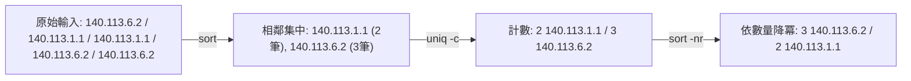

# `sort`、`uniq` 與 `wc` 排序、去重與計數

> 一句話考試定位摘要：牢記 `uniq` **只能偵測相鄰的重複行**（因此管線中通常必須先 `sort`），以及預設文字比較與 `sort -n` 數值排序的關鍵差異。（`03_Shell.pdf, p.36`）

## 核心定義與原理

- **`sort`**：依指定條件排列或去重文字行；預設進行文字（string）比較，數值比較必須明確加上 `-n`。（`03_Shell.pdf, p.36`）
- **`uniq`**：去除或統計重複行（例如 `uniq -c`），但**只會偵測相鄰（adjacent）的重複行**，因此通常必須先經過 `sort`。（`03_Shell.pdf, p.36`）
- **`wc`**：計算行數、字數或位元組數，無論單獨使用或接在管線末端統計結果都非常實用。（`03_Shell.pdf, p.36`）

## 流程與架構圖

頻率統計標準管線（以 `ip.txt` 為例）資料轉換流程：


（來源：`03_Shell.pdf, p.36`）

## 關鍵指令、設定與細節

### 1. `sort` 常用旗標
| 旗標 | 作用說明 |
| :--- | :--- |
| `-n` | 依**數值（numeric）**順序排序（`03_Shell.pdf, p.36`） |
| `-r` | 反向排序（reverse）（`03_Shell.pdf, p.36`） |
| `-u` | 僅保留唯一（unique）項目（`03_Shell.pdf, p.36`） |
| `-k` | 指定排序欄位（key field）（`03_Shell.pdf, p.36`） |
| `-t` | 指定欄位分隔符號（delimiter）（`03_Shell.pdf, p.36`） |

### 2. `sort`、`uniq` 與 `wc` 實務範例
```sh
# 依第 5 個以空白分隔的欄位進行數值排序
sort -n -k 5,5 file.txt

# 統計重複行出現次數，並依出現次數由多到少列出
$ sort ip.txt | uniq -c | sort -nr
      3 140.113.1.1
      2 140.113.6.2

# 分別計算行數（lines）、字數（words）、位元組數（bytes）
wc -l file.txt
wc -w file.txt
wc -c file.txt
```
（來源：`03_Shell.pdf, p.36`）

## 考點與常見陷阱

!!! tip "考點"
    1. **計數與排行固定範式**：`sort <input> | uniq -c | sort -nr`——前一次 `sort` 讓重複項目相鄰供 `uniq -c` 計數，後一次 `sort -nr` 再將計數值以數值降冪排列。（`03_Shell.pdf, p.36, 41-42`）

!!! warning "常見陷阱"
    1. **忘記加 `-n` 導致「`"14"` 排在 `"123"` 之前」**：若未使用 `-n`，`sort` 會進行字串比對而非數值大小比對（文字比較中 `"14"` 可能排在 `"123"` 之前，或較大數字反而排在前面）；凡是要比對數字（例如 `uniq -c` 的計數結果）都必須加 `-n`。（`03_Shell.pdf, p.36`）
    2. **未先 `sort` 就直接 `uniq`**：因為 `uniq` 只會辨識「相鄰」的重複行，未排序的輸入直接管線送進 `uniq` 將無法正確合併分散在各處的相同項目。（`03_Shell.pdf, p.36`）

## 相關頁面

- 所屬簡報總覽：[簡報總覽：Shells（命令列、管線與文字處理）](src-03-shell.md)
- 文字工具總覽與整合實例：[檔案目錄指令、UNIX 哲學與文字處理選型地圖](unix-philosophy-and-text-toolkit.md)
- 搭配欄位抽取：[`cut` 與 `awk` 欄位擷取比較](cut-vs-awk.md)

## 資料來源

- `03_Shell.pdf`：p.33、p.36、p.41–42
