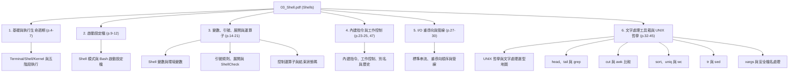

# 簡報總覽：Shells（命令列、管線與文字處理）

> 本頁彙整課程簡報 `03_Shell.pdf` 的學習目標、全章知識地圖、原子筆記索引，以及針對 Debian Linux 的範圍過濾說明。（`03_Shell.pdf, p.1-49`）

## 來源資訊與學習目標

- **原始檔案**：`03_Shell.pdf`（共 49 頁；標題：*Shells — Command-line interfaces, pipelines, and everyday text processing*）（`03_Shell.pdf, p.1`）
- **課程單位與授權**：國立陽明交通大學資訊工程學系資訊中心（NYCU CS IT Center）；`tsaimh (2022-2026, CC BY-SA)`、`lctseng (2019-2021, CC BY-SA)`、`? (1996-2018)`（`03_Shell.pdf, p.1`）
- **核心學習目標（What You Will Learn）**：
  1. 說明 Shell 的角色，以及它與 Terminal（終端機）和 Kernel（核心）的差異。（`03_Shell.pdf, p.2`）
  2. 設定啟動檔（startup files）、變數（variables）、引號規則（quoting）、展開（expansion）、別名（aliases）與工作控制（job control）。（`03_Shell.pdf, p.2`）
  3. 使用重導向（redirection）與管線（pipelines）串接小型 UNIX 工具。（`03_Shell.pdf, p.2`）
  4. 安全地使用 `grep`、`cut`、`awk`、`sort`、`uniq`、`tr`、`sed` 與 `xargs` 處理文字。（`03_Shell.pdf, p.2`）
  5. 辨識 `sh`/`bash`、`tcsh`、`zsh` 與 PowerShell 之間的可攜性（portability）差異。（`03_Shell.pdf, p.2`）

!!! tip "課程核心原則（Course Emphasis & Strategy）"
    - **先學可攜觀念（portable ideas first）**，特定 Shell 的便利語法擺在第二。（`03_Shell.pdf, p.2`）
    - **互動與腳本策略**：互動操作時可使用系統給予的 Shell，但撰寫可攜腳本時應以 `sh` 為目標（除非任務明確指定其他 Shell）；指令實際行為以本機的 `man` 手冊（manual pages）與平台文件為準。（`03_Shell.pdf, p.11, 49`）

## 主題架構與知識地圖

## 核心考點導覽與原子頁面索引

| 單元 / 類型 | 原子頁面 | 涵蓋頁碼 | 核心考點一句話 |
| :--- | :--- | :--- | :--- |
| Concept | [Terminal、Shell、Kernel 分層與指令執行流程](shell-terminal-kernel-and-execution.md) | p.4–7 | 三層職責、Enter 後五階段執行順序與 Debian 預設 Shell |
| Config | [Shell 執行模式與 Bash 啟動設定檔](shell-startup-files.md) | p.9–12 | Login / Non-login / Non-interactive 模式、Bash 讀檔順序與 <code>curl &#124; sh</code> 風險 |
| Concept | [Shell 變數與環境變數](shell-vs-environment-variables.md) | p.14–16 | `export` 子行程繼承差異、`$SHELL` 陷阱與 POSIX 賦值語法 |
| Concept | [Shell 引號規則、展開與指令替換](shell-quoting-and-expansion.md) | p.16–19, 21, 44–45 | 單／雙引號與未加引號差異、`$(...)`、Globbing vs Regex、ShellCheck `SC2086` |
| Concept | [控制運算子與結束狀態碼（Exit Status）](shell-control-operators-and-exit-status.md) | p.20, 45 | `$?`（`0` 成功／非 `0` 失敗）與 `;`、`&&`、`||` 短路執行 |
| Command | [內建指令、工作控制、別名與歷史紀錄](shell-builtins-aliases-and-job-control.md) | p.21, 23–25, 45, 47–48 | Built-in vs External、`Ctrl-Z`/`bg`/`fg`/`jobs` 狀態機與 `&` 非 detached 陷阱 |
| Concept | [標準串流、I/O 重導向與管線（Pipelines）](io-redirection-and-pipelines.md) | p.27–30, 45 | FD `0/1/2`、`>out 2>&1` 由左至右順序、<code>&#124;</code> 不含 `stderr`、<code>2>&amp;1 &#124;</code> vs <code>&#124;&amp;</code> |
| Synthesis | [檔案目錄指令、UNIX 哲學與文字處理選型地圖](unix-philosophy-and-text-toolkit.md) | p.32–33, 41–43, 45 | 基礎檔案指令（`rm` 警示）、8 大工具選型表、整合管線與 Cheat Sheet |
| Command | [`head`、`tail` 與 `grep` 檢視與搜尋](head-tail-and-grep.md) | p.33–34 | 頭尾截取、`tail -f`、`grep -F/-E/-n/-l` 與 `journalctl` 替代說明 |
| Comparison | [`cut` 與 `awk` 欄位擷取比較](cut-vs-awk.md) | p.33, 35, 41 | 固定分隔欄 vs 條件運算能力、`/etc/passwd` 實例與避免解析 `ls` |
| Command | [`sort`、`uniq` 與 `wc` 排序、去重與計數](sort-uniq-and-wc.md) | p.33, 36, 41–42 | 字串 vs `-n` 數值排序、`uniq` 只認相鄰重複行（須先 `sort`） |
| Command | [`tr` 與 `sed` 字元轉換與串流編輯](tr-and-sed.md) | p.33, 37 | `tr` 逐字元處理 vs `sed` 逐行正規替換之核心邊界 |
| Command | [`xargs` 參數轉換與安全檔名處理](xargs-safe-arguments.md) | p.33, 38–40, 45 | `stdin` 轉參數、<code>-print0 &#124; xargs -0</code> 處理含空白／換行檔名與 `find -exec` |

## 範圍過濾與備註

### 依規範略過的 FreeBSD 與 `tcsh` 專屬內容
依據本知識庫「聚焦 Debian Linux」原則，以下投影片中的 FreeBSD／`tcsh` 專屬對照與操作內容已略過，不另立頁面或收錄操作配方：
- `p.7`：Platform 比較表中 FreeBSD 14+ 預設 shell（`sh`、未內建 `bash`）與講者個人帳號範例細節。
- `p.11`：「FreeBSD sh and tcsh Startup Files」整頁的 FreeBSD `sh` / `tcsh`（`.tcshrc`、`.cshrc`、`.login`、`.logout`）啟動檔細節（僅保留跨平台可攜腳本原則）。
- `p.16`：右欄 `tcsh` 專屬變數設定語法（`set` / `setenv` 與反引號範例）。
- `p.21`：「For long-running services」中提到的 FreeBSD `rc.d`（僅保留 Debian 相關之 `systemd` 與專用 supervisor）。
- `p.39`：`xargs` 的 FreeBSD 專屬延伸參數 `-J token`（僅收錄 POSIX 通用的 `-n`、`-I`、`-s`）。
- `p.48`：「tcsh History Substitution」整頁的 `tcsh` 專屬歷史替換修飾符（僅保留「腳本應使用明確指令與變數」之通用實務原則）。

### 投影片未展開之項目
以下概念於 `03_Shell.pdf` 僅提及名詞或單一用法，未展開內部機制或完整參數，各原子頁皆維持原文範圍而不自行補充：
- Debian `/bin/sh` 具體指向哪一個底層實作程式。（`03_Shell.pdf, p.7`）
- `fork/exec` 系統呼叫與 `/etc/profile` 內部預設腳本結構。（`03_Shell.pdf, p.5, 10`）
- `Ctrl-Z` 與 `kill` 背後對應的具體 POSIX signal 名稱與編號。（`03_Shell.pdf, p.24`）
- `grep -E` 的正規表達式完整語法與 `journalctl` 的篩選參數。（`03_Shell.pdf, p.34`）
- `cut` 字元範圍參數、進階 `awk` 程式語法、`sed` 除單次替換 `s/old/new/` 外的其餘選項。（`03_Shell.pdf, p.35, 37`）
- `ShellCheck` 的安裝方式與除 `SC2086` 以外的其他檢查規則編號。（`03_Shell.pdf, p.44`）

## 資料來源

- `03_Shell.pdf`：p.1–49
