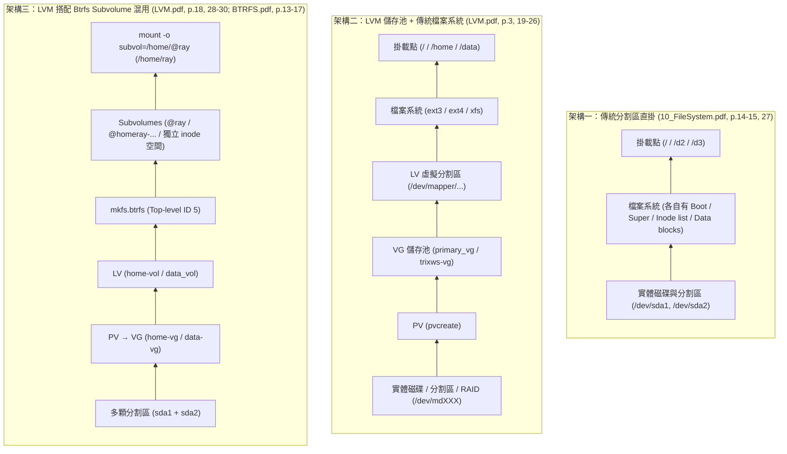
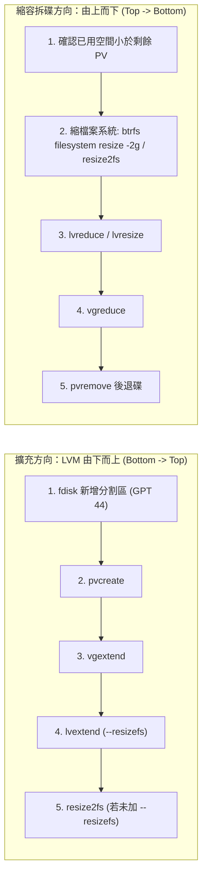
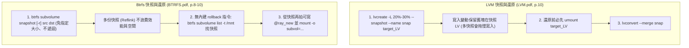
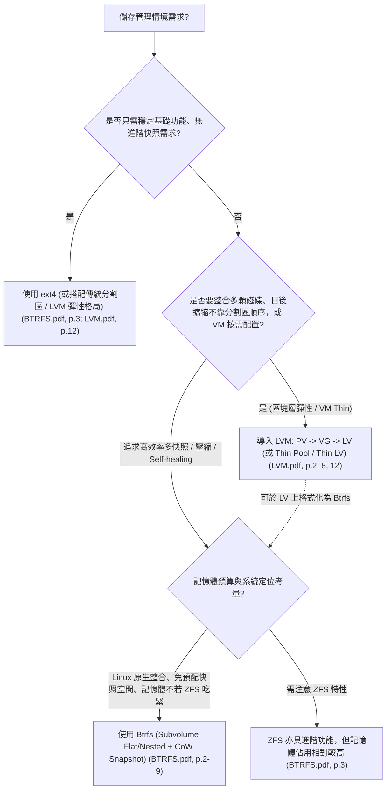

# 儲存管理總對照：傳統分割區、LVM 與 Btrfs

> 一句話考試比較摘要：一次釐清**傳統磁碟分割區**（直接於區塊分割上建立檔案系統、受限分割區順序）、**LVM**（位於實體磁碟與檔案系統之間的 Device Mapper 區塊層儲存池 `PV → VG → LV`）與 **Btrfs**（檔案系統層內建 Subvolume、CoW 快照與多碟管理），以及實戰為何常將 **Btrfs 建於 LVM LV 之上**與三者的擴縮容／快照還原／`/etc/fstab` 核心差異。（`10_FileSystem.pdf, p.14-18, 26-29, 42-43`；`LVM.pdf, p.2-30`；`BTRFS.pdf, p.2-17`）

!!! info "教學型 HTML 簡報"
    想從零開始透過雙欄圖解快速分清傳統分割區、LVM 與 Btrfs 的定位差異與考題選型，請點此：[開啟教學型對照簡報（新分頁）](slides/storage-partition-lvm-btrfs.html){ target="_blank" }。

---

## 1. 分層架構定位與疊加混用：傳統分割區 vs. LVM vs. Btrfs

在 Linux 儲存管理體系中，三者分別作用於不同抽象層級，因此既可單獨比較，也能在實戰中**分層疊加混用**：（`10_FileSystem.pdf, p.14-15, 27`；`LVM.pdf, p.2-6, 18`；`BTRFS.pdf, p.2, 4, 13-17`）

（來源：`10_FileSystem.pdf, p.14-15, 27`；`LVM.pdf, p.2-6, 18, 28-30`；`BTRFS.pdf, p.2, 4, 13-17`）

| 比較維度 | 傳統分割區（Partition + 一般 FS） | LVM（Logical Volume Manager） | Btrfs（B-Tree Filesystem） |
| :--- | :--- | :--- | :--- |
| **所在系統層級** | 直接切分磁碟分割區並於其上格式化（`10_FileSystem.pdf, p.14, 27`） | **Device Mapper（`/dev/mapper/`）區塊層儲存池**，位於實體磁碟與檔案系統之間（`LVM.pdf, p.2`） | **現代化 CoW 檔案系統層**，本身內建捲宗管理與 Subvolume 抽象（`BTRFS.pdf, p.2, 4`） |
| **核心管理單位** | 磁碟分割區 + 單一獨立 Super block / Inode list（`10_FileSystem.pdf, p.27`） | `PV` → `VG`（儲存池）→ `LV`（虛擬分割區）；最小配置單位 **`PE / LE`（預設 `4MB`）**（`LVM.pdf, p.3-7`） | **Top-level Subvolume（ID `5`）** 與各 `@` Subvolume（各自擁有**獨立目錄階層與 inode 編號命名空間**）（`BTRFS.pdf, p.4`） |
| **多磁碟整合** | 各分割區獨立，各自掛載到不同掛載點（`10_FileSystem.pdf, p.15`） | 把任意數量磁碟／分割區／RAID 整合成同一大儲存池（`LVM.pdf, p.2, 4-5`） | 內建捲宗管理，支援基於軟體的 **RAID 0、RAID 1** 等（`BTRFS.pdf, p.2`） |
| **可否與他者混用？** | 分割區可作為 LVM 的 PV（`t -> 44 Linux LVM`）（`LVM.pdf, p.3, 23`） | 下接實體磁碟或分割區；上層可格式化 `ext3`、`ext4`、`xfs` 或 **`btrfs`**（`LVM.pdf, p.3, 13, 18`） | 可直接建於磁碟／分割區（如 `/dev/sdb`），也可**建於 LVM 的 LV 之上**（`BTRFS.pdf, p.10, 12-16`） |

### 為何課程實戰常將 LVM 與 Btrfs 疊加混用？
在 `LVM.pdf`（`p.18, 28-30`）與 `BTRFS.pdf`（`p.13-17`）的 Debian 13（`trixws`）實戰演練中，皆將跨多顆分割區 PV 組成的 **LV（例如 `/dev/data-vg/data_vol`、`/dev/home-vg/home-vol`）再格式化為 Btrfs（`mkfs.btrfs`）**：（`LVM.pdf, p.18, 28-30`；`BTRFS.pdf, p.13-17`）
- **下層由 LVM 彈性伸縮區塊資源**：當需要動態納入新分割區擴充空間或安全縮容拆離其中一顆 PV（`sda2`）時，可透過 LVM 的 `vgextend` / `lvextend` 與 `lvreduce` / `vgreduce` / `pvremove` 管理底層空間池。（`LVM.pdf, p.17-18, 28-30`）
- **上層由 Btrfs 管理 Subvolume 與高效率快照**：同一個 LV 空間內可切分多個 `@USER` subvolume 獨立掛載與建立不佔寫入效能的 CoW 快照，彼此各司其職。（`BTRFS.pdf, p.4, 8-9, 12-17`）

---

## 2. 空間規劃、佈局與擴縮容順序對照

| 比較項目 | 傳統分割區 | LVM（`LVM.pdf, p.2, 7-9, 13-30`） | Btrfs（`BTRFS.pdf, p.4-7`；`LVM.pdf, p.29`） |
| :--- | :--- | :--- | :--- |
| **分割區順序限制** | **受限於分割區位置順序（partition precedence）**，調整不便（`LVM.pdf, p.2, 12`） | **無須擔心 partition precedence**；即使只有單顆磁碟也非常實用（`LVM.pdf, p.2, 12`） | 同一個 Btrfs 儲存池下用 Subvolume 區隔不同路徑，不須預先切割固定分割區大小（`BTRFS.pdf, p.4`） |
| **按需配置機制** | 無；每個分割區固定大小 | **Thin Provisioning**：`Thin Pool`（`metadata` + `data` 兩隱藏 LV）與 `Thin LV`（`-V` 虛擬容量上限），適合 VM 主機（`p.8-9`） | 所有 Subvolume 共用同一 Btrfs 檔案系統剩餘空間（`BTRFS.pdf, p.4, 16`） |
| **內部佈局選項** | 依掛載點目錄對應分割區（`10_FileSystem.pdf, p.15`） | `PV → VG → LV` 分層；LV 提供 `/dev/<VG>/<LV>` 與 `/dev/mapper/<VG>-<LV>` 兩條路徑（`p.6`） | **Nested Layout**（子層自動掛載、繼承父選項、刪父前必先刪子）vs. **Flat Layout**（各 subvolume 皆位於 top-level 下、須手動或 fstab 掛載但可個別設掛載選項）（`p.5-7`） |
| **擴充順序與工具** | 無法跨分割區直接彈性併入空間（`LVM.pdf, p.2`） | **由下而上（Bottom → Top）**：`rescan` → `fdisk` (`t`→`44`, `w`) → `pvcreate` → `vgextend` → `lvextend --resizefs` / `resize2fs`（`p.19-26`） | 若建於 LV 上且 LV 空間變更後，可調整檔案系統大小；亦可透過 `subvol=` 直接新增或掛載 subvolume（`BTRFS.pdf, p.12, 15-16`） |
| **縮容與拆碟順序** | 須小心搬移後重切分割區 | **由上而下（Top → Bottom）**：先確認已用空間小於剩餘 PV → 縮檔案系統 → `lvreduce` / `lvresize` → `vgreduce` → `pvremove` → 退碟（`p.27-30`） | 可線上／指令調整縮減空間，例如 **`btrfs filesystem resize -2g /data/`**（實測 `3.99GiB → 1.99GiB`）（`LVM.pdf, p.29`） |

（來源：`LVM.pdf, p.13, 19-30`）

---

## 3. CoW 快照與還原（Rollback）深度對比

傳統分割區上的基礎檔案系統（如 `ext4`）不以 CoW 快照為核心能力；而 **LVM Snapshot** 與 **Btrfs Snapshot** 皆建立於 **Copy-on-Write（CoW）** 之上——當資料未修改時共同指向同一實體儲存位址，既能大幅節省空間，也能在瞬間完成低成本快照（`10_FileSystem.pdf, p.43`；`LVM.pdf, p.10-11`；`BTRFS.pdf, p.8-9`）。

### LVM Snapshot vs. Btrfs Snapshot 完整對照表

| 比較項目 | LVM Snapshot（`LVM.pdf, p.10-11`） | Btrfs Snapshot（`BTRFS.pdf, p.8-10`） |
| :--- | :--- | :--- |
| **共通基礎** | **Copy-on-Write（CoW）**：建立當下不完整複製資料，僅複製指標（`LVM.pdf, p.10`；`BTRFS.pdf, p.9`） | **Copy-on-Write（CoW）**：與來源 subvolume 共用資料與中繼資料（`BTRFS.pdf, p.8-9`） |
| **物件本質** | **快照本身是一個 LV**（`LVM.pdf, p.10`） | **快照本質上是一個 subvolume**（`BTRFS.pdf, p.8`） |
| **建立指令** | `lvcreate -L <SIZE> --snapshot --name <snap> <target LV>`（`LVM.pdf, p.10`） | `btrfs subvolume snapshot [-r] <source> <destination>`（`BTRFS.pdf, p.8`） |
| **建立時需指定容量？** | **需要**預先指定 LV 大小，實務通常設為目標 LV 的 **20–30%**（`LVM.pdf, p.10`；`BTRFS.pdf, p.9`） | **不需要**指定快照大小（`BTRFS.pdf, p.9`） |
| **多份快照的寫入與空間影響** | 針對同一個 LV 建立多份快照時需寫入所有快照捲宗，導致**寫入速度變慢且略微浪費空間**（`BTRFS.pdf, p.9`） | **多份快照（reflink）不會浪費效能與空間**（`BTRFS.pdf, p.9`） |
| **是否具遞迴性／唯讀控制** | 針對單一目標 LV 建立（`LVM.pdf, p.10`） | **不具遞迴性（Not recursive）**；可加 **`-r`** 建立唯讀快照；可寫快照與原 subvolume 無差別（`BTRFS.pdf, p.8`） |
| **還原（Rollback）機制** | **有內建合併指令**：**先 `umount` 目標 LV**，再執行 `lvconvert --merge <snapshot LV>`（`LVM.pdf, p.10`） | **沒有內建 rollback 指令**：可掛載快照複製檔案，或**從快照再拍一份可寫新 subvolume 後以 `-o subvol=` 重新掛載**（`BTRFS.pdf, p.10`） |
| **能否取代正式備份？** | **不能（Not backup!）**（`LVM.pdf, p.10`） | 依賴同一個 CoW 儲存空間（`BTRFS.pdf, p.8`）；實務操作異動前仍應備份原始資料（`LVM.pdf, p.14`） |

（來源：`LVM.pdf, p.10-11`；`BTRFS.pdf, p.8-10`）

---

## 4. 檔案系統選型與 `/etc/fstab` 實戰對照

### 4.1 課程提及之檔案系統選型比較
| 檔案系統 | 日誌 / CoW 類型 | 核心特色與課程定位（`10_FileSystem.pdf, p.42-43`；`LVM.pdf, p.3`；`BTRFS.pdf, p.2-3`） |
| :--- | :--- | :--- |
| **`ext3` / `ext4`** | Journaling（`ext3/ext4`） | **`ext4` 是最常見、具備基礎功能的檔案系統**；支援 Journaling 縮短崩潰後 `fsck` 時間；可搭配 LVM `resize2fs` 線上擴充（`10_FileSystem.pdf, p.42`；`LVM.pdf, p.26`；`BTRFS.pdf, p.3`） |
| **`xfs`** | Journaling | 日誌檔案系統之一（`10_FileSystem.pdf, p.42`；亦出現於 LVM `/data` 檔案系統示意圖，`LVM.pdf, p.3`） |
| **`btrfs`** | Journaling / CoW | 現代化 CoW 檔案系統，具**免預指定容量快照**、**內建捲宗與 RAID 0/1**、**Self-healing checksum**、**透明壓縮（`compress=zstd`）**與 **Reflinks（`cp --reflink=always`）**；縮減大小可用 `btrfs filesystem resize -2g`（`10_FileSystem.pdf, p.42`；`LVM.pdf, p.29`；`BTRFS.pdf, p.2-3, 9`） |
| **`ZFS`** | CoW | CoW 檔案系統（課程舉例 `ZFS deduplication`）；同樣具備多種進階能力，但**記憶體使用量相對較高**（`10_FileSystem.pdf, p.43`；`BTRFS.pdf, p.3`） |

- **提醒 CoW 的共性缺點（`10_FileSystem.pdf, p.43`）**：雖然 CoW 能節省空間並提供低成本快照，但也可能遇到**資料不一致（如 reference count 不一致）**與顯示大小**並非真實檔案佔用空間（Not "real" used space on file）**的現象。（`10_FileSystem.pdf, p.43`）

### 4.2 `/etc/fstab` 六欄位對照與實際寫法
依 [檔案系統：架構、Inode、連結與權限管理](filesystem.md)，`/etc/fstab` 由 **`Device / Mountpoint / FStype / Options / Dump / Pass#`** 六欄組成，讓系統於開機時自動檢查與掛載：（`10_FileSystem.pdf, p.16`）

| 儲存架構 | `/etc/fstab` 設定重點 | 課程來源範例與說明 |
| :--- | :--- | :--- |
| **一般裝置 / Swap** | 標準六欄格式；swap 分割區 `Mountpoint` 寫 `none`、`FStype` 寫 `swap`、`Options` 用 `sw` | 通用開機自動檢查與掛載機制（`10_FileSystem.pdf, p.16`） |
| **LVM LV 掛載** | 建立新 LV（如 `/dev/data-vg/data_vol`）並手動掛載後，**須修訂 `/etc/fstab` 確保重開機仍自動掛載** | 可採 LV 裝置路徑或 `/dev/mapper/<VG>-<LV>` 與 UUID 對應（`LVM.pdf, p.6, 18`；`BTRFS.pdf, p.16`） |
| **Btrfs Flat Layout** | 以 `btrfs filesystem show` 取得 `UUID=...`，在 `Options` 加上 **`subvol=`** 並搭配不同掛載選項 | `UUID=... / btrfs subvol=@,defaults,autodefrag 0 0` `UUID=... /home btrfs subvol=@home,defaults,noatime 0 0` `UUID=... /home/ray btrfs subvol=/home/@ray 0 0`（`BTRFS.pdf, p.7, 14, 16`） |

---

## 5. 考題情境選型決策樹與易混考點總整理

（來源：`10_FileSystem.pdf, p.42-43`；`LVM.pdf, p.2, 8, 12, 18`；`BTRFS.pdf, p.2-9, 13-17`）

!!! warning "考前五大高風險易混陷阱"
    1. **LVM 擴充 vs. 縮容順序寫反**：擴充永遠是 **`PV → VG → LV → Filesystem`**；縮容／拔碟永遠是 **`先縮 Filesystem → lvreduce → vgreduce → pvremove`**（且需先確認已用空間小於剩餘 PV）。（`LVM.pdf, p.13, 19, 27-30`）
    2. **LVM 快照 vs. Btrfs 快照**：**LVM 必須指定大小（常設 20–30%）且多快照會減慢寫入**；**Btrfs 不需指定大小且多快照不浪費效能**。（`LVM.pdf, p.10`；`BTRFS.pdf, p.9`）
    3. **LVM Rollback vs. Btrfs Rollback**：LVM 要**先 `umount` 再 `lvconvert --merge`**；**Btrfs 完全沒有內建 rollback 指令**，實務是從快照拍一份新可寫 subvolume 後改以 `-o subvol=` 重新掛載。（`LVM.pdf, p.10`；`BTRFS.pdf, p.10`）
    4. **Btrfs Snapshot 的非遞迴特性與 Nested 刪除限制**：Btrfs `snapshot` **不具遞迴性（Not recursive）**；Nested layout 下**刪除父 subvolume 前必須先刪光所有子 subvolume**。（`BTRFS.pdf, p.5, 8`）
    5. **把「快照」當成「備份」**：無論是 LVM（明文標註 **Not backup!**）或 Btrfs，異動儲存架構前仍須妥善**備份（backup）原始資料**。（`LVM.pdf, p.10, 14`）

!!! note "跨章來源邊界備註"
    - 本比較頁嚴格彙整自三份已匯入課程講義的已載事實：對於各別講義未展開的項目（例如 `xfs` 線上擴容工具、`ext4` 與 `xfs` 縮容限制差異、搬移 PV 上既有 extents 的進階指令、Btrfs 軟體 RAID 0/1 與 subvolume 刪除指令語法、以及 `ZFS` 細部操作），均依規範不自行補寫外部資料。（`10_FileSystem.pdf`；`LVM.pdf`；`BTRFS.pdf`）

---

## 來源主題頁與資料來源

- **主題講義詳解**：
  - [檔案系統：架構、Inode、連結與權限管理](filesystem.md)（`10_FileSystem.pdf, p.14-18, 26-29, 42-43`）
  - [邏輯捲宗管理（LVM）：架構、精簡配置、快照與磁碟擴縮實戰](lvm.md)（`LVM.pdf, p.2-30`）
  - [Btrfs（B-Tree Filesystem）：Subvolume、佈局、快照與遷移實戰](btrfs.md)（`BTRFS.pdf, p.2-17`）
- **原始簡報來源**：`10_FileSystem.pdf`（p.14–18, 26–29, 42–43）、`LVM.pdf`（p.2–30）、`BTRFS.pdf`（p.2–17）
